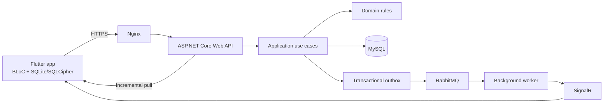

# Panxii — Tài liệu dự án

Panxii là nền tảng POS SaaS dành cho cửa hàng bán lẻ, được định hướng theo mô hình **multi-tenant**, **offline-first** và **đa ngôn ngữ**. Tài liệu trong repository này mô tả mục tiêu sản phẩm, nghiệp vụ, kiến trúc, API, dữ liệu, kiểm thử và vận hành.

> **Lưu ý:** Đây là repository tài liệu công khai. Các repository chứa mã nguồn dự án hiện được giữ riêng tư.

Repository này tập trung vào tài liệu dự án. Báo cáo tổng kết và trạng thái theo sáu giai đoạn SDLC có tại [result.md](result.md).

## Tổng quan sản phẩm

Panxii hướng tới việc giúp cửa hàng duy trì hoạt động bán hàng khi mạng không ổn định, đồng thời đồng bộ giao dịch an toàn khi kết nối được khôi phục. Các nguyên tắc sản phẩm gồm:

- **Offline-first:** ứng dụng sử dụng dữ liệu cục bộ để phục vụ thao tác tại quầy và lưu các thay đổi chờ đồng bộ.
- **Multi-tenant:** dữ liệu và quyền truy cập được giới hạn trong phạm vi cửa hàng.
- **Giao dịch có thể truy vết:** hóa đơn đã đồng bộ được bảo toàn; hủy hoặc điều chỉnh được thể hiện bằng giao dịch mới.
- **Đồng bộ tin cậy:** retry có định danh ổn định; server sequence, transactional outbox, RabbitMQ, SignalR và API pull phối hợp để phân phối và khôi phục thay đổi.
- **Phân quyền rõ ràng:** SuperAdmin quản trị nền tảng, TenantAdmin quản lý cửa hàng, Staff thực hiện nghiệp vụ bán hàng theo quyền được cấp.

Xem [project_overview.md](project_overview.md) để biết định vị sản phẩm, người dùng và phạm vi; [implemented_modules.md](implemented_modules.md) mô tả chi tiết các module đã triển khai và logic xử lý.

## Tải ứng dụng và công cụ

| Tài nguyên | Tải về | Ghi chú |
|---|---|---|
| Panxii cho Android | [Tải APK production 0.1.6](https://panxii.duckdns.org/downloads/panxii-0.1.6-production.apk) | Phiên bản `0.1.6+8`; SHA-256: `C83E891A42AC20B5B199FBCFBF9273DDDE0CE2F1219BAFE1B4E08EC6D5D72F9C` |
| Panxii Printer Bridge cho Windows | [Mã nguồn và hướng dẫn tải/build](https://github.com/PanxiiPos/panxii-printer-bridge/tree/feature/desktop-printer-bridge) | EXE được build từ repository; cài driver máy in theo hướng dẫn. Chưa có link tải EXE phát hành riêng |

Printer Bridge chạy trên PC Windows trong mạng LAN để nhận lệnh in từ ứng dụng. Không mở cổng bridge ra Internet; xem hướng dẫn ghép nối và cấu hình mạng trong repository của công cụ.

## Kiến trúc ở mức khái quát

Kiến trúc chi tiết, trách nhiệm từng lớp và luồng dữ liệu được mô tả trong [system_architecture.md](architecture/system_architecture.md).

## Hướng dẫn đọc tài liệu

### Tìm hiểu sản phẩm và thiết kế

1. [Tổng quan sản phẩm](project_overview.md)
2. [Quy tắc nghiệp vụ](business_rule.md)
3. [Kiến trúc hệ thống](architecture/system_architecture.md)
4. [Domain và use cases](architecture/domain_use_cases.md)
5. [Quyết định kiến trúc (ADR)](architecture/adr/README.md)

### Tra cứu theo chủ đề

| Chủ đề | Tài liệu |
|---|---|
| Module và logic xử lý | [Các module đã triển khai](implemented_modules.md) |
| Quy tắc nghiệp vụ | [Business rules](business_rule.md), [Domain & use cases](architecture/domain_use_cases.md) |
| Kiến trúc và quyết định kỹ thuật | [System architecture](architecture/system_architecture.md), [ADR index](architecture/adr/README.md), [SDLC & Architecture](SDLC%26Architecture.md) |
| Database và migration | [Database design](database/database_design.md), [Migration & seed strategy](backend/migration_seed_strategy.md) |
| API và tương thích | [API contract](api/api_contract.md), [OpenAPI](api/openapi.yaml), [Error codes](api/error_codes.md), [API compatibility](api/api_compatibility_matrix.md) |
| Đồng bộ offline/realtime | [RabbitMQ sync flow](sync/data_sync_flow_rabbitmq.md), [SQLite & print recovery](sync/sqlite_print_recovery_spec.md) |
| Bảo mật và quyền riêng tư | [Security, RBAC & feature flags](security/security_rbac_feature_flags.md), [Privacy & data retention](security/privacy_data_retention.md) |
| Backend development | [Backend coding standard](backend/backend_coding_standard.md) |
| Mobile, UI và trải nghiệm | [Frontend coding standard](frontend/frontend_coding_standard.md), [Design system](frontend/design_system.md), [Mobile screen flow & API mapping](frontend/mobile_screen_flow_api_mapping.md) |
| Kiểm thử | [Use case theo từng level kiểm thử](use_cases_by_test_level.md), [Testing strategy](testing/testing_strategy.md), [Role-based cases](testing/role_based_test_cases.md), [Risk-based test specification](testing/risk_based_testing_spec.md) |
| Hạ tầng và vận hành | [Infrastructure setup](infrastructure/infrastructure_setup.md), [Internal deployment](infrastructure/internal_free_deployment.md), [Operations runbook](infrastructure/operations_runbook.md), [Disaster recovery](infrastructure/disaster_recovery.md), [SLO & observability](infrastructure/slo_observability.md) |
| Release và readiness | [Release management](release/release_management.md), [Production readiness plan](release/production_readiness_plan.md) |
| Quy trình cộng tác | [Development workflow](development_workflow.md), [Commit convention](commit_convention.md), [Task risk register](task_risk.md) |
| Thiết lập môi trường | [Environment setup](setup_env.md) |
| Payment và module mở rộng | [Payment specification](payment/payment_specification.md) |
| Tổng kết dự án | [Panxii theo sáu giai đoạn SDLC](result.md) |

Khi bắt đầu một thay đổi kỹ thuật, hãy xem quy tắc nghiệp vụ và kiến trúc trước, sau đó chọn tài liệu API, dữ liệu, coding standard, kiểm thử và vận hành liên quan. Không cần đọc toàn bộ repository cho mọi thay đổi.

## Nguyên tắc khi tài liệu có mâu thuẫn

Áp dụng thứ tự ưu tiên sau:

1. Business rule đã được phê duyệt.
2. ADR accepted mới nhất.
3. API/OpenAPI contract đang phát hành.
4. Database schema và migration hiện hành.
5. Coding standard.
6. Ví dụ trong tài liệu cũ.

## Phạm vi và trạng thái

Các tài liệu mô tả cả yêu cầu, thiết kế và bằng chứng triển khai; nội dung thiết kế không mặc nhiên có nghĩa tính năng đã được phát hành. Đối với trạng thái triển khai, kiểm thử, UAT và các hạng mục còn chờ, hãy tham khảo [báo cáo tổng kết](result.md) cùng [production readiness plan](release/production_readiness_plan.md) và [release management](release/release_management.md).

Inventory, attendance, Bluetooth transport và các hình thức thanh toán mở rộng cần có đặc tả, hợp đồng dữ liệu/API và kế hoạch kiểm thử riêng trước khi được xem là phạm vi triển khai.
