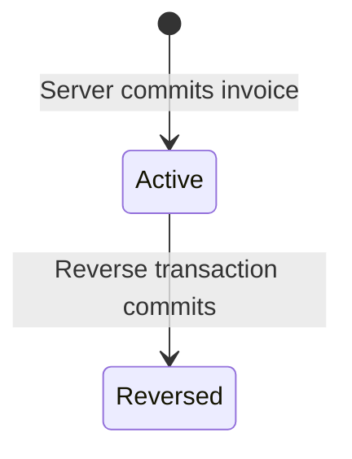

# DOMAIN MODEL VÀ USE CASE SPECIFICATION

## 1. Actors

| Actor | Phạm vi |
|---|---|
| SuperAdmin | Quản trị toàn nền tảng: tenant lifecycle, global flags, platform support; không thuộc tenant |
| TenantAdmin | Dữ liệu tenant, bulk price, reverse/correction, tenant flags |
| Staff | Tạo invoice, tìm product/customer, in invoice; không tạo/sửa/xóa customer hoặc reverse/correction invoice |
| Device Worker | Sync outbox, pull changes, xử lý revoke |

## 2. Core aggregates

- `Tenant`: cửa hàng/doanh nghiệp trong SaaS; status, timezone, currency, lifecycle. Đây là ranh giới dữ liệu, không phải người thuê nhà.
- `PlatformAdmin`: SuperAdmin toàn cục, không có tenant membership.
- `User`: role, status, tenant membership.
- `UserDevice`: session, app version, revoke state.
- `Product`: price, active state, version.
- `Customer`: profile, tenant ownership.
- `Invoice`: immutable transaction content, status, reversal relationship.
- `AppSetting`: global/tenant effective configuration.

## 3. Invoice business status và local sync state

Server `InvoiceStatus` enum: `Active`, `Reversed`. `Active` applies to a committed Sale or Correction; a reversal transaction changes the original and its Reverse entry to `Reversed`. Invoice content remains immutable after server commit; reverse/correction creates new entries.

Client-only `SyncStatus` enum: `Draft`, `Pending`, `Sending`, `Queued`, `Synced`, `Failed`. `Online`/`Offline` and global pull activity are separate app state. The API does not return client `SyncStatus`.

## 4. Use case catalog

| ID | Use case | Actor | Transaction |
|---|---|---|---|
| UC-AUTH-01 | Login device | All users | Yes |
| UC-AUTH-02 | Refresh/revoke session | Authenticated | Yes |
| UC-TENANT-01 | Create/suspend tenant | SuperAdmin | Yes |
| UC-PROD-01 | Create/update product | TenantAdmin | Yes |
| UC-PROD-02 | Bulk update price | TenantAdmin | Yes |
| UC-PROD-03 | Pause/resume product and all variants, or one variant independently | TenantAdmin | Local outbox + MySQL transaction |
| UC-CUST-01 | Create/update/deactivate/delete customer | TenantAdmin | Yes |
| UC-CUST-02 | Search/read customer for invoice | Staff, TenantAdmin | Read |
| UC-INV-01 | Create invoice offline | Staff/Admin | Local transaction |
| UC-INV-02 | Sync invoice | Staff/Admin | MySQL + outbox |
| UC-INV-03 | Reverse invoice | TenantAdmin | MySQL + outbox |
| UC-INV-04 | Correct invoice | TenantAdmin | Reverse + new invoice |
| UC-SYNC-01 | Pull changes | Device | Local transaction |
| UC-SET-01 | Resolve effective flags | Authenticated | Read |
| UC-SET-02 | Update feature flag | Admin | Yes |

## 5. Invariants

- Mọi tenant entity phải thuộc tenant context hiện tại.
- Sale quantity > 0; Reverse quantity < 0.
- `TotalAmount` phải cân bằng detail trong tolerance currency.
- Reverse phải có `OriginalInvoiceId` và chỉ được tạo một lần cho invoice gốc.
- Cùng `ClientOperationId` và payload khác nhau phải bị từ chối.
- Staff không được sửa giá gốc.
- `RequireCustomerPhone` phải được enforce ở server.
- Device revoked không được tiếp tục sync.

## 6. Acceptance criteria

Mỗi use case phải có request/response trong [API Contract](../api/api_contract.md), error code trong [Error Catalog](../api/error_codes.md), unit test và integration test theo [Testing Strategy](../testing/testing_strategy.md).
