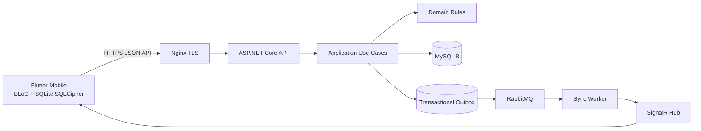

# SYSTEM ARCHITECTURE

## 1. Mục tiêu

Hệ thống POS SaaS chạy multi-tenant, offline-first và i18n. Backend dùng ASP.NET Core 8 Clean Architecture; mobile Flutter BLoC; MySQL là server database; SQLite/SQLCipher là local source of truth cho UI; RabbitMQ xử lý asynchronous event; SignalR báo hiệu đồng bộ.

## 2. Kiến trúc tổng thể

## 3. Backend layers

- **Domain:** entity, value object, invariant, domain event; không phụ thuộc framework.
- **Application:** command/query, validator, authorization use case, repository ports, transaction orchestration.
- **Infrastructure:** EF Core, MySQL, RabbitMQ, SignalR publisher, clock, secret provider.
- **API:** HTTP binding, OpenAPI, middleware, error envelope, authentication.

Dependency chỉ hướng vào trong. Chi tiết coding nằm tại [Backend Coding Standard](../backend/backend_coding_standard.md).

## 4. Luồng dữ liệu chính

### Invoice sync

`SQLite local outbox -> POST /api/v1/invoices/sync -> MySQL transaction -> outbox -> RabbitMQ -> SignalR event -> other devices pull API`.

### Query offline

`Widget -> BLoC -> UseCase -> Repository -> SQLite`. Remote API chỉ cập nhật local database qua sync/pull worker.

### Security boundary

JWT, tenant context, device revoke và feature flag được kiểm tra ở server. Client không được truy cập MySQL/RabbitMQ trực tiếp.

## 5. Availability và consistency

- MySQL transaction là nguồn xác nhận invoice server.
- Idempotency bảo vệ retry.
- Outbox bảo vệ việc phát event sau commit.
- SignalR chỉ là notification; pull API mới trả dữ liệu đầy đủ.
- SQLite ưu tiên availability cho UI offline.

## 6. Quyết định vận hành

Chỉ Nginx mở public port 80/443. MySQL, RabbitMQ và internal API nằm trong private Docker network. Backup, restore và health check phải theo [Infrastructure Setup](../infrastructure/infrastructure_setup.md).
