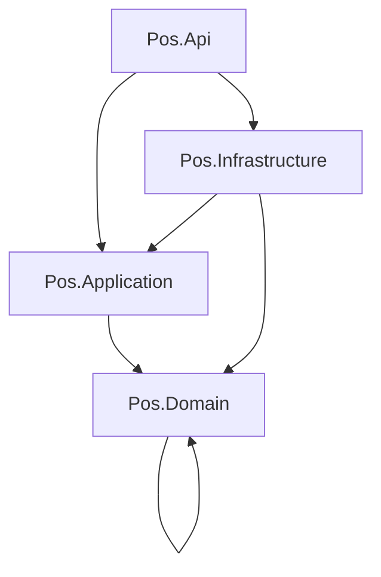

# BỘ QUY CHUẨN CODE BACKEND POS

**Phạm vi:** ASP.NET Core 8 Web API, Clean Architecture, EF Core 8, MySQL 8, RabbitMQ, SignalR  
**Mục tiêu:** giảm spaghetti code, loại bỏ code lặp, giảm coupling và tạo các chức năng có thể tái sử dụng an toàn.

---

## 1. Nguyên tắc bắt buộc

1. **Một class một trách nhiệm chính.** Controller nhận HTTP; use case điều phối nghiệp vụ; domain quyết định luật; repository truy cập dữ liệu.
2. **Dependency chỉ hướng vào trong.** Domain không phụ thuộc EF Core, ASP.NET, MySQL, RabbitMQ hoặc SignalR.
3. **Không gọi chéo tuỳ ý giữa feature.** Feature chỉ giao tiếp qua application contract hoặc domain event.
4. **Tái sử dụng bằng abstraction có ý nghĩa.** Không tạo `CommonHelper`, `Utils` hoặc `BaseService` để gom code không cùng trách nhiệm.
5. **Không lặp business rule.** Một luật như tính tổng hóa đơn, tenant isolation, quyền reverse hoặc feature flag phải có một owner duy nhất.
6. **Không để DTO đi sâu vào Domain.** DTO chỉ thuộc API/Application boundary; Domain dùng command/value object/entity riêng.
7. **Không để EF entity đi ra API.** Response phải dùng read model/response DTO.
8. **Không dùng exception cho flow bình thường.** Validation/business rejection trả `Result` hoặc error code có cấu trúc.
9. **Không ẩn side effect.** Method có ghi DB, publish message, gửi email hoặc thay đổi trạng thái phải thể hiện rõ qua tên và interface.
10. **Code mới phải có test ở đúng boundary.** Không merge feature nếu chưa chứng minh tenant, authorization, error contract và transaction behavior.
11. **Không hard-code trạng thái, mã lỗi, log và exception message.** Dùng enum/constant/catalog một nguồn (`ErrorCodes`, status enum, log event), exception mang error code + args; message hiển thị đi qua i18n. Xem quy tắc chi tiết tại [frontend_coding_standard.md](../frontend/frontend_coding_standard.md#84-không-hard-code-trạng-thái-lỗi-log-và-ngoại-lệ).

---

## 2. Kiến trúc thư mục chuẩn

```text
src/
  Pos.Domain/
    Common/
    Entities/
    ValueObjects/
    DomainEvents/
    Rules/
    Errors/

  Pos.Application/
    Abstractions/
      Persistence/
      Identity/
      Messaging/
      Time/
      Files/
    Behaviors/
    Features/
      Invoices/
        Commands/
        Queries/
        Dtos/
        Validators/
      Products/
      Customers/
      Settings/
    Common/
      Result/
      Pagination/
      Mapping/

  Pos.Infrastructure/
    Persistence/
      AppDbContext.cs
      Configurations/
      Repositories/
      Migrations/
    Identity/
    Messaging/
    Time/
    Files/

  Pos.Api/
    Controllers/
    Middleware/
    OpenApi/
    DependencyInjection/

  tests/
    Pos.Domain.Tests/
    Pos.Application.Tests/
    Pos.Infrastructure.Tests/
    Pos.Api.ContractTests/
```

### 2.1. Dependency direction



Quy tắc compile dependency:

- `Pos.Domain`: không reference project ngoài Domain.
- `Pos.Application`: chỉ reference Domain và package thuần application nếu thật sự cần.
- `Pos.Infrastructure`: implement interface của Application, được reference EF Core/RabbitMQ/SignalR provider.
- `Pos.Api`: reference Application và composition root của Infrastructure; không chứa business rule.
- Test được reference layer cần test, không dùng private implementation để bypass contract.

---

## 3. Ma trận ownership: chức năng đặt ở đâu?

| Chức năng | Owner duy nhất | Không đặt ở |
|---|---|---|
| Tính subtotal/tax/rounding invoice | Domain `InvoiceCalculator`/domain rule | Controller, EF query, Flutter |
| Kiểm tra invoice reverse | Domain/application use case | Repository, controller |
| Lấy tenant hiện tại | `ITenantContext` | DTO, entity setter từ client |
| Kiểm tra role/policy | Authorization policy + application guard | Rải `if (role == ...)` trong mọi service |
| Global query filter | EF model configuration | Từng query thủ công |
| Tạo error code | Domain/application error catalog | Exception message tự do |
| Transaction boundary | Unit of Work/use case | Repository tự mở transaction lồng nhau |
| Mapping request DTO | Application mapper/factory | Controller thủ công lặp lại |
| Mapping response read model | Query handler/projector | Trả EF entity trực tiếp |
| Idempotency | Pipeline behavior/application service | Từng controller tự kiểm tra |
| Audit fields | SaveChanges interceptor/domain service | Mỗi handler tự gán rải rác |
| Publish after commit | Transactional outbox publisher | Gọi RabbitMQ trực tiếp trong controller |
| Clock/UTC | `IClock` | `DateTime.UtcNow` rải trong domain |
| Cursor pagination | `CursorPage` + query abstraction | Mỗi endpoint tự mã hóa cursor |
| Feature flag evaluation | `IFeatureFlagService` | Đọc JSON setting ở nhiều nơi |
| Error response | Global exception/error middleware | Mỗi controller format một kiểu |

Nếu một logic xuất hiện từ hai nơi trở lên, phải xác định owner trước khi copy thêm code.

---

## 4. Cách định danh chức năng tái sử dụng

Trước khi tạo class/helper mới, trả lời 7 câu hỏi:

1. Chức năng này là **business rule**, **use case**, **technical adapter**, hay **presentation mapping**?
2. Nó cần dữ liệu domain nào và có side effect nào?
3. Nó có thể dùng lại giữa bao nhiêu feature thật sự, hay chỉ giống nhau tình cờ?
4. Ai là owner của invariant mà chức năng này bảo vệ?
5. Interface cần nằm ở layer nào để dependency hướng vào trong?
6. Có thể test nó không cần MySQL/RabbitMQ/HTTP không?
7. Nếu thay MySQL bằng database khác, phần nào phải thay đổi?

### 4.1. Tiêu chí tạo abstraction

Chỉ tạo abstraction khi thỏa ít nhất một điều kiện:

- Có từ hai caller độc lập với cùng một contract và cùng một lý do thay đổi.
- Cần đảo implementation để test hoặc thay provider.
- Là cross-cutting concern: tenant, clock, transaction, idempotency, authorization, outbox.
- Bảo vệ một invariant domain quan trọng.

Không tạo abstraction chỉ vì class dài, hoặc vì dự đoán tương lai chưa có caller thứ hai.

### 4.2. Quy tắc đặt tên

| Loại | Mẫu tên | Ví dụ |
|---|---|---|
| Use case command | `VerbNounCommand` + `Handler` | `ReverseInvoiceCommandHandler` |
| Query | `Get/List/SearchNounQuery` + `Handler` | `SearchProductsQueryHandler` |
| Domain rule | `NounRule`/`NounPolicy` | `InvoiceTotalRule` |
| Value object | Tên khái niệm nghiệp vụ | `Money`, `TenantId`, `InvoiceNumber` |
| Port/interface | `I` + capability | `IInvoiceRepository`, `IUnitOfWork` |
| Adapter | capability + provider | `RabbitMqEventPublisher` |
| Mapper | `SourceToTargetMapper` | `InvoiceToResponseMapper` |
| Validator | command + `Validator` | `SyncInvoiceCommandValidator` |
| Error | `ERR_` + `UPPER_SNAKE_CASE` | `ERR_INVOICE_IMMUTABLE` |

Tránh tên mơ hồ: `Helper`, `Manager`, `Processor`, `CommonService`, `Data`, `Util`, `Misc`, `DoSomething`.

---

## 5. Chuẩn hóa các reusable building blocks

### 5.1. Result và error

Application dùng result có cấu trúc thống nhất:

```csharp
public sealed record Error(
    string Code,
    IReadOnlyDictionary<string, object?> Args,
    bool Retryable = false);

public readonly record struct Result<T>(
    T? Value,
    Error? Error)
{
    public bool IsSuccess => Error is null;

    public static Result<T> Success(T value) => new(value, null);
    public static Result<T> Failure(Error error) => new(default, error);
}
```

Thực tế project có thể dùng thư viện Result, nhưng contract phải giữ `Code`, `Args`, `FieldErrors`, `Retryable` tương thích [API Contract](../api/api_contract.md).

Không làm:

```csharp
throw new Exception("Sản phẩm không tồn tại");
```

Nên làm:

```csharp
return Result<Invoice>.Failure(
    Errors.ProductNotFound(productId));
```

Exception chỉ dành cho lỗi ngoài dự kiến, lỗi infrastructure hoặc transaction failure; middleware chuyển chúng thành error response an toàn.

### 5.2. Value object

Dùng value object cho dữ liệu có invariant:

```csharp
public readonly record struct TenantId(Guid Value)
{
    public static TenantId Parse(Guid value) =>
        value == Guid.Empty
            ? throw new ArgumentException("Tenant id is required.")
            : new(value);
}
```

`Money`, `TenantId`, `InvoiceNumber`, `Sku`, `Cursor` không nên được truyền khắp hệ thống như string/decimal trần nếu chúng có quy tắc riêng.

### 5.3. Clock

```csharp
public interface IClock
{
    DateTime UtcNow { get; }
}
```

Domain/application dùng `IClock`; không gọi `DateTime.Now` hoặc `DateTime.UtcNow` trực tiếp trong business code. Infrastructure cung cấp implementation thật; test cung cấp fake clock.

### 5.4. Tenant context

```csharp
public interface ITenantContext
{
    TenantId? TenantId { get; }
    UserId? UserId { get; }
    DeviceId? DeviceId { get; }
    bool IsPlatformAdministrator { get; }
}
```

`TenantId` từ JWT/server context. Không map `TenantId` từ request body vào entity.

### 5.5. Pagination

Mọi query collection dùng một contract:

```csharp
public sealed record CursorPage<T>(
    IReadOnlyList<T> Items,
    string? NextCursor,
    bool HasMore,
    int PageSize);
```

Cursor phải opaque, được ký hoặc mã hóa, có expiry và chứa đủ tenant/filter context để tránh dùng cursor sai query.

### 5.6. Feature flags

```csharp
public interface IFeatureFlagService
{
    Task<bool> IsEnabledAsync(
        string key,
        TenantId tenantId,
        CancellationToken cancellationToken);
}
```

Feature flag được đọc qua một service duy nhất; service hợp nhất `Tenant > Global > Default`. Domain rule nhận kết quả boolean rõ ràng, không tự parse JSON `AppSettings`.

### 5.7. Transactional outbox

Application ghi event qua port:

```csharp
public interface IOutboxWriter
{
    Task AddAsync<T>(
        DomainEvent<T> domainEvent,
        CancellationToken cancellationToken);
}
```

Handler không gọi RabbitMQ/SignalR trực tiếp. Outbox được commit cùng transaction MySQL; publisher/worker gửi message sau commit và consumer phải idempotent.

---

## 6. Chuẩn feature implementation

Mỗi feature mới đi theo flow:

```text
HTTP request
  -> Controller
  -> Command/Query
  -> Validation behavior
  -> Authorization/Tenant behavior
  -> Handler/use case
  -> Domain entity/rule
  -> Repository/UoW port
  -> Infrastructure adapter
  -> Result/Response DTO
```

### 6.1. Controller

Controller chỉ làm 5 việc:

1. Bind route/query/body.
2. Gửi command/query qua mediator/application interface.
3. Chuyển Result thành HTTP status theo mapping chung.
4. Trả response envelope chuẩn.
5. Khai báo OpenAPI metadata.

Controller không được chứa LINQ DB, tính tổng invoice, kiểm tra role thủ công, gọi RabbitMQ, đọc `AppSettings` trực tiếp hoặc map từng field dài dòng.

### 6.2. Command handler

Handler điều phối một use case, không trở thành `GodService`.

```csharp
public sealed class ReverseInvoiceCommandHandler
{
    public async Task<Result<OperationResult<InvoiceResponse>>> HandleAsync(
        ReverseInvoiceCommand command,
        CancellationToken cancellationToken)
    {
        // Validate authorization/tenant, load aggregate, execute domain rule,
        // save once, add outbox event, return response model.
    }
}
```

Một handler không được gọi trực tiếp handler khác. Nếu hai use case dùng chung nghiệp vụ, đưa invariant vào domain service hoặc tạo application service có contract rõ ràng.

### 6.3. Domain entity

Entity bảo vệ trạng thái hợp lệ qua method có ý nghĩa:

```csharp
public sealed class Invoice
{
    public void Reverse(Invoice reversal, UserId approver)
    {
        if (Status != InvoiceStatus.Synced)
            throw DomainErrors.InvoiceNotReversible();

        Status = InvoiceStatus.Reversed;
    }
}
```

Không expose setter public cho các field quan trọng như `Status`, `TotalAmount`, `TenantId`. Không để handler thay từng field để né invariant.

### 6.4. Repository

Repository chỉ chứa persistence concern:

```csharp
public interface IInvoiceRepository
{
    Task<Invoice?> GetForUpdateAsync(
        InvoiceId id,
        CancellationToken cancellationToken);

    Task AddAsync(
        Invoice invoice,
        CancellationToken cancellationToken);
}
```

Không đặt quy tắc reverse, permission, tax calculation hoặc feature flag trong repository. Query read-only phức tạp có thể dùng query service/read model riêng thay vì ép mọi thứ qua generic repository.

### 6.5. Generic repository

Không bắt buộc và mặc định không dùng `IGenericRepository<T>`. Nó thường che mất khác biệt giữa aggregate, query và transaction, đồng thời tạo nhiều method CRUD không phù hợp.

Chỉ dùng generic abstraction cho capability thật sự chung, ví dụ `IOutboxWriter`, `ICursorCodec`, `IClock`, không dùng để thay thế mọi repository.

---

## 7. Quy tắc giảm code lặp

### 7.1. Lặp code được phép và không được phép

**Được phép lặp nhỏ:** mapping đơn giản một lần, test data riêng, code khác domain dù hình thức giống nhau.

**Không được phép lặp:**

- Format error response.
- Gán tenant/audit fields.
- Tính invoice total.
- Kiểm tra idempotency.
- Encode/decode cursor.
- Merge feature flags.
- Kiểm tra authorization cùng một policy.
- Publish event sau transaction.
- Quy tắc decimal/rounding.

### 7.2. Quy trình xử lý code trùng

1. Đánh dấu hai đoạn code và xác định chúng có cùng lý do thay đổi không.
2. Nếu có, xác định layer owner.
3. Tạo test khóa hành vi hiện tại.
4. Trích xuất tên có nghĩa, không trích xuất `Helper` mơ hồ.
5. Chuyển caller sang abstraction mới.
6. Xóa code cũ trong cùng change.
7. Kiểm tra dependency graph và coverage.

Không refactor hàng loạt chỉ dựa trên text similarity; hai đoạn giống syntax có thể khác invariant.

### 7.3. Giới hạn class/method

Đây là guardrail, không phải luật cứng:

- Controller: tối đa khoảng 100 dòng; mỗi action ngắn và không có business logic.
- Handler: khoảng 150 dòng; nếu vượt phải tách policy/port, không chia method vô nghĩa.
- Method: nên dưới 30 dòng nếu vẫn giữ được tên và flow rõ.
- Constructor: tối đa 5-7 dependency trực tiếp. Vượt ngưỡng là dấu hiệu God class.
- Feature không được inject `DbContext`, `IHttpContextAccessor`, `IRabbitMqConnection` cùng lúc trong domain/application.

---

## 8. Persistence và EF Core

- `DbContext` chỉ thuộc Infrastructure.
- Entity configuration tách file `IEntityTypeConfiguration<T>`.
- `SaveChanges` là transaction boundary mặc định; use case nhiều bước dùng transaction explicit.
- Global Query Filter áp dụng cho tenant-aware entity.
- Không gọi `IgnoreQueryFilters()` ngoài platform administration path có audit.
- Dùng `AsNoTracking()` cho read-only query.
- Không lazy-load trong API hot path.
- Dùng projection sang read DTO, không load cả graph nếu không cần.
- Không gọi `SaveChanges` nhiều lần trong một use case nếu không có lý do rõ ràng.
- Không dùng `ExecuteUpdateAsync` cho invoice/detail đã sync.
- Optimistic concurrency dùng `Version`/concurrency token.
- Migration phải review SQL, có backup/rollback plan trước production.

---

## 9. Dependency Injection và cấu hình

Đăng ký dependency theo module:

```csharp
services.AddApplication();
services.AddInfrastructure(configuration);
services.AddApi();
```

Quy tắc:

- `Singleton` chỉ cho stateless/thread-safe service không giữ request data.
- `Scoped` cho use case, `DbContext`, repository và tenant-aware service.
- `Transient` cho object nhẹ, không giữ state.
- Không service locator, không gọi `GetService` rải trong business code.
- Configuration map vào options typed và validate lúc startup.
- Không truyền `IConfiguration` xuống Domain/Application.
- Không inject implementation nếu layer chỉ cần capability interface.

---

## 10. Async, cancellation và lỗi

- Mọi I/O dùng async end-to-end.
- Mọi method I/O nhận `CancellationToken` và truyền tiếp xuống EF/RabbitMQ.
- Không dùng `.Result`, `.Wait()` hoặc `async void` ngoài event UI không áp dụng ở backend.
- Không catch exception rồi bỏ qua.
- Log exception ở boundary một lần, có `CorrelationId`, không log token/PIN/PII.
- Dùng error code ổn định theo [API Contract](../api/api_contract.md).
- Retry chỉ áp dụng transient failure; không retry business rejection.

---

## 11. Caching và performance

- Chỉ cache read model/configuration có chiến lược invalidation.
- Key cache luôn gồm tenant và version khi dữ liệu tenant-aware.
- Không cache invoice mutable state nếu chưa có invalidation rõ.
- Pagination bắt buộc cho collection lớn.
- Query list phải có index tương ứng và projection.
- Bulk operation có giới hạn batch và transaction policy.
- Đo bằng profiling/metrics trước khi tối ưu, không tối ưu bằng abstraction phức tạp thiếu số liệu.

---

## 12. Quy tắc API contract

Mỗi endpoint phải tuân theo [API Contract](../api/api_contract.md):

- `data/meta` cho success.
- `data: null` + `error.code` cho failure.
- `camelCase`, UTC ISO-8601, string enum, decimal domain.
- `X-Correlation-Id` và idempotency cho command retry.
- Response DTO không chứa EF entity, password hash, PIN hoặc tenant data ngoài scope.
- OpenAPI schema và contract test cập nhật cùng pull request.

---

## 13. Checklist code review

### Architecture

- [ ] Class nằm đúng layer và đúng feature.
- [ ] Dependency chỉ hướng vào trong.
- [ ] Không có controller gọi DB/broker trực tiếp.
- [ ] Không có handler gọi handler khác.
- [ ] Không tạo `Helper/Manager/Utils` không có ownership.

### Reuse và coupling

- [ ] Chức năng tái sử dụng có contract rõ và caller thực tế.
- [ ] Không copy business rule ở controller/service/repository.
- [ ] Dependency constructor không phình to.
- [ ] Feature giao tiếp qua port/domain event, không gọi database của feature khác.

### Data/security

- [ ] Tenant lấy từ server context.
- [ ] Global query filter vẫn hoạt động.
- [ ] Authorization và feature flag kiểm tra ở server.
- [ ] Invoice synced không bị update/delete nội dung.
- [ ] Transaction và outbox cùng commit.

### API/test/operations

- [ ] Request/response đúng canonical envelope.
- [ ] Error code có i18n key.
- [ ] CancellationToken được truyền đủ.
- [ ] Unit test domain rule.
- [ ] Integration test tenant/transaction/idempotency.
- [ ] Contract test OpenAPI.
- [ ] Log không chứa secret/PII.

---

## 14. Quy trình phát triển feature mới

1. Viết use case và invariant trong tài liệu/issue.
2. Xác định entity, value object, error code và owner.
3. Vẽ dependency path từ API đến Infrastructure.
4. Tạo command/query DTO và validator.
5. Viết unit test cho domain rule trước hoặc cùng implementation.
6. Tạo port ở Application, adapter ở Infrastructure.
7. Viết handler transaction-safe và outbox nếu có side effect.
8. Thêm controller mỏng + OpenAPI contract.
9. Thêm integration/contract test và i18n error keys.
10. Review dependency graph, duplication và migration.
11. Chạy build, test, static analysis, migration validation.
12. Cập nhật tài liệu nếu contract hoặc business rule thay đổi.

---

## 15. Anti-pattern bị cấm

| Anti-pattern | Thay thế |
|---|---|
| Controller béo | Command/query handler |
| God service | Nhiều use case/policy có ownership rõ |
| Generic repository cho mọi entity | Repository theo aggregate + query service |
| `CommonHelper` khổng lồ | Value object/service theo capability |
| Exception message tiếng Việt trong domain | Error code + args |
| Hard-code status/error code/log message/exception text | Enum/constant catalog + error code + structured log event |
| Domain gọi EF/HTTP/RabbitMQ | Port/interface và adapter |
| Handler gọi handler | Shared domain policy hoặc application service contract |
| Copy-paste tenant filter | Global Query Filter + tenant context |
| Gọi RabbitMQ trước DB commit | Transactional outbox |
| Public setter mọi entity | Method bảo vệ invariant |
| `DateTime.Now` rải rác | `IClock` |
| `IConfiguration` khắp code | Typed options |
| `IgnoreQueryFilters()` tùy tiện | Platform path explicit + audit |
| Fire-and-forget task | Background queue có lifecycle/ack |
| Log toàn bộ request | Structured log đã redact |

---

## 16. Definition of Done cho code backend

Một feature chỉ được merge khi:

- Có owner rõ cho mỗi business rule và reusable function.
- Không có dependency ngược hoặc cross-feature coupling không được thiết kế.
- Không có code lặp business logic đã tồn tại.
- API dùng đúng contract và error code.
- Tenant isolation, authorization, feature flag được test.
- Transaction/idempotency/outbox được test nếu feature có side effect.
- Không có secret/PII trong log.
- Migration và rollback plan được review.
- Test pass và static analysis không có lỗi mới.
- Tài liệu được cập nhật nếu có thay đổi public contract.
