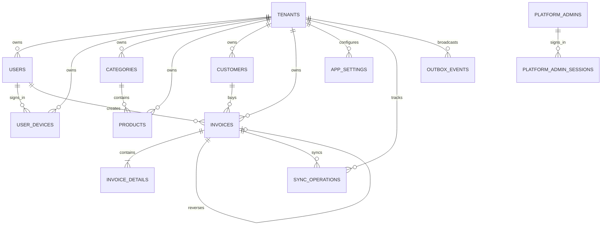

# ĐẶC TẢ DATABASE HỆ THỐNG POS

**Phiên bản:** 1.0  
**Cơ sở:** `business_rule.md` và `SDLC&Architecture.md`  
**Database server:** MySQL 8.0  
**ORM:** Entity Framework Core 8, Code-First  
**Database local:** SQLite + SQLCipher AES-256

---

## 1. Mục tiêu và nguyên tắc bất biến

Database phải hỗ trợ SaaS multi-tenant, bán hàng offline-first, đồng bộ nhiều thiết bị, RBAC, audit và truy vết kế toán.

1. Dữ liệu nghiệp vụ của cửa hàng phải có `TenantId`.
2. Mọi truy vấn nghiệp vụ trên server phải chịu `Global Query Filter` theo tenant hiện tại.
3. `Invoices` và `InvoiceDetails` đã đồng bộ thành công là dữ liệu bất biến. Không sửa hoặc xóa nội dung gốc.
4. Hủy hoặc sửa hóa đơn phải tạo hóa đơn mới theo cơ chế reverse entry.
5. Mọi request đồng bộ phải có khóa idempotency để retry không tạo bản ghi trùng.
6. Tiền tệ lưu bằng `DECIMAL`, không dùng `FLOAT` hoặc `DOUBLE`.
7. Thời gian lưu theo UTC; client chỉ chuyển sang múi giờ hiển thị.
8. JSON mở rộng dùng kiểu `JSON` của MySQL. Không dùng `NVARCHAR(MAX)` vì đó là kiểu SQL Server.
9. Không lưu plaintext mật khẩu, PIN quản trị, refresh token hoặc khóa SQLCipher.
10. Dữ liệu local là bản sao phục vụ offline; server là nguồn xác nhận cuối cùng.

### 1.1. Phân loại bảng

| Nhóm | Bảng | TenantId | Cho phép sửa/xóa sau sync |
|---|---|---:|---|
| Nền tảng | `tenants` | Không | Chỉ trạng thái bằng quyền SuperAdmin |
| Danh tính | `users`, `user_devices` | Có | Có, theo chính sách audit |
| Quản trị nền tảng | `platform_admins`, `platform_admin_sessions` | Không | Có, theo chính sách audit |
| Danh mục | `categories`, `products`, `customers` | Có | Có trước khi phát sinh giao dịch |
| Giao dịch | `invoices`, `invoice_details` | Có | Không sửa/xóa nội dung sau sync |
| Cấu hình | `app_settings` | Có thể null | Có, theo phạm vi cấu hình |
| Đồng bộ | `sync_operations`, `outbox_events` | Có | Trạng thái kỹ thuật được cập nhật |
| Audit | `audit_logs` | Có thể null | Append-only |
| In ấn | `print_jobs` | Có | Trạng thái kỹ thuật được cập nhật |

---

## 2. Sơ đồ quan hệ



`INVOICES` tự tham chiếu qua `OriginalInvoiceId`. Hóa đơn đảo trỏ đến hóa đơn gốc; chiều ngược lại truy vấn bằng `OriginalInvoiceId`.

---

## 3. Quy ước dữ liệu chung

| Dữ liệu | Kiểu MySQL | Quy ước |
|---|---|---|
| Khóa định danh | `CHAR(36)` | UUID dạng string; có thể đổi sang `BINARY(16)` nếu team chuẩn hóa converter |
| Tiền | `DECIMAL(19,4)` | Không dùng số thực nhị phân |
| Tỷ lệ phần trăm | `DECIMAL(9,4)` | `10.0000` nghĩa là 10% |
| Số lượng | `DECIMAL(19,4)` | Hóa đơn đảo lưu số âm |
| Thời gian | `DATETIME(6)` | UTC |
| Cờ | `TINYINT(1)` | EF Core ánh xạ `bool` |
| JSON | `JSON` | Feature flags, metadata, extra data |
| Mã nghiệp vụ | `VARCHAR(64)` | Index khi tìm kiếm hoặc đồng bộ |

Các bảng tenant-aware có các cột audit:

```text
TenantId       CHAR(36)     NOT NULL
CreatedAt      DATETIME(6)  NOT NULL
CreatedBy      CHAR(36)     NULL
UpdatedAt      DATETIME(6)  NULL
UpdatedBy      CHAR(36)     NULL
ExtraDataJson  JSON         NULL
```

`CreatedBy` và `UpdatedBy` có thể null cho dữ liệu system/import. Không cascade delete từ user sang dữ liệu nghiệp vụ.

---

## 4. Định nghĩa bảng server MySQL

### 4.1. `tenants`

Bảng gốc của SaaS, không có `TenantId`.

| Cột | Kiểu | Null | Mô tả |
|---|---|---:|---|
| `Id` | `CHAR(36)` | Không | PK |
| `Code` | `VARCHAR(32)` | Không | Mã tenant duy nhất |
| `Name` | `VARCHAR(160)` | Không | Tên cửa hàng |
| `Status` | `VARCHAR(20)` | Không | Enum `Active`, `Suspended`, `Closed` |
| `TimeZone` | `VARCHAR(64)` | Không | Ví dụ `Asia/Ho_Chi_Minh` |
| `CurrencyCode` | `CHAR(3)` | Không | Mặc định `VND` |
| `IsDeleted` | `TINYINT(1)` | Không | Soft delete cấp nền tảng |
| `CreatedAt` | `DATETIME(6)` | Không | Thời gian tạo |
| `UpdatedAt` | `DATETIME(6)` | Có | Thời gian cập nhật |
| `Version` | `BIGINT` | Không | Optimistic concurrency, mặc định 1 |
| `ExtraDataJson` | `JSON` | Có | Metadata nền tảng |

Unique `Code`. Chỉ SuperAdmin được quản lý tenant. Onboarding tạo tenant và TenantAdmin đầu tiên trong cùng transaction. DELETE đặt `IsDeleted = true`, `Status = Closed`, revoke device/session; không xóa vật lý tenant hoặc dữ liệu nghiệp vụ.

### 4.2. `users`

`users` chỉ chứa chủ cửa hàng/doanh nghiệp (`TenantAdmin`) và nhân viên (`Staff`); mọi user đều thuộc một tenant. `SuperAdmin` là account toàn cục, được lưu riêng trong `platform_admins` và không có `TenantId`.

| Cột | Kiểu | Null | Mô tả |
|---|---|---:|---|
| `Id` | `CHAR(36)` | Không | PK |
| `TenantId` | `CHAR(36)` | Không | FK `tenants`; bắt buộc với TenantAdmin/Staff |
| `Username` | `VARCHAR(120)` | Không | Unique trong tenant |
| `DisplayName` | `VARCHAR(160)` | Không | Tên hiển thị |
| `Email` | `VARCHAR(254)` | Có | Email |
| `PasswordHash` | `VARCHAR(255)` | Không | Argon2id/bcrypt |
| `Role` | `VARCHAR(20)` | Không | `TenantAdmin`, `Staff` |
| `Status` | `VARCHAR(20)` | Không | `Active`, `Locked`, `Disabled` |
| `AdminPinHash` | `VARCHAR(255)` | Có | PIN TenantAdmin legacy; không dùng để cấp quyền reverse invoice v1 |
| `LastLoginAt` | `DATETIME(6)` | Có | Audit đăng nhập |
| Audit + ExtraData | ... | ... | Các cột dùng chung |

Login nhận username/password; server tìm tenant user trên mọi tenant và tìm platform admin toàn cục. Nếu cặp username/password khớp nhiều account, login bị từ chối. Tenant users luôn được giới hạn theo tenant; platform admin không được gán vào tenant.

### 4.2.1. `platform_admins` và `platform_admin_sessions`

Hai bảng này lưu identity và session của SuperAdmin, tách khỏi dữ liệu cửa hàng. `platform_admins` có `Id`, `Username` (unique toàn cục), `DisplayName`, `Email`, `PasswordHash`, `Status`, `LastLoginAt` và audit fields. `platform_admin_sessions` lưu `UserId`, `DeviceId`, `Platform`, `AppVersion`, `SessionId`, `RefreshTokenHash`, hạn refresh, revoke state và thời gian audit; có FK trực tiếp tới `platform_admins`.

JWT của SuperAdmin có `sub`, `role=SuperAdmin`, `device_id`, `session_id` nhưng không có `tenant_id`. API xác thực session qua `platform_admin_sessions`.

### 4.3. `user_devices`

Quản lý session, thiết bị và remote kill-switch.

| Cột | Kiểu | Null | Mô tả |
|---|---|---:|---|
| `Id` | `CHAR(36)` | Không | PK |
| `TenantId` | `CHAR(36)` | Không | FK tenant |
| `UserId` | `CHAR(36)` | Không | FK user |
| `DeviceId` | `VARCHAR(160)` | Không | ID ổn định do app tạo |
| `Platform` | `VARCHAR(32)` | Không | Nền tảng client |
| `AppVersion` | `VARCHAR(32)` | Không | Version native |
| `SessionId` | `CHAR(36)` | Không | Session claim trong JWT, unique |
| `RefreshTokenHash` | `CHAR(64)` | Không | SHA-256; không lưu plaintext |
| `RefreshTokenExpiresAt` | `DATETIME(6)` | Không | Hạn refresh token |
| `IsRevoked` | `TINYINT(1)` | Không | Kill-switch |
| `LastSeenAt` | `DATETIME(6)` | Không | Lần refresh gần nhất |
| Audit + ExtraData | ... | ... | Các cột dùng chung |

Composite FK `(TenantId, UserId)` tới `users`; unique `SessionId` và `RefreshTokenHash`; index `(TenantId, UserId, DeviceId)`. Khi revoke, API trả `401` ngay cả với access token đã cấp; mobile xóa SQLite và force logout.

### 4.4. `categories`

| Cột | Kiểu | Null | Mô tả |
|---|---|---:|---|
| `Id` | `CHAR(36)` | Không | PK |
| `TenantId` | `CHAR(36)` | Không | FK tenant |
| `ParentId` | `CHAR(36)` | Có | FK cùng bảng |
| `Code` | `VARCHAR(64)` | Không | Mã danh mục trong tenant |
| `Name` | `VARCHAR(160)` | Không | Tên danh mục |
| `IsActive` | `TINYINT(1)` | Không | Trạng thái |
| `SortOrder` | `INT` | Không | Thứ tự |
| Audit + ExtraData | ... | ... | Các cột dùng chung |

Unique `(TenantId, Code)`. Không cho `ParentId = Id`; service phải kiểm tra vòng lặp cây.

### 4.5. `products`

Giá hiện tại nằm ở đây; giá lúc bán phải snapshot vào `invoice_details`.

| Cột | Kiểu | Null | Mô tả |
|---|---|---:|---|
| `Id` | `CHAR(36)` | Không | PK |
| `TenantId` | `CHAR(36)` | Không | FK tenant |
| `CategoryId` | `CHAR(36)` | Có | FK category |
| `Sku` | `VARCHAR(64)` | Không | Mã SKU |
| `Barcode` | `VARCHAR(64)` | Có | Mã quét |
| `Name` | `VARCHAR(200)` | Không | Tên sản phẩm |
| `Unit` | `VARCHAR(32)` | Không | Đơn vị tính |
| `BasePrice` | `DECIMAL(19,4)` | Không | Giá bán hiện tại, > 0 |
| `CostPrice` | `DECIMAL(19,4)` | Có | Giá vốn nếu bật kho |
| `TaxRate` | `DECIMAL(9,4)` | Không | Giữ 0 trong v1; nghiệp vụ thuế thuộc phần mở rộng sau |
| `IsActive` | `TINYINT(1)` | Không | Đang bán |
| `Version` | `BIGINT` | Không | Optimistic concurrency |
| Audit + ExtraData | ... | ... | Các cột dùng chung |

Unique `(TenantId, Sku)`; barcode nên unique theo tenant nếu có giá trị. Bulk update chỉ cho TenantAdmin, nhận magnitude dương cùng operation `Increase`/`Decrease`, giá sau cập nhật phải > 0; transaction và tăng `Version`.

### 4.6. `customers`

| Cột | Kiểu | Null | Mô tả |
|---|---|---:|---|
| `Id` | `CHAR(36)` | Không | PK |
| `TenantId` | `CHAR(36)` | Không | FK tenant |
| `Code` | `VARCHAR(64)` | Không | Mã khách hàng |
| `FullName` | `VARCHAR(160)` | Không | Tên |
| `Phone` | `VARCHAR(32)` | Có | Nên chuẩn hóa E.164 |
| `Email` | `VARCHAR(254)` | Có | Email |
| `Address` | `VARCHAR(500)` | Có | Địa chỉ |
| `IsActive` | `TINYINT(1)` | Không | Trạng thái |
| Audit + ExtraData | ... | ... | Các cột dùng chung |

Unique `(TenantId, Code)`. Phone chỉ unique nếu business rule xác nhận một số điện thoại là một khách hàng.

### 4.7. `invoices`

Sổ giao dịch. Sau `Synced`, không được thay đổi nội dung, tổng tiền, customer hoặc device origin.

| Cột | Kiểu | Null | Mô tả |
|---|---|---:|---|
| `Id` | `CHAR(36)` | Không | PK, tạo từ client để idempotent |
| `TenantId` | `CHAR(36)` | Không | FK tenant |
| `InvoiceNumber` | `VARCHAR(64)` | Không | Số hiển thị, unique trong tenant |
| `OriginalInvoiceId` | `CHAR(36)` | Có | FK invoice gốc khi reverse |
| `InvoiceType` | `VARCHAR(20)` | Không | `Sale`, `Reverse`, `Correction` |
| `Status` | `VARCHAR(20)` | Không | `Draft`, `Pending`, `Synced`, `Reversed`, `Rejected` |
| `CustomerId` | `CHAR(36)` | Có | FK customer |
| `CreatedByUserId` | `CHAR(36)` | Không | User lập hóa đơn |
| `DeviceId` | `VARCHAR(160)` | Không | Thiết bị tạo |
| `ClientCreatedAt` | `DATETIME(6)` | Không | Thời gian client |
| `SyncedAt` | `DATETIME(6)` | Có | Server nhận thành công |
| `Subtotal` | `DECIMAL(19,4)` | Không | Tổng trước giảm/thuế |
| `DiscountAmount` | `DECIMAL(19,4)` | Không | Giảm giá |
| `TaxAmount` | `DECIMAL(19,4)` | Không | Giữ 0 trong v1; thuế là phần mở rộng sau |
| `RoundingAmount` | `DECIMAL(19,4)` | Không | Làm tròn |
| `TotalAmount` | `DECIMAL(19,4)` | Không | Tổng thanh toán |
| `CurrencyCode` | `CHAR(3)` | Không | Snapshot tiền tệ |
| Audit + ExtraData | ... | ... | Các cột dùng chung |

`Reverse` bắt buộc có `OriginalInvoiceId`; Sale bình thường không có. Reverse phải có số lượng, subtotal, tax và total mang dấu âm tương ứng bản gốc. Một invoice gốc chỉ được reverse một lần cho mỗi nghiệp vụ hủy, kiểm tra trong transaction.

### 4.8. `invoice_details`

Snapshot để hiển thị và kiểm toán, không phụ thuộc giá/sản phẩm hiện tại.

| Cột | Kiểu | Null | Mô tả |
|---|---|---:|---|
| `Id` | `CHAR(36)` | Không | PK |
| `InvoiceId` | `CHAR(36)` | Không | FK invoice |
| `ProductId` | `CHAR(36)` | Có | FK product, có thể null |
| `LineNumber` | `INT` | Không | Thứ tự dòng |
| `SkuSnapshot` | `VARCHAR(64)` | Không | SKU lúc bán |
| `ProductNameSnapshot` | `VARCHAR(200)` | Không | Tên lúc bán |
| `UnitSnapshot` | `VARCHAR(32)` | Không | Đơn vị lúc bán |
| `Quantity` | `DECIMAL(19,4)` | Không | Âm đối với Reverse |
| `UnitPrice` | `DECIMAL(19,4)` | Không | Giá snapshot dương; dấu hiển thị do UI quyết định |
| `DiscountAmount` | `DECIMAL(19,4)` | Không | Giảm giá dòng |
| `TaxRate` | `DECIMAL(9,4)` | Không | Snapshot; giữ 0 trong v1 |
| `TaxAmount` | `DECIMAL(19,4)` | Không | Giữ 0 trong v1 |
| `LineTotal` | `DECIMAL(19,4)` | Không | Thành tiền |
| Audit + ExtraData | ... | ... | Các cột dùng chung |

Unique `(InvoiceId, LineNumber)`. Không cascade delete detail của invoice đã sync.

### 4.9. `app_settings`

`TenantId = NULL` là cấu hình global do SuperAdmin; có tenant là override của cửa hàng.

| Cột | Kiểu | Null | Mô tả |
|---|---|---:|---|
| `Id` | `CHAR(36)` | Không | PK |
| `TenantId` | `CHAR(36)` | Có | Null = global |
| `SettingKey` | `VARCHAR(120)` | Không | Ví dụ `RequireCustomerPhone` |
| `SettingValue` | `JSON` | Không | true/false/object |
| `ValueType` | `VARCHAR(20)` | Không | `Boolean`, `Number`, `String`, `Object` |
| `IsEnabled` | `TINYINT(1)` | Không | Có áp dụng |
| `Version` | `BIGINT` | Không | Đồng bộ cache |
| Audit + ExtraData | ... | ... | Các cột dùng chung |

Unique `(TenantId, SettingKey)`. Vì MySQL cho phép nhiều giá trị `NULL` trong unique index, cần thêm `ScopeKey` hoặc enforce duplicate bằng service/trigger cho scope global.

### 4.10. `sync_operations`

Nhật ký nhận outbox client và lớp bảo vệ idempotency.

| Cột | Kiểu | Null | Mô tả |
|---|---|---:|---|
| `Id` | `CHAR(36)` | Không | PK |
| `TenantId` | `CHAR(36)` | Không | FK tenant |
| `ClientOperationId` | `CHAR(36)` | Không | UUID do client tạo |
| `EntityType` | `VARCHAR(40)` | Không | Ví dụ `Invoice` |
| `EntityId` | `CHAR(36)` | Không | ID entity |
| `PayloadHash` | `CHAR(64)` | Không | SHA-256 payload chuẩn hóa |
| `OperationType` | `VARCHAR(40)` | Không | Loại command để replay |
| `Status` | `VARCHAR(20)` | Không | `Received`, `Applied`, `Rejected` |
| `ErrorCode` | `VARCHAR(80)` | Có | Mã lỗi i18n |
| `HttpStatus` | `SMALLINT` | Có | HTTP status của kết quả cuối |
| `ResponseJson` | `JSON` | Có | Response chuẩn để retry replay |
| `ResponseHash` | `CHAR(64)` | Có | Hash response đã lưu |
| `ResourceId` | `CHAR(36)` | Có | Resource tạo/cập nhật |
| `ExpiresAt` | `DATETIME(6)` | Có | Hạn lưu idempotency |
| `ProcessedAt` | `DATETIME(6)` | Có | Thời điểm xử lý |
| Audit + ExtraData | ... | ... | Các cột dùng chung |

Unique `(TenantId, ClientOperationId)`. Cùng operation id nhưng khác hash phải bị từ chối với `ERR_SYNC_PAYLOAD_MISMATCH`.

### 4.11. `outbox_events`

Transactional outbox để phát SignalR sau khi nghiệp vụ commit.

| Cột | Kiểu | Null | Mô tả |
|---|---|---:|---|
| `Id` | `CHAR(36)` | Không | PK |
| `TenantId` | `CHAR(36)` | Không | Group SignalR |
| `EventType` | `VARCHAR(80)` | Không | Ví dụ `InvoiceSynced` |
| `AggregateId` | `CHAR(36)` | Không | Invoice/product liên quan |
| `ServerSequence` | `BIGINT` | Không | Thứ tự tăng đơn điệu theo tenant |
| `Payload` | `JSON` | Không | Payload tối thiểu |
| `Status` | `VARCHAR(20)` | Không | `Pending`, `Published`, `Failed` |
| `RetryCount` | `INT` | Không | Số lần retry |
| `AvailableAt` | `DATETIME(6)` | Không | Có thể lấy |
| `PublishedAt` | `DATETIME(6)` | Có | Đã broadcast |
| `CreatedAt` | `DATETIME(6)` | Không | Thời điểm tạo |

Worker đọc `Pending`, phát `OnDataUpdated` vào group `tenant:{TenantId}`, rồi cập nhật `Published`. Client vẫn phải gọi API pull để bảo đảm nhất quán.

---

## 5. Index và khóa ngoại đề nghị

```sql
CREATE INDEX IX_Products_Tenant_Name
    ON Products (TenantId, IsActive, Name);
CREATE INDEX IX_Products_Tenant_Barcode
    ON Products (TenantId, Barcode);
CREATE INDEX IX_Invoices_Tenant_CreatedAt
    ON Invoices (TenantId, CreatedAt DESC);
CREATE INDEX IX_Invoices_Tenant_Status
    ON Invoices (TenantId, Status, CreatedAt DESC);
CREATE INDEX IX_Invoices_Original
    ON Invoices (TenantId, OriginalInvoiceId);
CREATE INDEX IX_Customers_Tenant_Phone
    ON Customers (TenantId, Phone);
CREATE INDEX IX_SyncOperations_Pending
    ON SyncOperations (TenantId, Status, CreatedAt);
CREATE INDEX IX_OutboxEvents_Pending
    ON OutboxEvents (Status, AvailableAt, CreatedAt);
CREATE UNIQUE INDEX UX_OutboxEvents_Tenant_Sequence
    ON OutboxEvents (TenantId, ServerSequence);
```

Tên bảng thực tế phải theo một naming convention thống nhất của EF Core. Khóa ngoại dùng `RESTRICT` cho giao dịch và không cascade delete từ tenant, user hoặc product xuống invoice.

---

## 6. Quy trình ghi hóa đơn online/offline

### 6.1. Client SQLite

1. Mở transaction SQLite.
2. Ghi `local_invoices` và `local_invoice_details`.
3. Ghi `local_outbox` với `ClientOperationId`, payload và `SyncStatus = Pending`.
4. Commit; UI luôn đọc lại từ SQLite.

Không gọi API trước khi commit local. Nếu app đóng sau commit, background worker vẫn có outbox để retry.

### 6.2. API `/api/invoices/sync`

1. Xác thực JWT, `TenantId`, device và quyền Staff/TenantAdmin.
2. Validate schema, tổng tiền, sản phẩm, feature flag và trạng thái tenant.
3. Mở transaction MySQL.
4. Insert `sync_operations` bằng `ClientOperationId`.
5. Nếu operation đã `Applied`, trả kết quả cũ, không insert invoice lại.
6. Insert `invoices` và `invoice_details`.
7. Insert `outbox_events` trong cùng transaction.
8. Commit.
9. Worker publish SignalR sau commit.
10. Client đánh dấu local record `Synced` khi nhận response thành công.

Lỗi nghiệp vụ chỉ trả `ErrorCode`, ví dụ `ERR_PRODUCT_NOT_FOUND`, `ERR_INVOICE_TOTAL_INVALID`, `ERR_DEVICE_REVOKED`; API không hardcode message tiếng Việt.

---

## 7. Bút toán đảo ngược

### 7.1. Hủy hóa đơn

Transaction server phải:

1. Lock invoice gốc bằng `SELECT ... FOR UPDATE`.
2. Kiểm tra invoice thuộc tenant hiện tại và đang `Synced`.
3. Kiểm tra actor trong JWT là TenantAdmin của tenant sở hữu invoice; Staff bị từ chối.
4. Kiểm tra chưa có reverse hợp lệ.
5. Tạo invoice mới với `InvoiceType = Reverse`, `OriginalInvoiceId` trỏ invoice gốc.
6. Tạo detail mới, giữ snapshot nhưng đảo dấu `Quantity`, `LineTotal`, `TaxAmount`.
7. Đổi trạng thái invoice gốc và reverse thành `Reversed`; không thay đổi nội dung giao dịch.
8. Ghi outbox event `InvoiceReversed`.
9. Commit toàn bộ hoặc rollback toàn bộ.

### 7.2. Sửa hóa đơn

Không sửa detail cũ. Gọi luồng hủy, sau đó tạo invoice mới `InvoiceType = Correction` với dữ liệu đúng. Quan hệ giữa correction và chuỗi reverse nên lưu bằng khóa nghiệp vụ rõ ràng hoặc metadata có schema, không dựa vào text tự do.

### 7.3. Kiểm tra cân bằng

Trong v1, tax fields luôn bằng 0; công thức dưới đây giữ chỗ cho phần mở rộng thuế sau.

```text
Subtotal = SUM(Quantity * UnitPrice)
LineTotal = Quantity * UnitPrice - DiscountAmount + TaxAmount
TotalAmount = Subtotal - DiscountAmount + TaxAmount + RoundingAmount
```

Do làm tròn tiền, so sánh theo tolerance nhỏ được định nghĩa cho currency, không so sánh số thực nhị phân.

---

## 8. Global Query Filter và bảo mật tenant

EF Core cần có `ITenantContext` lấy tenant từ JWT/request context:

```csharp
entity.HasQueryFilter(x =>
    tenantContext.Id != null && x.TenantId == tenantContext.Id);
```

- Không cho client gửi `TenantId` để override tenant của token.
- Endpoint SuperAdmin phải dùng query riêng, quyền rõ ràng và audit.
- Không dùng `IgnoreQueryFilters()` trong code nghiệp vụ thông thường.
- Mọi insert phải gán `TenantId` từ server context.
- Test phải chứng minh tenant A không đọc, sửa hoặc sync dữ liệu tenant B.
- Unique key nghiệp vụ phải bao gồm `TenantId`.

---

## 9. Schema SQLite local tối thiểu

SQLite chỉ giữ dữ liệu cần cho offline và đồng bộ; dùng prefix `local_`.

### `local_invoices`

Giữ `Id`, `TenantId`, `InvoiceNumber`, `OriginalInvoiceId`, tổng tiền snapshot, `SyncStatus`, `SyncErrorCode`, `ClientOperationId`, `ServerSyncedAt`, `CreatedAt`.

### `local_invoice_details`

Giữ snapshot sản phẩm, `InvoiceId`, `LineNumber`, `Quantity`, `UnitPrice`, discount, tax và total.

### `local_products`, `local_categories`, `local_customers`

Bản sao phục vụ tìm kiếm. Mỗi bảng cần `ServerUpdatedAt` hoặc `Version` để pull incremental.

### `local_outbox`

| Cột | Mô tả |
|---|---|
| `ClientOperationId` | UUID duy nhất |
| `EntityType`, `EntityId` | Loại và ID bản ghi |
| `PayloadJson` | Payload chuẩn hóa |
| `Status` | `Pending`, `Sending`, `Synced`, `Failed` |
| `AttemptCount` | Số lần retry |
| `NextAttemptAt` | Backoff |
| `LastErrorCode` | Mã lỗi i18n |

SQLCipher mở database bằng key lấy từ secure storage của hệ điều hành. Khi nhận 401 do revoke, app đóng connection, xóa file database và xóa key/session liên quan.

### `local_change_cursor`

Client lưu cursor theo tenant và chỉ cập nhật sau khi toàn bộ batch đã upsert thành công.

| Cột | Mô tả |
|---|---|
| `TenantId` | Tenant scope |
| `LastServerSequence` | Sequence cuối đã apply |
| `UpdatedAt` | Thời điểm cập nhật local |

### `print_jobs`

Print là side effect out-of-band, không nằm trong transaction ghi invoice. Printer failure không rollback invoice.

| Cột | Kiểu | Mô tả |
|---|---|---|
| `Id` | `CHAR(36)` | PK |
| `TenantId` | `CHAR(36)` | Tenant scope |
| `InvoiceId` | `CHAR(36)` | Invoice cần in |
| `DeviceId` | `VARCHAR(160)` | Thiết bị/máy in |
| `Status` | `VARCHAR(20)` | `Pending`, `Printing`, `Completed`, `Failed` |
| `AttemptCount` | `INT` | Số lần thử |
| `LastErrorCode` | `VARCHAR(80)` | Lỗi i18n |
| `CreatedAt`, `CompletedAt` | `DATETIME(6)` | UTC |

Reprint dùng lại `PrintJobId`, không tạo invoice mới.

### `audit_logs`

`audit_logs` là append-only, không cascade delete và không dùng để thay đổi nghiệp vụ.

| Cột | Kiểu | Mô tả |
|---|---|---|
| `Id` | `CHAR(36)` | PK |
| `TenantId` | `CHAR(36)` | Null cho platform event |
| `ActorUserId` | `CHAR(36)` | User thực hiện |
| `DeviceId` | `VARCHAR(160)` | Device |
| `Action` | `VARCHAR(80)` | Ví dụ `InvoiceReversed` |
| `EntityType`, `EntityId` | `VARCHAR(80)`, `CHAR(36)` | Đối tượng |
| `BeforeJson`, `AfterJson` | `JSON` | Snapshot cần thiết |
| `CorrelationId` | `CHAR(36)` | Truy vết request |
| `CreatedAt` | `DATETIME(6)` | UTC |

Không lưu password, PIN, raw token hoặc SQLCipher key trong audit.

---

## 10. Feature flag và version API

### 10.1. Độ ưu tiên cấu hình

`Tenant setting` override `Global setting`; nếu không có thì dùng default trong code. API nên trả effective settings để mobile không phải tự hợp nhất nhiều nguồn.

```json
{
  "RequireCustomerPhone": true,
  "EnableInventory": false,
  "EnableBluetoothPrint": true,
  "AutoRoundMoney": true
}
```

`RequireCustomerPhone = true` phải được kiểm tra ở cả UI và server; UI chỉ là trải nghiệm, server mới là rào cản nghiệp vụ.

### 10.2. Force update

```json
{
  "minimumNativeVersion": "2.0.0",
  "latestNativeVersion": "2.2.0",
  "shorebirdPatch": "patch-42"
}
```

`GET /config/version` có thể là cấu hình global. Native version thấp hơn minimum thì bắt buộc tải bản mới; OTA chỉ dùng cho thay đổi tương thích native code.

---

## 11. Migration, transaction và concurrency

- Mọi thay đổi schema đi qua EF Core migration; review SQL trước khi deploy.
- Production migration chạy trong pipeline có backup và health check.
- Dùng transaction cho sync invoice, reverse invoice, bulk price update và thay đổi feature flag liên quan nhiều bản ghi.
- Dùng `Version`/concurrency token cho product và app settings để tránh lost update.
- Không dùng `ExecuteUpdateAsync` trên `invoices` hoặc `invoice_details` để đổi nội dung sau sync.
- `ExecuteUpdateAsync` phù hợp cho bulk update `products.BasePrice`, nhưng phải giới hạn tenant, quyền và predicate version.
- Không giữ transaction mở khi gọi SignalR; chỉ ghi outbox trong transaction rồi publish sau commit.

---

## 12. Backup và vận hành

1. Backup MySQL tự động hằng ngày, lưu nhiều bản và mã hóa backup.
2. Kiểm tra restore định kỳ, không chỉ kiểm tra file tồn tại.
3. Không xóa audit/giao dịch đã sync; retention chỉ áp dụng log kỹ thuật sau phê duyệt.
4. MySQL chỉ bind private network, không mở public port; API đi qua Nginx 80/443.
5. Monitor deadlock, failed sync, độ dài outbox, tỷ lệ 401 do revoke và thời gian query theo tenant.
6. Không ghi token, PIN, password hoặc dữ liệu khách hàng nhạy cảm vào log/Dozzle.

---

## 13. Bộ kiểm thử database bắt buộc

### Tenant và phân quyền

- Staff tenant A không đọc product, customer, invoice tenant B.
- TenantAdmin A không bulk update product tenant B.
- SuperAdmin tạo/khóa tenant được nhưng vẫn có audit.
- User disabled hoặc device revoked nhận 401 và không sync được.

### Invoice và kế toán

- Invoice synced không thể sửa detail hoặc xóa.
- Reverse tạo invoice mới với detail âm và liên kết đúng `OriginalInvoiceId`.
- Hai request hủy đồng thời không tạo hai reverse invoice.
- Retry cùng `ClientOperationId` không tạo duplicate.
- Payload khác với cùng operation id bị từ chối.
- Tổng header cân bằng tổng detail trong tolerance.

### Offline và realtime

- App restart sau local commit vẫn gửi lại outbox.
- Mất mạng giữa request và response retry an toàn.
- SignalR event chỉ phát sau transaction commit.
- Thiết bị nhận event sẽ pull dữ liệu, không coi event là nguồn dữ liệu đầy đủ.

### Feature flag và i18n

- Tenant override global đúng thứ tự ưu tiên.
- `RequireCustomerPhone` chặn thanh toán ở server khi thiếu phone.
- Mọi lỗi API có `ErrorCode`, không có message nghiệp vụ hardcode.

---

## 14. Error code đề nghị

| Code | Tình huống |
|---|---|
| `ERR_TENANT_INACTIVE` | Tenant bị khóa hoặc đóng |
| `ERR_ACCESS_DENIED` | Không đủ quyền |
| `ERR_DEVICE_REVOKED` | Device/session bị kill-switch |
| `ERR_PRODUCT_NOT_FOUND` | Product không tồn tại trong tenant |
| `ERR_PRODUCT_INACTIVE` | Product không còn bán |
| `ERR_CUSTOMER_PHONE_REQUIRED` | Feature flag yêu cầu số điện thoại |
| `ERR_INVOICE_NOT_FOUND` | Không tìm thấy invoice |
| `ERR_INVOICE_IMMUTABLE` | Cố sửa/xóa invoice đã sync |
| `ERR_INVOICE_ALREADY_REVERSED` | Invoice đã được hủy |
| `ERR_INVOICE_TOTAL_INVALID` | Header không cân bằng detail |
| `ERR_SYNC_DUPLICATE` | Operation đã xử lý |
| `ERR_SYNC_PAYLOAD_MISMATCH` | Cùng operation id nhưng payload khác |
| `ERR_SYNC_CONFLICT` | Xung đột version/dữ liệu |
| `ERR_FORCE_UPDATE_REQUIRED` | Native app quá cũ |

---

## 15. Quyết định cần chốt trước migration

1. Chuẩn UUID: `CHAR(36)` hay `BINARY(16)`.
2. Phase đầu có bật module kho hay chỉ chuẩn bị `CostPrice`.
3. Cách đánh số `InvoiceNumber`: client tạm, server chính thức hay UUID hiển thị.
4. Có cho phép khách hàng trùng phone trong cùng tenant không.
5. Có cần bảng `payment_transactions` cho nhiều phương thức thanh toán không.
6. Có cần `product_price_histories` để audit bulk update không.
7. Thời hạn lưu audit kỹ thuật, sync payload và outbox event.
8. Chính sách merge conflict khi hai thiết bị cùng sửa product/customer offline.

Các quyết định trên phải được ghi thành business rule hoặc ADR trước khi triển khai production, không ngầm suy diễn trong migration.
