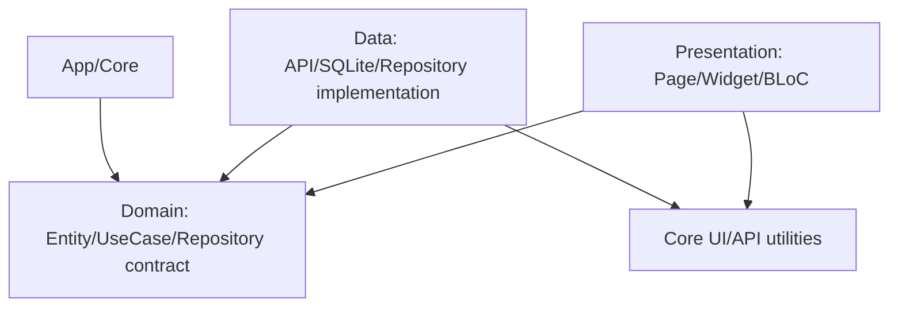

# BỘ QUY CHUẨN CODE FRONTEND FLUTTER POS

**Phạm vi:** Flutter, BLoC, `easy_localization`, SQLite/SQLCipher, API v1, SignalR  
**Mục tiêu:** UI nhất quán, dễ tái sử dụng, ít phụ thuộc, không lặp code và không để logic nghiệp vụ rò vào widget.

---

## 1. Công nghệ bắt buộc

| Nhóm | Package/chuẩn | Quy tắc |
|---|---|---|
| State management | `flutter_bloc`/BLoC | UI giao tiếp với feature qua event/state |
| Theme/color | `flex_color_scheme` | Một nguồn duy nhất cho Primary, Surface, Neutral và Typography |
| Icon | `hugeicons` | Dùng thay toàn bộ Icon mặc định và icon tự vẽ |
| Complex UI | `forui` | Dùng cho Dropdown, Dialog, DateRangePicker, Badge, Toast |
| Local database | SQLite + `sqflite_sqlcipher` | Local source of truth cho trải nghiệm offline |
| Localization | `easy_localization` | Không hardcode text hiển thị |
| Networking | HTTP client thống nhất | Parse canonical API envelope |
| Realtime | SignalR client | Chỉ phát tín hiệu để pull, không coi event là data source |

Không thêm package UI khác để giải quyết cùng một bài toán nếu chưa có ADR và review dependency.

---

## 2. Cấu trúc thư mục

```text
lib/
  app/
    app.dart
    router/
    theme/
      app_theme.dart
      app_colors.dart
      app_typography.dart
    localization/
    error_handling/

  core/
    api/
      api_client.dart
      api_envelope.dart
      api_error.dart
    auth/
    database/
    icons/
      app_icons.dart
    widgets/
      app_scaffold.dart
      app_button.dart
      app_text_field.dart
      app_empty_state.dart
      app_loading.dart
    utils/

  features/
    auth/
      data/
      domain/
      presentation/
    products/
      data/
      domain/
      presentation/
    invoices/
      data/
      domain/
      presentation/
    customers/
      data/
      domain/
      presentation/
    settings/
      data/
      domain/
      presentation/

  l10n/
    vi.json
    en.json
```

Mỗi feature được chia thành:

```text
feature/
  data/          API DTO, local model, datasource, repository implementation
  domain/        entity, value object, repository contract, use case
  presentation/ bloc/cubit, page, feature widgets
```

### 2.1. Dependency direction



- `domain` không import Flutter widget, BLoC, HTTP client, SQLite hoặc `forui`.
- `presentation` không gọi API client/database trực tiếp.
- `data` không được import page/widget.
- `core` chỉ chứa capability thật sự dùng chung, không chứa business logic của feature.
- Feature A không import trực tiếp BLoC, datasource hoặc repository implementation của feature B.

---

## 3. Quy tắc Theme bằng `flex_color_scheme`

### 3.1. Một nguồn màu duy nhất

`flex_color_scheme` là nguồn tạo `ColorScheme`. Không khai báo màu rải rác trong widget.

```dart
import 'package:flex_color_scheme/flex_color_scheme.dart';
import 'package:flutter/material.dart';

abstract final class AppTheme {
  static ThemeData light() {
    return FlexThemeData.light(
      scheme: FlexScheme.indigoM3,
      surfaceMode: FlexSurfaceMode.levelSurfacesLowScaffold,
      blendLevel: 6,
      useMaterial3: true,
      fontFamily: 'BeVietnamPro',
    ).copyWith(
      extensions: const <ThemeExtension<dynamic>>[
        AppNeutralColors.light,
      ],
    );
  }

  static ThemeData dark() {
    return FlexThemeData.dark(
      scheme: FlexScheme.indigoM3,
      surfaceMode: FlexSurfaceMode.levelSurfacesLowScaffold,
      blendLevel: 8,
      useMaterial3: true,
      fontFamily: 'BeVietnamPro',
    ).copyWith(
      extensions: const <ThemeExtension<dynamic>>[
        AppNeutralColors.dark,
      ],
    );
  }
}
```

Tên scheme là quyết định thiết kế và phải được chốt trong một ADR/theme file. Không đổi scheme trong từng màn hình.

### 3.2. Color tokens bắt buộc

UI chỉ dùng semantic token, không dùng màu hex trực tiếp:

| Token | Nguồn | Dùng cho |
|---|---|---|
| `primary` | `ColorScheme.primary` | CTA, selected state, focus |
| `onPrimary` | `ColorScheme.onPrimary` | Text/icon trên primary |
| `surface` | `ColorScheme.surface` | Nền card/panel/input |
| `surfaceContainer*` | `ColorScheme` | Phân cấp bề mặt |
| `onSurface` | `ColorScheme.onSurface` | Text chính |
| `outline` | `ColorScheme.outline` | Border/divider |
| `error` | `ColorScheme.error` | Lỗi |
| `neutral` | `AppNeutralColors` | Text phụ, disabled, nền trung tính |

Nếu cần màu nghiệp vụ như `sale`, `reverse`, `pending`, tạo semantic token trong `AppThemeExtension`, không dùng `Colors.green`/`Colors.red` trực tiếp.

### 3.3. Typography

- Typography được khai báo trong `ThemeData.textTheme`, không set `fontSize` tùy ý ở widget.
- Dùng font sản phẩm đã chốt, ví dụ `BeVietnamPro`; không dùng default font cho UI production.
- Cùng một semantic level phải dùng cùng `TextTheme`: `titleLarge`, `titleMedium`, `bodyLarge`, `bodyMedium`, `labelLarge`.
- Không dùng chữ in hoa toàn bộ để thay thế hierarchy.
- Text dài phải có overflow/wrap rõ ràng và được test trên màn hình nhỏ.

---

## 4. Quy tắc icon bằng `hugeicons`

### 4.1. Không dùng icon ngoài `hugeicons`

- Không dùng `Icons.*` trong feature UI.
- Không dùng icon Unicode, emoji hoặc SVG tự vẽ cho action đã có trong `hugeicons`.
- Không import nhiều icon library khác nhau.
- Tạo `AppIcons` để chuẩn hóa icon thường dùng và tránh tên package lan khắp feature.

```dart
import 'package:hugeicons/hugeicons.dart';

abstract final class AppIcons {
  static const search = HugeIcons.strokeRoundedSearch01;
  static const add = HugeIcons.strokeRoundedAdd01;
  static const edit = HugeIcons.strokeRoundedPencilEdit01;
  static const delete = HugeIcons.strokeRoundedDelete02;
  static const filter = HugeIcons.strokeRoundedFilter;
  static const refresh = HugeIcons.strokeRoundedRefresh;
  static const invoice = HugeIcons.strokeRoundedInvoice01;
}
```

Tên icon phải kiểm tra theo version package đang dùng; nếu package đổi tên, sửa tại `AppIcons`, không sửa hàng loạt trong feature.

### 4.2. Icon button

Mọi icon-only button phải có:

- Tooltip hoặc semantic label.
- Kích thước hit area tối thiểu 44x44 logical pixels.
- Trạng thái disabled/loading.
- Icon phản ánh đúng hành động, không dùng icon trang trí thay cho action.

```dart
IconButton(
  tooltip: context.tr('products.search'),
  onPressed: state.isLoading ? null : onSearch,
  icon: const HugeIcon(
    icon: AppIcons.search,
    size: 22,
  ),
)
```

Không đặt text trong rounded rectangle nếu một icon quen thuộc đã biểu đạt đủ action. Với action nguy hiểm, có thể dùng icon + text nếu cần giảm nhầm lẫn.

---

## 5. Quy tắc component bằng `forui`

`forui` là chuẩn cho các component phức tạp cần behavior, accessibility và visual consistency.

### 5.1. Mapping component

| Nhu cầu | Component chuẩn |
|---|---|
| Chọn một/nhiều option | `forui` Dropdown/Select |
| Xác nhận/hành động modal | `forui` Dialog |
| Chọn khoảng ngày | `forui` DateRangePicker |
| Trạng thái ngắn | `forui` Badge |
| Feedback tạm thời | `forui` Toast |

Không tự viết Dropdown/Dialog/DateRangePicker/Toast mới trong feature nếu `forui` đã đáp ứng. Nếu cần wrapper, đặt ở `core/widgets` và giữ API theo semantic của app.

### 5.2. Wrapper app-level

Feature không gọi cấu hình `forui` lặp lại. Tạo wrapper:

```dart
abstract final class AppFeedback {
  static void showSuccess(BuildContext context, String message) {
    // Map vào FToast/FToastManager theo cấu hình forui của app.
  }

  static void showError(BuildContext context, String message) {
    // Một nơi duy nhất kiểm soát duration, placement và semantic label.
  }
}
```

Wrapper không được nuốt error code; message phải được dịch trước khi hiển thị.

### 5.3. Dialog và destructive action

- Dialog phải có title, nội dung, action chính và action hủy rõ ràng.
- Reverse invoice, logout device, xóa local database cần destructive confirmation.
- Không gọi use case khi dialog mới mở; chỉ gọi khi người dùng confirm.
- Dialog trả typed result, không trả `dynamic` nếu có thể tránh.

---

## 6. Kiến trúc state management BLoC

### 6.1. Event/state theo feature

BLoC chỉ điều phối use case và phát state UI:

```dart
sealed class ProductEvent {
  const ProductEvent();
}

final class ProductsStarted extends ProductEvent {
  const ProductsStarted();
}

final class ProductsSearchChanged extends ProductEvent {
  const ProductsSearchChanged(this.query);
  final String query;
}

sealed class ProductState {
  const ProductState();
}

final class ProductsLoading extends ProductState {
  const ProductsLoading();
}

final class ProductsLoaded extends ProductState {
  const ProductsLoaded(this.items, this.nextCursor);
  final List<Product> items;
  final String? nextCursor;
}

final class ProductsFailure extends ProductState {
  const ProductsFailure(this.error);
  final AppError error;
}
```

Quy tắc:

- BLoC không chứa widget logic, màu sắc, route hoặc SQL.
- State phải biểu diễn rõ loading/loaded/empty/failure/syncing.
- Event phải là ý định của người dùng hoặc lifecycle, không phải method tùy ý.
- Không dùng một `AppBloc` khổng lồ cho toàn bộ ứng dụng.
- BLoC không gọi BLoC khác; dùng repository/use case chung nếu cần chia sẻ dữ liệu.
- `BlocBuilder` chỉ rebuild phần cần thiết; dùng selector khi state lớn.

### 6.2. Khi dùng Cubit

Cubit phù hợp cho state nhỏ, đồng bộ và không có event flow phức tạp như filter UI, tab selection hoặc form state. Luồng sync invoice, auth và reverse dùng BLoC để biểu diễn event/retry rõ ràng.

---

## 7. Offline-first và data flow

```text
Widget -> BLoC -> UseCase -> Repository
                         |-> SQLite/SQLCipher (read/write UI)
                         |-> Remote API (sync/pull)
                         |-> SignalR signal -> pull API
```

### 7.1. Repository policy

Repository là owner của việc chọn local/remote:

- Query UI đọc SQLite trước.
- Search BLoC phát kết quả local ngay, đồng thời gọi API khi online; debounce 300 ms và dùng query generation/cancellation để response cũ không ghi đè kết quả của từ khóa/bộ lọc mới.
- Chuẩn hóa query giống business/API contract. Trang server đầu tiên thay tập kết quả synced đang cache; local mutation/outbox pending vẫn được giữ riêng. Merge theo ID, áp version server mới hơn hoặc bằng chỉ khi không có local mutation pending; deduplicate trước khi emit state.
- Khi query/filter/sort/tenant đổi, reset server cursor và local continuation cursor. Chỉ một request load-more cho một cursor được chạy tại một thời điểm; append page chỉ khi query generation còn hiện hành và cursor khớp.
- Dùng cursor keyset cho local và remote list lớn. Server `nextCursor` quyết định tiếp trang online; cursor local không thay thế cursor server hoặc `ServerSequence` của sync pull. Offline giữ local results, không giả lập đã tải hết server pages.
- Với API v1, request đầu cursor-based phải gửi query key `cursor` với giá trị rỗng (`cursor=`); các request tiếp theo gửi nguyên `nextCursor`. `page` chỉ dành cho client cũ và không được dùng trong feature mobile mới.
- Background worker gửi `Pending` outbox lên `/api/v1/invoices/sync`.
- Response parse theo canonical API envelope.
- Retry dùng cùng `Idempotency-Key`/`clientOperationId`.
- SignalR chỉ gửi event/cursor; dữ liệu đầy đủ lấy từ pull API.
- UI trạng thái mạng/sync dùng token `networkOnline`, `networkOffline`, `syncPending`, `syncUploading`, `syncQueued`, `syncDownloading`, `syncComplete`, `syncError` từ [Design System](design_system.md); feature không tự khai báo token/màu. Luôn có nhãn/icon và không hiển thị `Queued` như đồng bộ hoàn tất.
- Sync pull upsert local và cập nhật `LastServerSequence` trong cùng SQLite transaction. Cursor của list chỉ được commit sau khi page đó xử lý thành công; không dùng list cursor làm sync checkpoint.

Widget không được biết app đang online hay offline bằng cách tự gọi network. BLoC nhận state từ repository.

### 7.2. Kill-switch

Khi API trả `401 ERR_DEVICE_REVOKED`:

1. Dừng sync worker.
2. Đóng SQLite connection.
3. Xóa file database và SQLCipher key trong secure storage.
4. Xóa access/refresh token.
5. Emit auth state signed-out.
6. Điều hướng về login.

Flow này phải nằm trong `AuthSessionManager`/security boundary, không copy vào từng BLoC.

---

## 8. API parsing và i18n

### 8.1. Canonical envelope

Frontend phải parse đúng [API Contract](../api/api_contract.md):

- Success: `data` + `meta`.
- Collection: `data: []` + `meta.paging`.
- Failure: `data: null` + `error.code`, `args`, `fieldErrors`, `retryable`.
- Header command retry: `Idempotency-Key`.
- Thời gian: UTC ISO-8601.
- Enum: string.
- Tiền/số lượng: map sang decimal-safe type, không dùng `double` cho phép tính tiền.

### 8.2. Error mapping

```dart
String localizeApiError(BuildContext context, AppError error) {
  final key = 'errors.${error.code}';
  return key.tr(args: error.args.map(
    (key, value) => MapEntry(key, value?.toString() ?? ''),
  ));
}
```

- Không hiển thị raw server message.
- Không dùng HTTP status làm text key.
- `retryable == true` mới được retry tự động, có backoff.
- Field error phải map tới form field cụ thể.
- Error code không biết phải có fallback `errors.unknown` và ghi telemetry không chứa PII.

### 8.3. Text

- Không hardcode text trong widget.
- Key i18n đặt theo feature, ví dụ `products.search`, `invoices.reverseConfirm`.
- `vi.json` và `en.json` phải cùng key tree.
- Text dài phải được test với tiếng Việt và tiếng Anh.

---

## 9. Widget và component reuse

### 9.1. Quy tắc tạo component

Tạo component dùng chung khi:

- Có ít nhất hai màn hình dùng cùng behavior và semantic.
- Component bảo vệ accessibility/theme/interaction quan trọng.
- Cần chuẩn hóa component `forui`, icon hoặc form field.

Không đưa một widget chỉ dùng một lần vào `core/widgets` chỉ vì file feature đang dài.

Tên component phải thể hiện semantic:

| Không dùng | Nên dùng |
|---|---|
| `CommonButton` | `AppPrimaryButton`, `AppDestructiveButton` |
| `CustomDialog` | `ConfirmReverseDialog` hoặc `AppDialog` |
| `DataWidget` | `ProductSearchField`, `InvoiceSummary` |
| `HelperWidget` | Tên theo trách nhiệm cụ thể |

### 9.2. Component API

- Props rõ ràng, typed, immutable.
- Không truyền `BuildContext` vào domain/data.
- Không truyền BLoC implementation sâu vào reusable core widget nếu chỉ cần callback/value.
- Không để component tự gọi repository.
- Callback đặt tên theo intent: `onSelected`, `onConfirmed`, `onRetry`, không dùng `onTap1`.
- Component phải hỗ trợ loading, disabled, error và empty nếu trạng thái có thể xảy ra.

---

## 10. Form, validation và navigation

- Validation local chỉ cải thiện UX; business validation vẫn do server quyết định.
- Form field dùng key i18n và map `fieldErrors` từ API.
- Không dùng `TextEditingController` trong domain/BLoC nếu không cần; quản lý lifecycle ở presentation.
- Route guard dựa trên auth/session/force-update state, không kiểm tra token rải trong từng page.
- Deep link và back navigation phải có behavior rõ ràng.
- Khi rời form có dữ liệu chưa sync, phải cảnh báo hoặc giữ state local.

### 10.1. Khách hàng trên hóa đơn

- Invoice composer mặc định ở trạng thái khách vãng lai. Khi `customerId == null`, không hiển thị tên, số điện thoại hay thông tin customer nào trên hóa đơn hoặc bản in.
- Cung cấp action rõ ràng `Chọn khách hàng` để mở danh sách khách đã lưu, có tìm kiếm và trạng thái loading/empty/offline; chọn một customer thì mới gắn customer đó vào invoice.
- Tạo customer bằng luồng/form riêng với action xác nhận `Lưu khách hàng`. Chỉ sau khi lưu local thành công mới chọn customer vừa tạo cho invoice; tạo offline phải được lưu vào outbox theo rule sync.
- Không đặt form customer nhập tạm trong invoice composer. Không đưa text nhập dở hoặc customer chưa được lưu vào invoice draft/payload/print. Hủy form tạo customer hoặc bỏ chọn phải giữ invoice ở trạng thái khách vãng lai.
- Lưu nháp/chốt invoice không được tự tạo customer. Mọi label, validation và empty state phải dùng i18n; nội dung dài không làm tràn UI.

---

## 11. Design và accessibility

- UI một cột theo định hướng master plan, responsive cho mobile nhỏ.
- Hit target tối thiểu 44x44.
- Contrast đạt mức dễ đọc; không dùng màu là tín hiệu duy nhất.
- Icon-only action có tooltip/semantic label.
- Focus/keyboard navigation phải hoạt động trên nền tảng hỗ trợ.
- Loading không làm layout nhảy; giữ kích thước ổn định.
- Không lồng card vào card; dùng surface hierarchy từ theme.
- Không dùng gradient/orb/decorative visual nếu không phục vụ nghiệp vụ.

---

## 12. Performance và lifecycle

- Không gọi API trong `build`.
- Không tạo BLoC/controller mới trong mỗi rebuild nếu không cần.
- Dispose controller, subscription và SignalR connection đúng lifecycle.
- List lớn dùng lazy loading/cursor pagination.
- Ảnh/cache phải có kích thước và eviction policy.
- Debounce tìm kiếm 300 ms; không gửi request mỗi keystroke và bỏ response stale.
- Nạp trước tối đa một trang mỗi lần, không tải trùng cursor; giữ vị trí cuộn khi realtime cập nhật.
- Không parse payload lớn trên UI isolate nếu có thể chuyển sang isolate/background.
- Không dùng `setState` để điều phối cross-feature state.

---

## 13. Testing frontend

### Unit

- Mapper canonical API envelope.
- Error code -> i18n key.
- Invoice calculator và reverse display model.
- Feature flag effective value.
- Cursor/outbox retry policy.

### BLoC test

- Loading -> loaded.
- Local data hiển thị khi offline.
- Network error giữ local data và đưa outbox Pending.
- Retry cùng operation id không duplicate.
- Search local hiển thị trước; server page thay synced result, pending local record được giữ và deduplicate theo ID/version.
- Đổi query/filter reset cursor; response query cũ và load-more trùng cursor bị bỏ qua.
- Offline hoặc remote search failure giữ local results và báo trạng thái dữ liệu có thể cũ.
- `ERR_DEVICE_REVOKED` xóa session/database và redirect login.

### Widget test

- Theme light/dark dùng đúng semantic tokens.
- Icon là `hugeicons` và có semantic label.
- Dropdown/Dialog/DateRangePicker/Badge/Toast dùng wrapper `forui`.
- Error field hiển thị đúng bản dịch.
- Invoice khách vãng lai mặc định không có thông tin customer trên hóa đơn và bản in.
- Customer chỉ được gắn invoice sau khi chọn từ danh bạ hoặc lưu thành công qua luồng tạo customer; hủy form không để lại dữ liệu customer trong invoice.
- Text tiếng Việt/Anh không overflow.

### Integration/E2E

- Tạo invoice offline, restart app, sync online.
- Hai thiết bị cùng tenant nhận SignalR rồi pull.
- Tenant khác không nhận dữ liệu.
- Force update chặn version native cũ.
- Kill-switch xóa local database.

---

## 14. Anti-pattern bị cấm

| Anti-pattern | Thay thế |
|---|---|
| Widget gọi API trực tiếp | BLoC -> use case -> repository |
| Widget tự đọc SQLite | Repository/local datasource |
| Hardcode màu hex | `flex_color_scheme`/theme token |
| Dùng `Icons.*` hoặc nhiều icon library | `hugeicons` + `AppIcons` |
| Tự viết Dropdown/Dialog/Toast | `forui` hoặc app wrapper |
| Text hardcode | `easy_localization` |
| Một BLoC cho toàn app | BLoC theo feature/use case |
| BLoC gọi BLoC khác | Shared use case/repository |
| Dùng `double` tính tiền | Decimal-safe model/calculator |
| SignalR payload là source of truth | SignalR signal + pull API |
| Copy kill-switch vào nhiều nơi | `AuthSessionManager` |
| `setState` cho server state | BLoC/repository |
| `dynamic` cho API model | Typed DTO + parser |
| Nuốt error và hiển thị toast chung chung | Error code + retry policy |

---

## 15. Checklist code review frontend

### Architecture

- [ ] Widget không gọi API/database trực tiếp.
- [ ] Feature dependency đúng hướng.
- [ ] BLoC không biết màu, route hoặc component `forui`.
- [ ] Không có cross-feature BLoC coupling.
- [ ] Reusable component có owner và semantic name.

### Design system

- [ ] Màu lấy từ `flex_color_scheme`/theme token.
- [ ] Typography lấy từ `TextTheme`.
- [ ] Icon dùng `hugeicons`.
- [ ] Dropdown/Dialog/DateRangePicker/Badge/Toast dùng `forui`.
- [ ] Icon-only button có tooltip/semantic label.

### Data and security

- [ ] API parse canonical envelope.
- [ ] Error dùng `error.code`, không dùng raw message.
- [ ] Offline UI đọc SQLite trước.
- [ ] Retry giữ nguyên idempotency key.
- [ ] Kill-switch xóa token, key và database.
- [ ] Không log token, PIN hoặc PII.

### Testing

- [ ] BLoC test cho loading/success/failure/offline.
- [ ] Widget test cho theme/icon/forui/i18n.
- [ ] E2E test cho sync, SignalR pull và revoke.
- [ ] Không có overflow trên vi/en và màn hình nhỏ.

---

## 16. Definition of Done frontend

Một feature chỉ hoàn tất khi:

1. Có model/mapper typed cho API contract.
2. Có local persistence nếu feature cần offline.
3. Có repository chọn local/remote đúng policy.
4. Có BLoC/Cubit với state loading, success, empty, failure phù hợp.
5. Tất cả text đi qua `easy_localization`.
6. Màu và typography đi qua `flex_color_scheme`/theme.
7. Icon đi qua `hugeicons`.
8. Component phức tạp đi qua `forui`.
9. Có test unit/BLoC/widget theo rủi ro.
10. Không có dependency trực tiếp từ widget tới HTTP/SQLite.
11. Có accessibility label, loading/disabled/error state.
12. Không phát sinh code lặp hoặc abstraction không có owner.

---

## 17. Quy trình phát triển màn hình mới

1. Xác định feature, user flow và trạng thái offline.
2. Xác định API DTO, local model, error code và i18n keys.
3. Tạo domain entity/use case/repository contract.
4. Tạo remote/local datasource và repository implementation.
5. Tạo BLoC/Cubit và test state transitions.
6. Dựng UI bằng theme token, `hugeicons` và `forui`.
7. Thêm loading/empty/error/retry/offline states.
8. Thêm route guard và feature flag nếu cần.
9. Chạy unit, BLoC, widget và integration test.
10. Kiểm tra vi/en, màn hình nhỏ, accessibility và offline restart.
11. Review dependency graph và code duplication.
12. Cập nhật API/feature documentation nếu contract thay đổi.
