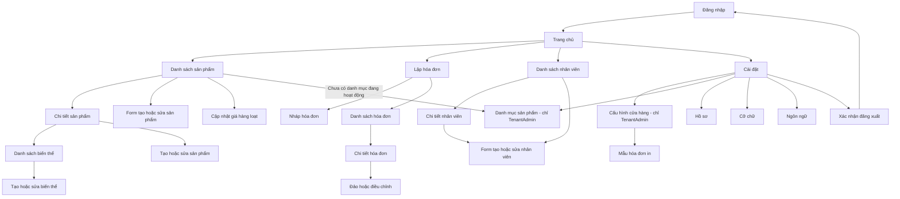

# MOBILE SCREEN FLOW VÀ API MAPPING

**Phạm vi:** Flutter app cho `TenantAdmin` và `Staff`; API v1; offline-first.
**Nguồn contract:** [API Contract](../api/api_contract.md), [OpenAPI](../api/openapi.yaml), [Business Rules](../business_rule.md), [Sync Flow](../sync/data_sync_flow_rabbitmq.md).
**Phạm vi hiện tại:** Module Customer chưa triển khai trên mobile. Invoice chỉ hỗ trợ khách vãng lai (`customerId: null`); không có picker hoặc form tạo khách hàng.

Tài liệu này chỉ gọi endpoint/schema đã có trong contract. Các mục ghi **GAP** là điểm chưa có contract đủ để triển khai; không tự suy diễn endpoint hoặc payload.

## 1. Phạm vi và quy tắc nền

- Hóa đơn chỉ ghi nhận giao dịch bán hàng. App không thu tiền, không ghi nhận phương thức thanh toán, và không hiển thị trạng thái đã/chưa thanh toán. Phần tiền được quản lý thủ công ngoài app.
- Không sửa/xóa hóa đơn đã đồng bộ. TenantAdmin dùng luồng đảo hóa đơn hoặc lập hóa đơn điều chỉnh; Staff chỉ tạo và xem hóa đơn trong phạm vi được phép.
- SQLite/SQLCipher là nguồn dữ liệu UI trên thiết bị. Ghi local trước; đồng bộ nền bằng outbox và giữ thay đổi khi offline.
- Mọi API thành công dùng envelope `{ data, meta }`; lỗi dùng `{ data: null, error: { code, args, fieldErrors, retryable }, meta }`. UI dịch `error.code`, không render thông điệp kỹ thuật từ server.
- Authenticated request gửi `Authorization: Bearer`, `X-Device-Id` khi contract yêu cầu, `X-Correlation-Id` nếu có, và `Accept-Language`. Tenant lấy từ JWT; không gửi/không tin `tenantId` trong payload.
- Command tạo hoặc sync có `Idempotency-Key` UUID ổn định qua retry. Với invoice, header phải bằng `clientOperationId`; retry không được tạo ID/key mới hoặc đổi payload.
- Cursor-based list dùng `cursor=` cho trang đầu, sau đó truyền `nextCursor` nguyên trạng. Không gửi `page` cùng `cursor`; khi đổi search/filter/sort phải bỏ cursor cũ.
- Decimal gửi dưới dạng JSON number, không gửi chuỗi tiền đã format theo locale. Timestamp gửi ISO 8601 UTC (`Z`). Request chỉ gửi field được schema cho phép (`additionalProperties: false` ở các schema tương ứng).
- UI mobile dùng chữ rõ, vùng chạm tối thiểu 44x44, semantic label/icon và semantic color token. Trạng thái quan trọng không được biểu đạt chỉ bằng màu.

## 2. Screen flow

`SyncStatus` là UI dùng chung trong app shell, luôn hiển thị trên mọi màn hình sau đăng nhập; đây là trạng thái/chức năng toàn cục, không phải một destination trong navigation. Chuyển sang login khi logout, token/session bị thu hồi hoặc device bị revoke.

Từ Home có lối vào **Cài đặt > Hiển thị và cỡ chữ** dành cho Staff/TenantAdmin; màn hình Login cũng có lối vào tùy chọn hiển thị. Cỡ chữ và ngôn ngữ là cài đặt local trên thiết bị, tách khỏi Cấu hình cửa hàng và không yêu cầu API.

## 3. Quy định UI đồng bộ toàn cục

Hiển thị đồng thời trạng thái mạng và trạng thái dữ liệu; online không đồng nghĩa dữ liệu đã đồng bộ.

| State local | Nhãn UI bắt buộc | Nguồn/chuyển trạng thái |
|---|---|---|
| `Draft` | Hóa đơn nháp trên thiết bị | Local only; chưa chốt để sync |
| `Pending` | Đã lưu trên thiết bị, chờ đồng bộ | Local outbox sau transaction local |
| `Sending` | Đang gửi dữ liệu | Outbox worker đang gửi request |
| `Queued` | Máy chủ đã nhận, đang xử lý | API trả `202`; chưa được báo là đồng bộ xong |
| `Synced` | Đã đồng bộ | Nhận `DataCreated` khớp `operationId` hoặc pull thấy change đã commit |
| `Failed` | Chưa đồng bộ được, cần xử lý | `CommandRejected`/lỗi nghiệp vụ; giữ dữ liệu và `LastErrorCode` |
| `Offline` | Mất kết nối; dữ liệu mới lưu trên thiết bị | Connectivity + trạng thái outbox; không được xóa pending |
| `Downloading` | Đang cập nhật dữ liệu | Đang pull/upsert changes |

Banner/status component phải giữ vị trí và kích thước ổn định giữa các state, có nhãn dễ hiểu, biểu tượng và màu tương phản. `Queued` khác `Synced`. Tap có thể mở thông tin lỗi/hoạt động gần nhất dạng dialog/bottom sheet; không yêu cầu màn hình đồng bộ riêng. Realtime dùng `DataCreated`/`CommandRejected`; SignalR chỉ báo hiệu, dữ liệu server được xác nhận qua event snapshot hoặc `GET /sync/pull?afterSequence=&limit=`. Upsert local trước khi cập nhật sequence.

**Đã triển khai trạng thái kết nối toàn cục:** App shell hiển thị một thanh trạng thái chung phía trên Navigator, hiện trên Home, các route Settings/editor, Login và overlay. Khởi động ở `Đang kiểm tra kết nối`, chỉ chuyển `Trực tuyến`/`Ngoại tuyến` sau khi có kết quả; không coi SignalR chưa kết nối là ngoại tuyến và không còn badge mạng riêng ở Home. Thanh giữ chiều cao theo nhãn dài nhất ở locale/cỡ chữ hiện tại, không che nội dung, remount route hay reset form khi đổi trạng thái.

Nguồn trạng thái là khả năng truy cập backend đã cấu hình, không phải chỉ có Wi-Fi/mobile data: probe `GET /health` ngay khi mở/resume và mỗi 10 giây khi foreground, timeout 5 giây; response API và lỗi transport cập nhật cùng monitor. HTTP 4xx (kể cả 401/403/conflict) cho biết server vẫn truy cập được, không được coi là mất mạng; HTTP 5xx cho biết backend hiện không sẵn sàng. Probe cũ không ghi đè kết quả API mới hơn; không chạy probe trùng, ngừng polling khi app background. SignalR tiếp tục phục vụ realtime/pull riêng. `Trực tuyến` không có nghĩa pending đã sync; chưa bổ sung worker/outbox business hoặc tự retry settings.

Refresh API lỗi giữ nội dung Home đã tải; lỗi lưu hồ sơ/cấu hình giữ form. Kiểm thử lỗi API giả lập không thay thế kiểm thử mất kết nối thật. Khi debug Android qua USB với `adb reverse tcp:5099 tcp:5099`, tắt Wi-Fi/mobile data vẫn có thể gọi backend qua USB; cần ngắt đường forwarding để kiểm thử backend không truy cập được, rồi khôi phục sau khi test.

`Invoice.status` trong API là `InvoiceStatus` (`Active`, `Reversed`) và mô tả trạng thái nghiệp vụ server. Trường local `syncStatus` dùng enum `Draft`, `Pending`, `Sending`, `Queued`, `Synced`, `Failed`. API không trả `syncStatus`; trạng thái online/offline và downloading là trạng thái app-wide riêng.

## 4. Mapping theo màn hình

### 4.1 Đăng nhập và phiên

**Mô tả:** Form username/password, lỗi đăng nhập dễ hiểu, trạng thái đang xác thực; sau thành công vào Home. Không lưu password; token lưu an toàn trên thiết bị.

| Hành động | API và dữ liệu |
|---|---|
| Đăng nhập | `POST /auth/login`; body `{ username, password }`; headers tùy chọn `X-Device-Id`, `X-Platform`, `X-App-Version`. |
| Nhận thành công | `data.accessToken`, `accessTokenExpiresAtUtc`, `refreshToken`, `user { id, tenantId, role, displayName }`, `device { id, isRevoked }`. `tenantId` có thể null cho SuperAdmin. |
| Gia hạn phiên | `POST /auth/refresh`; body `{ refreshToken }`; nhận access/refresh token mới. Thay refresh token cũ bằng token đã rotate. |
| Đăng xuất | `POST /auth/logout`; nhận `data.revoked`; xóa session/token local và quay về Login. |

Lỗi chính: `ERR_INVALID_CREDENTIALS`, `ERR_TENANT_INACTIVE`, `ERR_DEVICE_REVOKED`, `ERR_FORCE_UPDATE_REQUIRED`, `ERR_RATE_LIMITED`. Không đưa SuperAdmin vào tenant flow nếu app hiện chỉ phục vụ cửa hàng.

**Đã triển khai UI:** Login dùng Cubit cho submitting/success/failure; validate username/password bắt buộc, username tối đa 120 ký tự; trim username nhưng không trim password. Có hiện/ẩn mật khẩu, autofill, đổi vi/en, chặn submit lặp và giữ dữ liệu khi đăng nhập lỗi. Lỗi field ở field; lỗi credentials/network và lỗi thao tác khác dùng dialog thường, đóng bằng Đã hiểu/Back/chạm ngoài. `ERR_FORCE_UPDATE_REQUIRED` kích hoạt dialog cập nhật bắt buộc toàn app. Chỉ vào Home sau repository hoàn tất, không tự retry đăng nhập.

Form neo phía trên thay vì căn giữa lại theo chiều cao nội dung. Khi gửi request, giữ nguyên field/controller/focus và bàn phím; không disable/re-enable field hoặc đổi kích thước nút. Nút submit khóa lặp, có vùng tiến trình giữ chỗ. Khi mở dialog, chủ động bỏ focus bàn phím; giữ nguyên controller/dữ liệu, không chèn lỗi chung làm dịch form. Lỗi field dài vẫn được phép làm vùng validation tăng chiều cao để đọc đủ nội dung. Không remount/reset form hoặc thay toàn màn hình bằng loading khi retry/thất bại. Thành công chỉ chuyển Login sang Home sau khi lưu token.

Kết nối backend local qua Android USB cần `adb reverse tcp:5099 tcp:5099` trước khi dùng `API_BASE_URL=http://127.0.0.1:5099/api/v1`. Cấu hình chạy từ workspace và smoke test backend thật được hướng dẫn trong [Mobile README](../../mobile/README.md#run-on-android-or-a-usb-connected-device).

Login có lối vào Hiển thị và cỡ chữ; Home có cùng lối vào trên app bar cho mọi role đang hỗ trợ. Shared preference lưu local các preset system/large/extra_large; root `TextScaler` áp dụng đúng một lần cho mọi route/overlay. Cấu hình màu dialog lấy từ theme app, chữ từ typography chung.

**Duy trì phiên:** Repository từ chối tài khoản ngoài Staff/TenantAdmin trước khi lưu; secure storage giữ access token, refresh token và thời điểm hết hạn trong một session record. Trước request API hoặc kết nối lại SignalR, tự refresh nếu access token sắp hết hạn trong 30 giây. Request nhận 401 được refresh và gửi lại tối đa một lần, giữ nguyên payload/idempotency key; các request đồng thời dùng chung một refresh để tránh rotate trùng. Lỗi mạng giữ phiên để thử lại. Refresh bị từ chối hoặc tenant/device bị khóa/thu hồi xóa token ngay, khóa request và dừng realtime; dialog bắt buộc yêu cầu OK rồi xóa toàn bộ route về Login, kể cả editor có nháp. Không chờ OK mới bảo vệ phiên. Logout chủ động xóa cả token và về Login sau xác nhận đăng xuất, không báo hết phiên. Không lưu mật khẩu. Session cũ chỉ có access token không thể tự khôi phục refresh token: khi token đó hết hạn phải đăng nhập lại một lần. `HOME_PREVIEW=true` vẫn bỏ qua Login theo cơ chế preview hiện có.

Mỗi request có xác thực được gắn session generation; login/logout thay generation, refresh token bình thường không thay generation. Request đang chờ và retry 401 không được gửi bằng credential của phiên thay thế. Response lỗi auth đến muộn từ phiên cũ không được refresh hoặc đăng xuất phiên mới.

### 4.2 Trang chủ

**Mô tả:** Điều hướng tới bán hàng, hóa đơn, sản phẩm, khách hàng, nhân viên và cài đặt theo role; hiển thị SyncStatus toàn cục. Có thể hiển thị hoạt động gần đây từ local cache.

**Đã triển khai:** Home hiển thị `Xin chào {displayName}` lấy từ `GET /me` và thẻ tenant từ `GET /tenant/profile`: tên, mã, trạng thái, tiền tệ, múi giờ. Tenant của hồ sơ phải khớp metadata; không dùng dữ liệu của tenant khác. Đọc `GET /settings/effective` để hiển thị cấu hình effective. Không cần API tổng hợp/dashboard mới.

Ba response khởi động được lưu bền trong bảng SQLCipher `account_snapshots`, khóa `(tenant_id, user_id, resource)`, sau khi kiểm tra contract và identity. Khi lỗi kết nối/timeout hoặc HTTP 502/503/504, kể cả lỗi mạng lúc tự refresh token, app khởi động bằng snapshot đúng tài khoản và báo dữ liệu chưa cập nhật thay vì lỗi toàn màn hình. Decode JWT lưu trong secure storage chỉ chọn partition local, không cấp quyền. HTTP 401/403, session bị thu hồi, response sai contract hoặc sai identity không được fallback cache. Thiết bị/tài khoản chưa từng tải đủ ba response online vẫn cần kết nối lần đầu; không tạo hồ sơ hoặc cấu hình giả. PATCH hồ sơ thành công cập nhật snapshot để lần mở offline giữ đúng tên mới.

Refresh hoặc lưu hồ sơ/cấu hình thành công tải lại Home nhưng giữ nội dung đã có trong khi chờ; khi refresh lỗi, giữ dữ liệu cũ và báo chưa cập nhật được. Lần tải đầu lỗi có nút thử lại. Lối vào Cài đặt ở app bar và ô chức năng cùng mở một màn hình. Lưới chức năng chuyển sang danh sách khi chữ lớn hoặc màn hình hẹp.

### 4.3 Sản phẩm và danh mục

**Mô tả:** Product là nhóm hàng gốc; `ProductVariant` mới là mặt hàng được chọn để bán và mang SKU, barcode, đơn vị, giá, trạng thái active cùng thuộc tính riêng. Danh sách chính hiện từng variant, bao gồm default variant một lần, không yêu cầu mở nhóm hàng để thấy các biến thể. Tên thẻ ghép tên gốc + tên variant nếu khác tên gốc + các đặc điểm dạng `[giá trị]`: `Sắt hộp 30 × 60 [1,2 mm] [Hòa Phát]`. Giá/đơn vị của chính variant được làm nổi; mã hàng ở dòng phụ. Nhãn nền màu phân biệt Đang bán/Ngừng bán và Chờ gửi/Đang gửi/Đang xử lý/Đã đồng bộ/Cần xử lý, luôn kèm chữ. Chạm thẻ mở đúng biến thể; có action riêng xem nhóm gốc và toàn bộ variants. Staff chỉ xem variant active trong nhóm active; TenantAdmin quản lý vòng đời product/variant.

| Hành động | API và dữ liệu gửi/nhận |
|---|---|
| List/search mặt hàng | `GET /products/catalog?categoryId=&search=&cursor=&pageSize=&includeInactive=`. Mobile luôn gửi `categoryId` của tab; kết quả không trộn danh mục. Nhận `{product,variant}` mỗi dòng và cursor metadata; tìm tên gốc, tên biến thể, SKU/barcode và JSON đặc điểm. Cache product và variant riêng trong cùng transaction, không xóa các variant ngoài trang. Hiển thị đúng variant khớp tìm kiếm. |
| List/search nhóm hàng | `GET /products?search=&cursor=&pageSize=&updatedSince=&includeInactive=`. Nhận product gốc `id, sku, barcode, name, unit, basePrice, taxRate, isActive, version, updatedAtUtc`; response list có cursor metadata. Search API hiện dùng tên/SKU/barcode legacy của product, chưa tìm xuyên qua SKU/barcode variant. Không dùng trường legacy để quyết định giá khi variant đã tải. |
| Đọc product và variants | `GET /products/{productId}` rồi `GET /products/{productId}/variants?includeInactive=`. Variant có `id, productId, sku, barcode, name, unit, basePrice, taxRate, isActive, version, extraData, updatedAtUtc`. `includeInactive=true` chỉ cho TenantAdmin. Cache riêng product và variant theo ID; ghép danh sách variant vào product theo `productId`. |
| Chọn mặt hàng bán | Chỉ cho chọn variant active thuộc product active. Hiển thị tên product + nhãn variant (nếu có), SKU, đơn vị và giá của chính variant. `extraData` theo object `{ schemaVersion: 1, attributes: {...} }`; render thuộc tính đã biết, giữ nguyên key/type chưa biết thay vì parse thành các field cố định. |
| Tạo product gốc | Mobile dùng `POST /products/commands` + `Idempotency-Key`, `action=create`, `data` chứa `sku, barcode?, name, unit, basePrice, taxRate:0, categoryId, extraData?`. Tự gắn danh mục đang chọn, không có picker/tab Tất cả. Endpoint legacy `POST /products` vẫn nhận `categoryId?`, `extraData?` để tương thích. Nhận `202 Queued`; backend tạo default variant với đặc điểm ngay trong cùng transaction, không cần sửa sau khi tạo. TenantAdmin only. |
| Tạo variant | `POST /products/{productId}/variants`; gửi `{ sku, barcode?, name?, unit, basePrice, taxRate: 0, extraData? }`; giá > 0; `extraData` tối đa 16 KiB và có `schemaVersion: 1`, `attributes` object. Trả `201` với variant mới và Location. TenantAdmin only. |
| Sửa product gốc | `PATCH /products/{productId}`; gửi field cần đổi trong `name, barcode, unit, basePrice, taxRate, categoryId` và `expectedVersion`. Các trường legacy được giữ để tương thích; chỉnh `basePrice/unit/barcode` ở product sẽ đồng bộ lên default variant, không sửa các variant khác. |
| Sửa variant | `PATCH /products/{productId}/variants/{variantId}`; gửi `{ sku, barcode, name, unit, basePrice, taxRate, extraData, expectedVersion }`; `barcode: null` xóa barcode, `extraData: null` xóa thuộc tính. Xử lý `409 ERR_VERSION_CONFLICT` bằng tải lại bản mới và yêu cầu người dùng xử lý conflict; không tự retry ghi. TenantAdmin only. |
| Ngừng bán / bán lại | Durable actions `deactivate`/`activate` đổi gốc VÀ mọi biến thể; `deactivateVariant`/`activateVariant` chỉ đổi một biến thể, kể cả default/cuối cùng, không đổi gốc/biến thể khác. Bán lại gốc bật cả các biến thể trước đó ngừng riêng. Dialog xác nhận nêu rõ phạm vi. Gốc đang ngừng thì detail biến thể có nút `Bán lại cả nhóm`; gốc active thì biến thể inactive có `Bán lại`, active có `Ngừng bán`. Lưu local/outbox atomic, chỉ tăng version entity thực sự đổi cờ; chờ receipt mới là synced. REST tương ứng `/products/{id}/activate`, `/products/{id}/deactivate`, `/products/{productId}/variants/{variantId}/activate` và `/deactivate`, body `{expectedVersion}`. Xóa cứng chỉ khi chưa có lịch sử hóa đơn. |
| Tăng/giảm giá hàng loạt | `POST /products/bulk-price`; chọn `productIds` để đổi giá gốc (đồng bộ default variant), `variantIds` để đổi giá của các variant đã chọn, hoặc gửi cả hai để đổi chung trong một transaction. Gửi `expectedVersions` và `variantExpectedVersions` tương ứng; `value > 0`. Nhận `products` và `variants` đã đổi. Nếu product và default variant được chọn đồng thời, server điều chỉnh giá dùng chung một lần; các variant còn lại được điều chỉnh riêng. |
| Danh mục | `GET /categories?search=&cursor=&pageSize=&includeInactive=` trả thêm `productCount`, `POST /categories`, `PATCH /categories/{id}`. TenantAdmin bật/tắt bằng `PATCH /categories/{id}/status` với `{isActive,expectedVersion}`; xóa bằng `DELETE /categories/{id}?expectedVersion=` trả `204`. Chỉ xóa khi không có sản phẩm (kể cả inactive) và không có danh mục con. `409` khi đã được dùng hoặc version cũ. |

**Offline/local database:** Bản local phải lưu product gốc và variants thành hai loại record riêng, có index theo tenant/product và giữ nguyên `ExtraData` JSON. Chọn hàng, giá, đơn vị và snapshot invoice lấy từ variant; không suy diễn variant từ tên/giá. Mọi catalog change từ pull phải upsert đúng loại entity và tenant trước khi cập nhật sequence.

Giá trị `extraData` backfill từ catalog cũ có thể chưa theo `schemaVersion: 1`. Khi đọc, giữ nguyên JSON chưa biết schema; không tự xóa hoặc ghi đè. Nếu giá trị cũ là object, chỉ wrap thành `{ schemaVersion: 1, attributes: <legacy object> }` khi người dùng chủ động sửa và lưu, để bảo toàn các key cũ. Nếu không phải object, yêu cầu luồng chuyển đổi rõ ràng thay vì tự bỏ dữ liệu.

**Mobile đã tích hợp:** Home mở danh sách mặt hàng/variant; TenantAdmin thêm product, mở nhóm gốc từ detail để sửa/ngừng bán/xóa product, quản lý variant và chọn tối đa 100 mặt hàng để đổi giá. Staff chỉ xem/tìm. Default variant dùng chung ID với product, không được xóa riêng. Variant có lịch sử hóa đơn phải ngừng bán thay vì xóa. Luồng chọn hàng vào hóa đơn chưa thuộc màn quản lý này.

**Phân trang mobile:** Tự tải trang tiếp khi cuộn gần cuối hoặc trang chưa lấp đầy màn hình; chỉ một lượt tải tại một thời điểm, dừng khi trang thiếu hoặc không thêm mặt hàng. Đổi tìm kiếm/danh mục/bộ lọc đặt lại phân trang. Giữ nút tải thêm/thử lại khi còn trang; lỗi không tự retry liên tục. Cuối danh sách chừa khoảng cho nút tạo sản phẩm và vùng điều hướng hệ thống.

**Tab danh mục và khởi tạo:** Dưới search là thanh tab ngang cuộn được, chỉ chứa danh mục active của tenant, không có Tất cả/Chưa phân loại. Lần đầu không có danh mục active, TenantAdmin tự chuyển sang quản lý danh mục; phải tạo/bật danh mục rồi tiếp tục sang sản phẩm. Staff không có quyền sửa danh mục, được hướng dẫn liên hệ chủ cửa hàng. Cài đặt có mục Danh mục sản phẩm cho TenantAdmin. Chuyển tab giữ từ khóa nhưng reset cursor và lựa chọn đổi giá; local SQL join theo category của product, remote gửi cùng `categoryId`, response cũ không trộn vào tab mới. Sản phẩm cũ chưa phân loại không bị xóa nhưng không xuất hiện trong các tab. Tắt danh mục ẩn tab, không đổi trạng thái hay xóa sản phẩm bên trong. Quản lý danh mục cần mạng; chỉ thông báo thành công sau server xác nhận, giữ form khi lỗi. Cache SQLCipher theo tenant/user để các tab vẫn dùng được offline.

**Ghi offline bền vững:** Mobile dùng `POST /products/commands` và `GET /products/commands/{operationId}`, không gửi lại các endpoint legacy không có receipt sau khi mất response. SQLCipher schema 6 lưu riêng records, journal, danh mục và pull cursor theo `(tenant_id, user_id)`; migration thêm/backfill cột `category_id` và index cho lọc local, giữ nguyên draft/journal/cursor. List join parent/variant theo cả tenant/user, lọc trạng thái cả hai và phân trang theo từng variant. Lưu local và journal cùng transaction; UI báo rõ chưa đồng bộ. Khi có mạng/foreground, worker client kiểm tra receipt rồi mới gửi lại cùng UUID/payload, polling 5 giây và pull tối đa 5 trang mỗi lượt. `202 Queued` không phải đã đồng bộ; chỉ receipt `Completed`/`CatalogBatch` sau commit mới xác nhận. UUID tạo local được ánh xạ sang ID server trước khi gửi thao tác phụ thuộc, không sửa thuộc tính JSON chưa biết.

**Đổi giá:** Tăng/giảm theo số tiền cố định (25.000 + 200 = 25.200), hoặc nhập giá mới riêng từng dòng. Preview giá cũ/mới trước xác nhận; toàn bộ batch dùng `expectedVersion`, fail một dòng thì không đổi dòng nào. Product và default variant được chọn theo một physical ID, không đổi hai lần. Giá dùng fixed-point `BigInt` 4 chữ số thập phân, nhận `basePriceText` để không mất độ chính xác JSON.

**Form dễ nhập:** Giá tại form product/variant, số tiền tăng/giảm và giá riêng từng dòng đều tự nhóm hàng nghìn khi nhập/dán, có hậu tố `₫`, giữ vị trí con trỏ khi sửa giữa số. Locale Việt: `25000` → `25.000`, `30123,4567` → `30.123,4567`; locale Anh dùng `25,000` / `30,123.4567`. Chuỗi gửi journal/API vẫn là decimal invariant không có dấu nhóm/currency, không parse bằng floating point. Form chia nhóm thông tin/giá/đặc điểm; nút lưu trong vùng tránh bàn phím và nội dung cuộn khi chữ lớn.

Mã hàng không bắt buộc người dùng nhập: bỏ trống tự tạo `MH-` + 12 ký tự theo [ADR-014](../architecture/adr/ADR-014-short-business-codes.md) trước enqueue; giữ UUID client và mã khi lưu lỗi/thử lại. Có nhập thì giữ mã đã nhập. Mã cũ và mã danh mục không đổi. Tên variant mới, kể cả thêm tương tự, điền sẵn tên product gốc và cho sửa. Thêm tương tự vẫn giữ giá/đơn vị/đặc điểm làm mẫu, không chép SKU/barcode.

**Đặc điểm biến thể:** Không yêu cầu người dùng nhập JSON. Dùng từng dòng Tên đặc điểm – Giá trị, có gợi ý Độ dày/Thương hiệu/Chiều dài, thêm/bỏ dòng, kiểm tra tên trống/trùng và giới hạn UTF-8 16 KiB. Ví dụ product **Sắt hộp 30 × 60** có variant **Dày 1,2 mm** với `Độ dày = 1,2 mm`, mã `SAT-3060-12`, giá `25.000 ₫`; variant **Dày 1,4 mm** có mã/giá riêng. Không nhập nhiều độ dày vào một giá trị để thay thế các variant bán được. Chi tiết sản phẩm chỉ giữ nút **Thêm biến thể** phía trên, bỏ nút **Thêm biến thể tương tự** (`catalog.copy_variant`) trên từng variant để tránh thao tác trùng. Không tự tạo mọi tổ hợp đặc điểm hoặc thay đổi SKU đã tồn tại.

App tự tạo `{schemaVersion:1,attributes:{...}}`, giữ nguyên metadata chưa biết. Các giá trị cũ không phải chuỗi (số/bool/null/object/list) hiển thị ở dạng đọc và giữ nguyên kiểu, không chuyển thành text/JSON nhập tay. Schema mới hơn hoặc legacy không phải object giữ nguyên toàn bộ, vẫn cho sửa thông tin bán hàng của variant hiện có; không dùng làm mẫu tạo variant mới. Detail hiển thị từng đặc điểm dạng nhãn dễ đọc, không render raw JSON.

**Idempotency và đổi phiên:** Mỗi lần xử lý lấy lại operation đầu hàng đợi trong transaction, không tái sử dụng danh sách command cũ sau receipt/remap. Chuyển `pending` sang `sending` bền vững trước request đầu tiên; từ đó giữ nguyên UUID và payload qua mất response, retry và khởi động lại, kể cả khi chưa nhận `202`. Chỉ command còn `pending` được remap ID phụ thuộc; `sending`/`queued`/`failed` không đổi payload. `sending` không có nghĩa server đã nhận lệnh. Mỗi phiên giữ store bất biến theo tenant/user đã capture; kết quả async của scope cũ không được cập nhật alias/cursor hoặc trả dữ liệu vào scope mới.

**Conflict:** Journal có `pending`/`sending`/`queued`/`failed`; lỗi nghiệp vụ dừng hàng đợi và hiện dialog một lần cùng danh sách lỗi. Không tự rebase hoặc ghi đè giá mới từ server. Người dùng có thể xác nhận bỏ thao tác lỗi **và toàn bộ thao tác xếp sau, kể cả sản phẩm khác**; dialog cảnh báo rõ phạm vi trước khi khôi phục snapshot server và nhập lại. Form sửa/đổi giá có xác nhận khi Back nếu chưa lưu.

**Tìm kiếm:** API catalog tìm trực tiếp các variant mà không cần tải toàn bộ nhóm trước. Tìm offline vẫn chỉ bảo đảm trên dữ liệu đã cache; banner nêu rõ giới hạn này. API legacy `GET /products?search=` vẫn chỉ tìm nhóm gốc và không dùng làm nguồn list mặt hàng mới.

### 4.4 Khách hàng (để sau)

**Trạng thái:** Các endpoint dưới đây là contract cho giai đoạn sau; module Customer chưa nằm trong phạm vi triển khai mobile hiện tại. Không có màn hình danh sách/chi tiết/form khách hàng, cũng không có luồng chọn khách trên invoice.

| Hành động | API và dữ liệu gửi/nhận |
|---|---|
| List/search | `GET /customers?search=&cursor=&pageSize=&updatedSince=&includeInactive=`. Nhận `id, code, fullName, phone, email, address, isActive, version, updatedAtUtc`; Staff chỉ active. |
| Đọc detail | `GET /customers/{id}`; nhận `Customer` đầy đủ; Staff chỉ đọc customer active, TenantAdmin đọc active/inactive. Có thể render cache trước khi response về. |
| Tạo/lưu danh bạ | `POST /customers` + `Idempotency-Key`; gửi `{ code, fullName, phone?, email?, address? }`; nhận `202 Queued`, chờ event/pull rồi mới báo hoàn tất. Staff và TenantAdmin. |
| Sửa | `PATCH /customers/{id}`; gửi field được sửa trong `fullName, phone, email, address` cùng `expectedVersion`; TenantAdmin only. |
| Ngừng hoạt động | `POST /customers/{id}/deactivate`; gửi `{ expectedVersion }`; TenantAdmin only. |
| Xóa | `DELETE /customers/{id}?expectedVersion=`; chỉ hard-delete khi chưa có invoice/history; nếu đã tham chiếu thì dùng deactivate. |

`RequireCustomerPhone` (nếu bật) được server enforce khi invoice sync; client cũng nên validate sớm nhưng không thay kiểm tra server. Invoice khách vãng lai gửi `customerId: null`, không tạo customer ngầm.

### 4.5 Lập hóa đơn, danh sách và chi tiết

**Mô tả:** Lập invoice bằng tìm/chọn product, chỉnh quantity, xem subtotal/discount/tax/rounding/total; trong phạm vi hiện tại invoice luôn là khách vãng lai (`customerId: null`). Lưu nháp local tự động. Không có vùng nhập tiền khách đưa, phương thức thu, hoặc nhãn đã/chưa thanh toán.

**Khả năng sử dụng:** Chọn hàng chỉ hiển thị các variant bán được như Product list, không thêm dòng product gốc. Dùng chung formatter `tên gốc [tên variant nếu khác] [giá trị đặc điểm]`; đặc điểm từ extraData v1 hoặc legacy object. Giỏ hàng, chi tiết và bản in dùng snapshot thuộc tính, không tra catalog mới để đổi lịch sử. Tên hàng/giá không đặt cạnh hàng nút trailing cố định gây tràn; mỗi hàng dạng card, quantity nhập trực tiếp (thập phân tối đa 4 chữ số, phải >0), có +/− và nút bỏ riêng. Form cuộn khi bàn phím mở, hỗ trợ màn hẹp/chữ lớn.

**Nháp:** Mở màn hình chưa chọn hàng không ghi nháp; chỉ lưu sau khi có hàng hoặc tiền dịch vụ. Bỏ hết hàng và phí bằng 0 thì xóa nháp rỗng đã lưu. Nháp cũ vẫn có nút Xóa bản nháp (xác nhận) trong danh sách và composer; chỉ xóa SQLite draft theo tenant/user, không xóa hóa đơn đã chốt hoặc outbox. Các lần ghi nháp được tuần tự hóa để nhập số nhanh không bị ghi đè bằng dữ liệu cũ.

**Phí dịch vụ:** Composer tải Service blocks từ ReceiptTemplate qua AccountRepository và hiển thị ô tiền cho mỗi service (mặc định 0, không âm). Lưu snapshot `serviceId`, `labelSnapshot`, `amount`; tổng cộng = subtotal − discount + rounding + serviceTotal (thuế v1 vẫn 0). Invoice có service snapshots dùng payloadVersion 2; không có phí dùng v1 như cũ. Nháp/correction/historical print giữ snapshot, đổi/xóa định nghĩa mẫu không xóa phí lịch sử.

**Danh sách và tra cứu:** Mỗi dòng hiển thị số hóa đơn, tổng tiền kèm tiền tệ, ngày giờ tạo theo giờ local và trạng thái. Gõ số hóa đơn lọc danh sách; nhấn tìm trên bàn phím (kể cả máy quét dạng bàn phím) hoặc quét camera mở chi tiết khi khớp chính xác số hóa đơn, không phân biệt hoa thường và bỏ khoảng trắng đầu/cuối. Bản in mới dùng QR chứa nguyên số hóa đơn dạng text, không customer/PII/URL. Camera vẫn nhận Code128 trên hóa đơn cũ, bỏ qua mã không có tiền tố `INV-` để QR chuyển khoản không kích hoạt tra cứu nhầm. Lookup lấy dữ liệu local theo tenant/user trước; online tìm server và duyệt cursor tới khi có exact match hoặc hết kết quả, rồi tải detail snapshots. Cursor tra cứu độc lập với cursor danh sách. Không tìm thấy/thiếu số/lỗi camera có thông báo; camera bị từ chối vẫn quay lại nhập tay được. Camera Android dùng ML Kit bundled để không cần tải model khi offline; iOS khai báo quyền camera. In Wi-Fi đã triển khai ở mục 4.7.

**Số hóa đơn:** Sale mới tự sinh `INV-` + 12 ký tự (16 ký tự tổng cộng) theo [ADR-014](../architecture/adr/ADR-014-short-business-codes.md) khi tạo nháp; hiển thị ở composer và giữ nguyên khi lưu/chốt/retry/sync. Không đổi số của nháp/hóa đơn cũ. Reverse/correction dùng số ngắn cùng thuật toán do backend sinh. Deploy API/worker mới trước mobile.

**Khách hàng trên chi tiết/mẫu in:** Vẫn giữ ba nhãn Tên khách hàng, Địa chỉ, Số điện thoại cùng dòng trống để ghi tay khi `customerId: null`; chỉ đọc, không phải form nhập khách tạm, không phát sinh customer master/snapshot. Đã áp dụng trên bản in Wi-Fi; chưa có xuất PDF.
**Status hiển thị:** API `status` được map thành `invoiceStatus` trong model mobile (`Active` hoặc `Reversed`); `syncStatus` là trạng thái outbox local. Không gộp hai trường thành một badge và không hiển thị `Paid/Unpaid`.

| Hành động | API và dữ liệu gửi/nhận |
|---|---|
| Lưu nháp | Chỉ SQLite local; không gọi API cho draft chưa chốt. Cho phép mở lại/chỉnh sửa local draft. |
| Chốt và đưa vào outbox | Lưu invoice + details + outbox trong một transaction local; gán UUID ổn định cho invoice và `clientOperationId`. Mỗi detail giữ `productId` (product gốc), `productVariantId` (variant bán được), SKU/tên/unit/giá cùng snapshot thuộc tính lúc chốt. Sau đó worker gọi sync. |
| Sync Sale | `POST /invoices/sync`; header `Idempotency-Key = clientOperationId`; body `{ clientOperationId, payloadVersion: 1, invoice }`. Invoice gửi `id, invoiceNumber, invoiceType: Sale, customerId: null, clientCreatedAtUtc, currencyCode, subtotal, discountAmount, taxAmount: 0, roundingAmount, totalAmount, details[]`. Mỗi detail gửi `lineNumber, productId, productVariantId, skuSnapshot, productNameSnapshot` (tên product gốc), `variantNameSnapshot`, `unitSnapshot`, `quantity>0, unitPrice>0, discountAmount, taxRate:0, taxAmount:0, lineTotal`. `variantExtraDataSnapshot` được server lấy từ catalog và lưu; không gửi `ExtraData` tùy ý trong line. |
| Giá/variant stale | Server đối chiếu variant ID thuộc product, active state, SKU/tên/unit/giá với catalog lúc sync. Nếu catalog đã đổi khiến line không hợp lệ, giữ invoice local ở trạng thái lỗi nghiệp vụ, hiển thị lỗi có thể xử lý và không xóa/ghi đè snapshot/draft; yêu cầu tải catalog mới và cho người dùng xác nhận chỉnh invoice rồi tạo operation mới theo quy tắc retry/idempotency. |
| Nhận sync | `202` chỉ xác nhận command được queue; nhận `operationId, status=Queued`. Timer/resume/online kiểm tra `GET /invoices/operations/{operationId}`: Completed áp full invoice và hoàn tất outbox; Rejected giữ dữ liệu và hiện lỗi; Queued tiếp tục chờ. Nếu API cũ chưa có receipt, GET invoice xác nhận commit; chưa thấy thì gửi lại nguyên operation/payload, không tạo UUID mới. Không giả thành công từ online/202. |
| List | `GET /invoices?search=&from=&to=&invoiceType=&cursor=&pageSize=`. Nhận summary gồm `id, invoiceNumber, invoiceType, status: InvoiceStatus, customerId, createdByUserId, clientCreatedAtUtc, syncedAtUtc, totalAmount, currencyCode, originalInvoiceId`. Staff chỉ thấy invoice mình tạo; TenantAdmin thấy tenant. |
| Detail | `GET /invoices/{id}`; nhận invoice và detail snapshots gồm `productId, productVariantId, skuSnapshot, productNameSnapshot, variantNameSnapshot, variantExtraDataSnapshot, unitSnapshot`, quantity, giá, tổng và liên kết invoice gốc nếu là reverse/correction. Render invoice từ snapshot, không lookup giá/tên hiện tại để thay đổi lịch sử. Staff chỉ đọc invoice do mình tạo. |
| In | Dựng A4/A5 local từ invoice snapshot + ReceiptTemplate/StoreProfile, gửi PNG và `paper: A4/A5` qua HTTPS tới PC trong LAN; bridge đặt đúng khổ driver. Không có backend print API. Có QR chỉ dẫn chuyển khoản, không có trạng thái thanh toán. Lỗi in không đổi invoice. |
| Sửa/xóa | Không có API edit/delete invoice. Draft local được sửa/hủy local. Invoice đã sync là immutable. |
| Đảo | TenantAdmin gọi `POST /invoices/{id}/reverse`; gửi `{ reasonCode }`, `Idempotency-Key`, `X-Device-Id`; nhận `201` operation result. Chỉ reverse một lần. |
| Điều chỉnh | TenantAdmin gọi `POST /invoices/{id}/correction`; gửi `{ reasonCode, roundingAmount?, details[] }`, `Idempotency-Key`, `X-Device-Id`; rounding mặc định `0`, total = subtotal - discount + rounding; server reverse invoice cũ và tạo correction mới atomically. |

Không gửi `invoiceType: Reverse/Correction` qua `/invoices/sync`; client chỉ sync Sale. Không cập nhật invoice đã sync bằng PATCH/DELETE. Thông tin `Paid/Unpaid` không thuộc UI hoặc model màn hình của phạm vi này.

**Bố cục in gọn:** QR tra cứu thay Code128 bên phải số/ngày hóa đơn, chứa nguyên số hóa đơn và nhãn **QR tra cứu hóa đơn**. Khung 90 x 90 pt, vùng mã 74 x 74 pt với viền trắng 8 pt mỗi cạnh; QR chuyển khoản cũng có viền trắng 8 pt để hỗ trợ camera. QR chuyển khoản riêng trong header phải cùng BIN/số tài khoản/tên người nhận; thông tin cửa hàng bên trái và nội dung header phải tùy chỉnh vẫn được giữ. Không có tài khoản, object trống hoặc cả ba field ngân hàng trống thì bỏ riêng QR/khối ngân hàng; QR tra cứu luôn có. Cấu hình ngân hàng nhập dở/sai vẫn báo lỗi, không tạo QR sai. Reverse không hiện QR nhận tiền nhưng vẫn có QR tra cứu. Không thay đổi số hóa đơn hoặc snapshot vì bố cục in.

**Nhập phí dịch vụ:** Dùng cùng formatter tiền với giá sản phẩm, phân cách hàng nghìn theo locale và hậu tố `₫` cho VND (ví dụ tiếng Việt `50.000 ₫`). Giá trị gửi/lưu vẫn là decimal chuẩn không có dấu phân nhóm; cho phép phí 0 và giữ chính xác tối đa 4 chữ số thập phân. Số lượng không dùng formatter tiền.

**Kết quả lưu/chốt:** Sau **Lưu và đồng bộ hóa đơn**, hiện `AppDialog.showNotice` kèm số hóa đơn và trạng thái từ local store, đợi đóng thông báo mới rời composer. Pending chỉ báo lưu trên thiết bị/chờ gửi; Queued chỉ báo server đã nhận/chưa xác nhận commit; Synced mới báo đồng bộ hoàn tất. Failed báo hóa đơn vẫn ở thiết bị, kèm lỗi đã dịch/mã lỗi và hướng dẫn mở chi tiết xử lý, không yêu cầu lập hóa đơn mới. Lỗi validation vẫn tại field; lỗi thao tác giữ form và dùng dialog lỗi hiện có. Điều chỉnh chỉ báo hoàn tất khi repository đã nhận kết quả commit.

Mở bán hàng trực tiếp từ Home: sau khi đóng thông báo lưu, thay composer bằng danh sách hóa đơn, không quay về Home; áp dụng cả online và offline, không phụ thuộc trạng thái đồng bộ. Composer mở từ danh sách vẫn pop về danh sách hiện có; không chồng thêm một danh sách mới. Luồng draft/điều chỉnh giữ đường quay lại hiện có.

**Khôi phục hóa đơn từ chối:** Chi tiết hiển thị cả thông báo đã dịch và mã lỗi; không chỉ hiện nhãn trạng thái. Khi người dùng xác nhận gửi lại, phải online và GET invoice kiểm tra chưa commit trước. Nếu đã có trên server thì cache kết quả, không POST lại. Nếu 404 và bản local đang failed, giữ invoice ID/số/nội dung, atomically tạo operation mới và giữ operation thất bại trước đó; không đổi UUID khi retry một operation đang Pending/Queued. Không tự sửa giá hoặc snapshot. Biến thể không có tên riêng gửi `variantNameSnapshot: null`; đọc snapshot null không lấy tên product thay vào. Backend coi null và chuỗi rỗng cùng nghĩa không có tên riêng, nhưng vẫn kiểm tra tên thật bằng ordinal. Chi tiết/list có SafeArea tránh thanh điều hướng hệ thống che tổng tiền/thao tác.

**PC tự chạy:** Bộ nhận lệnh có trình cài `.bat`, thiết lập chạy ngầm theo tài khoản Windows khi đăng nhập để dùng đúng driver/printer và state ghép nối. Với PC tự đăng nhập, bridge tự chạy sau khi bật máy; không dùng service LocalSystem hay lưu mật khẩu Windows. Hướng dẫn và file chạy tại [windows-print-bridge](../../tools/windows-print-bridge/README.md).

**Lưu ý triển khai:** Lưu `invoiceStatus` riêng với `syncStatus` local. Correction dùng cùng snapshot variant trong details; server reverse invoice gốc và tạo correction atomically. Server không trả payment state. Legacy client có thể bỏ `productVariantId`/`variantNameSnapshot`; backend ánh xạ sang default variant, nhưng client mới phải luôn gửi ID variant đã chọn.

### 4.6 Nhân viên

**Mô tả:** TenantAdmin quản lý tài khoản Staff trong tenant. List tìm theo username/display name; detail hiển thị profile, status, version và thời gian cập nhật. Form tạo có username, mật khẩu khởi tạo, tên hiển thị, email/phone; form sửa không cho đổi role/tenant/credential. Xóa chỉ khi chưa có lịch sử; nếu có dùng deactivate.

| Hành động | API và dữ liệu gửi/nhận |
|---|---|
| List | `GET /tenant/staff?search=&cursor=&pageSize=`; nhận StaffAccount, không có credential. |
| Detail | `GET /tenant/staff/{userId}`; chỉ tài khoản Staff thuộc tenant hiện tại. |
| Tạo | `POST /tenant/staff`; gửi `{ username, initialPassword, displayName, email?, phone? }`; nhận `201 StaffAccount`. Không giữ/trả password. |
| Sửa | `PATCH /tenant/staff/{userId}`; gửi `{ username, displayName, email?, phone?, expectedVersion }`; nhận StaffAccount mới. |
| Ngừng hoạt động | `POST /tenant/staff/{userId}/deactivate`; revoke session/device và nhận status `Inactive`. |
| Xóa | `DELETE /tenant/staff/{userId}`; hard-delete chỉ khi không có lịch sử/dependency; nếu không phải deactivate. |

`StaffAccount` nhận: `id, tenantId, username, displayName, email, phone, status, version, createdAtUtc, updatedAtUtc`. Không có API cho TenantAdmin thay đổi role hoặc mật khẩu Staff sau tạo trong contract hiện tại.

### 4.7 Cấu hình cửa hàng và mẫu in

**Mô tả:** TenantAdmin sửa thông tin cửa hàng, tài khoản nhận tiền, mẫu in và quyền Wi-Fi. Staff/TenantAdmin ghép nối PC riêng trên thiết bị và in A4 qua Windows bridge khi quyền được xác nhận; Bluetooth chưa triển khai transport. Không có backend print API.

| Hành động | API và dữ liệu gửi/nhận |
|---|---|
| Nạp metadata cửa hàng | `GET /tenant/profile`; TenantAdmin/Staff nhận `id, code, name, status, timeZone, currencyCode, version, createdAtUtc, updatedAtUtc` từ tenant trong JWT; không truyền tenant ID. |
| Nạp cấu hình | `GET /settings/effective`; nhận `storeProfile`, `receiptTemplate`, `productDisplay`, feature flags, `settingsVersion` và `settingVersions` cho từng key có thể sửa. |
| Sửa thông tin cửa hàng | `PUT /settings/StoreProfile`; body `{ value: { storeName, address?, phone?, taxCode?, bankTransfer? }, expectedVersion }`; bankTransfer gồm BIN 6 chữ số, số tài khoản 6–34 chữ số, tên chủ tài khoản tối đa 100 ký tự. Xóa cả ba field để bỏ property. UI mobile đã ẩn ba ô nhập ngân hàng; khi lưu, app gửi lại nguyên `bankTransfer` đã lưu nên QR chuyển khoản trên hóa đơn vẫn hoạt động với dữ liệu cũ. |
| Sửa mẫu in | `PUT /settings/ReceiptTemplate`; body `{ value: { templateId, showStoreAddress, showTaxBreakdown, footerText?, layout? }, expectedVersion }`; `templateId` là `Standard`, layout version 1/2 ở mục 4.7.1. |
| Cho phép in Wi-Fi | TenantAdmin `PUT /settings/EnableWifiPrint`, body `{ value: true/false, expectedVersion }`; mặc định false. Staff không được ghi. |
| Lưu tùy chọn hiển thị sản phẩm | `PUT /settings/ProductDisplay`; body `{ value: { layout, sortBy, showSku, showBarcode, showCategory }, expectedVersion }`. |

**Đã triển khai:** Editor tenant chỉ hiện cho TenantAdmin; Cubit và backend chặn Staff ghi. Lưu riêng StoreProfile, ReceiptTemplate (Standard), ProductDisplay và ba switch `AutoRoundMoney`/`EnableBluetoothPrint`/`EnableWifiPrint`; cache/draft tenant-scope trong SQLite/SQLCipher. Bluetooth có nhãn chưa triển khai. Không cho sửa `RequireCustomerPhone` hoặc global flags. StoreProfile không đổi metadata tên/mã tenant. Ba ô nhập chuyển khoản ngân hàng đã ẩn khỏi form Thông tin cửa hàng; giá trị `bankTransfer` đã lưu vẫn được gửi lại khi lưu và QR trên hóa đơn giữ nguyên. Menu ghép nối PC hiện cho cả Staff/TenantAdmin; token/pin chỉ lưu secure storage tenant/user trên thiết bị, không gửi settings API.

Mỗi PUT gửi `expectedVersion = settingVersions[key]`, dùng `0` khi tenant chưa có override; **không dùng aggregate `settingsVersion`** hoặc version của global setting. Response cập nhật value/version của đúng key, giữ nội dung chưa lưu ở nhóm khác. Backend thiếu metadata thì editor báo lỗi rõ, không đoán version. Deploy backend bổ sung metadata trước khi bật mobile editor.

Tenant configuration được cache trong SQLite/SQLCipher ở bảng `tenant_settings_cache`, khóa theo `(TenantId, setting key)` và lưu riêng version, JSON value, trạng thái pending. Tải cấu hình luôn thử server trước; khi lỗi kết nối có cache thì dùng bản local và báo rõ dữ liệu có thể cũ. Mỗi lần lưu, app ghi bản nháp local trước rồi mới gọi `PUT`; nếu request thất bại, giữ nháp và cho người dùng thử lưu lại. Không có background outbox cho setting: server chỉ được báo đã lưu khi PUT thành công. Nếu server trả conflict, nháp local được giữ; thao tác tải bản mới nhất phải được xác nhận và chỉ xóa nháp sau khi tải server thành công. Cache có tenant isolation, không dùng để cấp quyền; backend vẫn enforce role/tenant/version. `RequireCustomerPhone` và global flags vẫn là cấu hình server chỉ đọc, không được biến thành tenant override.

Snapshot `settings/effective` tải từ Home dùng chung cho editor: nếu chưa từng mở editor online, vẫn có thể mở lần đầu offline từ snapshot này. Bản local của editor (gồm value/version đã xác nhận và pending draft) được ưu tiên hơn snapshot server cũ khi offline; snapshot cũ không xóa draft hoặc lùi version. PUT thành công cập nhật đúng key/value/version trong snapshot effective của tài khoản hiện tại. Tải bản mới nhất để bỏ draft luôn yêu cầu response server mới, không dùng snapshot cũ để giả thành reload thành công.

Tải/lưu cấu hình và PATCH hồ sơ giữ cố định tenant/user cùng session generation từ đầu thao tác. Kiểm tra lại sau các bước đọc local, request và trước/sau ghi cache; xác nhận PUT dùng partition đã chụp ban đầu, không lấy tenant/user mới từ token tại thời điểm response về. Nếu đổi tài khoản hoặc logout/login lại cùng tài khoản, thao tác cũ báo lỗi thay vì trả cache/draft cũ cho phiên mới; bản nháp đã ghi vẫn thuộc tenant ban đầu. Không đổi schema: settings/draft là dữ liệu chung theo tenant, snapshot hồ sơ/effective settings vẫn phân vùng tenant/user.

Rời form còn thay đổi chưa được ghi local vẫn cần xác nhận; bản nháp đã lưu local thì được giữ khi rời trang/đóng app. Kết quả/lỗi cấu hình được giữ cạnh vùng thao tác. Có kết nối PC Wi-Fi; chưa có xuất PDF/Bluetooth.

**In thực tế:** Chi tiết hóa đơn > Xem trước/in Wi-Fi. Chặn nháp, cờ false/pending, giấy không phải A4; kiểm tra cờ lại trước gửi. Render PNG 200dpi từ chính renderer preview. Luôn có số hóa đơn + QR tra cứu, ngày tạo, ba dòng khách hàng trống và chữ ký. Cụm số hóa đơn/khách hàng dùng chữ A4 11,5 pt, A5 10 pt; QR ở khối này tối đa 80 pt trên A4 và 64 pt trên A5 để tiết kiệm diện tích nhưng vẫn giữ vùng trắng khi quét. Header trái/phải thay nhóm thông tin cửa hàng. Nếu cấu hình ngân hàng, tạo VietQR local từ tài khoản và tổng VND nguyên dương, không gắn memo/tên người chuyển; Reverse không có QR chuyển khoản. Không thêm payment status hoặc module Customer. Preview designer vẫn dùng dữ liệu mẫu; QR thật xem ở preview invoice.

Bảng A4 có đường kẻ và năm cột **Tên sản phẩm | Độ dày | Số lượng | Đơn giá | Thành tiền**. Tách thuộc tính `thickness`, `Độ dày`, `Do day`, `product.thickness` (Unicode NFC, trim, không phân biệt hoa/thường) từ `variantExtraDataSnapshot` legacy/envelope v1 sang cột độ dày; không có thì để trống, kể cả hóa đơn trộn sắt thép/phụ kiện. Editor lưu khóa gợi ý theo nhãn đã dịch nên phải hỗ trợ cả tiếng Việt/Anh, không phụ thuộc ngôn ngữ in hiện tại. Kích thước, thương hiệu và thuộc tính còn lại giữ trong tên cùng tên biến thể khác tên gốc, không đọc catalog hiện tại hay sửa snapshot. SKU tùy chọn nằm trong ô tên; số lượng A4 không kèm đơn vị dù showUnit bật. Phí dịch vụ snapshot hiển thị ngay sau hàng hóa trong cùng bảng: tên phí, độ dày trống, số lượng 1, đơn giá/thành tiền bằng phí; phí 0 vẫn theo hideWhenZero, phí lịch sử không mất khi xóa template. Không lặp phí dưới bảng hoặc cộng tổng lần nữa. Tổng/chữ ký giữ như cũ. Tên dài tự xuống hàng; bảng qua trang lặp tiêu đề, dòng quá dài chia tiếp không mất nội dung. Bản mẫu A4 dùng cùng renderer bảng; khổ giấy khác giữ kiểu hàng cũ. Chữ A4 13 pt; tên cửa hàng hoặc dòng đầu header trái tùy chỉnh 24 pt đậm, các dòng địa chỉ/điện thoại và header phải vẫn cỡ thường.

**PC bridge:** HTTPS URL/token/SHA-256 pin nhập từ PC; không bypass TLS. Journal client lưu UUID theo tài liệu trước request; retry/restart cùng ảnh không in trùng, kể cả đã in tài liệu khác xen giữa. PC SQLite giữ UUID/hash/trạng thái, `accepted -> printing -> submitted/uncertain/failed`. Submitted không xác nhận giấy đã in; uncertain không tự retry, yêu cầu xem Windows queue trước xác nhận in thêm bản mới. Không qua Docker. Hướng dẫn [Windows bridge](../../tools/windows-print-bridge/README.md).

**STT và nhiều trang:** Bảng bổ sung STT bên trái năm cột dữ liệu, tổng cộng sáu cột. STT liên tục từ 1 tới hết hàng hóa/dịch vụ hiển thị, không reset ở trang mới; dòng rất dài tiếp nối không cấp số mới. Tiêu đề sáu cột lặp lại khi bảng sang trang. Khối header phải (thông tin tùy chỉnh/ngân hàng dưới QR) căn giữa; các ô đơn giá/thành tiền và tổng vẫn căn phải. Total vẫn chỉ render một lần theo vị trí block trong template, không phải tổng mỗi tờ; với template có tổng sau hàng hóa, tổng nằm sau hết dòng hàng/dịch vụ. Nếu footer/chữ ký sau tổng vượt trang, tổng không được sao chép sang trang chữ ký.

Mỗi trang giấy A4/A5 có chân trang **Trang x/y**, đánh số theo thứ tự trang sau khi hoàn tất phân trang và tính trên tổng số trang của cùng hóa đơn. Chừa vùng riêng để số trang không đè nội dung; số hóa đơn vẫn in đậm riêng, ngày và các dòng khách hàng in chữ thường.

Khối đầu hai cột và thông tin hóa đơn dùng giãn dòng 1,0, không thêm đệm sau từng dòng header hoặc khối QR cạnh thông tin hóa đơn. Dòng khách hàng có phần gạch trống ngắn vừa một dòng trên A4/A5, không tách phần gạch thành dòng riêng. QR tra cứu không có nhãn chữ bên dưới; cỡ chữ, kích thước QR và bảng hàng giữ nguyên.

**Ngày in:** Preview chỉ hiện nhãn “Ngày in:” trống dưới ngày tạo để giữ chỗ. Khi bấm gửi in, lấy thời điểm UTC đã lưu theo tenant/user + hash ảnh preview hoặc tạo mới, rồi điền ngày/giờ/phút/giây theo locale và giờ local vào PNG gửi PC; preview vẫn để trống. Không sửa invoice/schema. Cùng lệnh kiểm tra/retry giữ nguyên timestamp và ảnh. Khi xác nhận In thêm một bản, xóa journal/time của tài liệu; lần gửi tiếp theo tạo timestamp mới. Thời điểm là lúc điện thoại chuẩn bị gửi, không phải lúc Windows nhận lệnh hay giấy ra.

Nút **Kiểm tra lại cùng lệnh in** vẫn bật ở trạng thái `submitted/uncertain/failed` (trừ lúc đang xử lý), gửi lại cùng tài liệu/UUID theo protocol idempotent hiện có để PC trả trạng thái đã lưu, không tạo bản in mới cho job đã có. Lỗi kết nối hiển thị riêng, giữ trạng thái cũ và cho kiểm tra lại. Muốn thêm bản giấy, xác nhận **In thêm một bản**, rồi nhấn **Gửi in qua PC**; thao tác này không tự gửi ngay. Banner **Ngoại tuyến** phản ánh backend Panxii, không phải kết nối LAN tới PC in.

#### 4.7.1 Thiết kế và xem trước hóa đơn

- TenantAdmin mở **Cấu hình cửa hàng > Thiết kế & xem trước hóa đơn**. Dùng chung SettingsCubit/repository và version của `ReceiptTemplate`; không thêm endpoint.
- Bật/tắt tên/địa chỉ/điện thoại cửa hàng, mã số thuế, mã hóa đơn, ngày giờ, nhân viên, khách hàng, chiết khấu, chi tiết thuế và lời nhắn cuối. SKU và đơn vị tính là tùy chọn trong danh sách sản phẩm. Danh sách sản phẩm và tổng tiền không được ẩn/xóa.
- Thêm/xóa khối chữ thuần (không HTML/script), căn trái/giữa/phải; thêm/xóa khối dịch vụ với tên và tùy chọn ẩn khi số tiền bằng 0 (mặc định bật). Kéo tay nắm hoặc dùng nút Lên/Xuống để đặt khối trước/sau khối khác. ID của khối không thay đổi khi sửa tên hoặc đổi vị trí. Tối đa 40 khối, gồm tối đa 10 dịch vụ; chữ tối đa 1000 ký tự, tên dịch vụ tối đa 120.
- UI khổ giấy chỉ hiển thị hai lựa chọn **A4 và A5**; các preset khác
  (Roll58/Roll80, A0–A3, A6–A10, Custom), ô nhập rộng/cao của Custom và ô lề
  đã ẩn khỏi editor. Contract/validation giữ nguyên: template đã lưu với khổ
  khác vẫn hợp lệ và giữ nguyên khi lưu nếu không chọn lại khổ; chọn A4/A5 sẽ
  thay khổ, lề giữ giá trị hiện có (mặc định 3 mm). Giới hạn kỹ thuật khi
  render không đổi: khổ cuộn 58/80 mm tự tăng chiều dài; giấy A0–A10 theo ISO
  216 dạng đứng; Custom rộng/cao mm. Rộng 25–1500 mm, cao 25–2000 mm, lề mỗi
  cạnh 0–10 mm, vùng in tối thiểu 10 mm mỗi chiều. Giấy có chiều cao cố định
  tự chia trang, kể cả khối chữ dài; giữ đúng tỷ lệ vật lý của giấy khi thu
  phóng.
- Preview cập nhật theo nội dung chưa lưu, dùng tên/thông tin cửa hàng đang chỉnh và hóa đơn mẫu (không lấy hóa đơn/PII thật). Nêu rõ đây là bản mẫu và tiền tệ của tenant; số tiền dịch vụ mẫu là 0. Không sinh invoice, không ghi phí hoặc giá trị preview vào database.
- Controls tôn trọng cỡ chữ hệ thống/app; nội dung giấy in dùng kích thước chữ vật lý riêng và thu phóng để không làm thay đổi bố cục in khi đổi accessibility scaling. Giấy trắng/chữ đen là mô phỏng bản in kể cả app dark mode. Có semantic nội dung và nút thay thế kéo thả.
- Căn trái/giữa/phải của khối chữ áp dụng trên toàn chiều rộng vùng in sau khi trừ lề, kể cả từng dòng xuống hàng; không căn theo độ rộng nội tại của chữ. Kiểm thử vị trí pixel của chữ khi render preview, không chỉ kiểm tra giá trị `align` được lưu.
- Lưu layout v1 (paper, showSku/showUnit, ordered blocks); có header hai cột thì v2 thêm `{ header: { left, right } }`, mỗi chuỗi tối đa 1000 ký tự. Không có layout mặc định A4, giấy explicit cũ giữ nguyên. Lưu lỗi giữ draft; reload/Back xác nhận bỏ thay đổi. StoreProfile chưa lưu giữ khi quay về designer; preview có thể dùng chúng nhưng chỉ lưu ReceiptTemplate.
- Preview là tham chiếu bố cục/phân trang; preview invoice thật dùng chung PNG renderer với job Wi-Fi nhưng Windows driver vẫn có thể fit vào vùng in. Cần kiểm tra bản in giấy. Chưa có Bluetooth/ESC-POS, nút in thử trong designer, xuất PDF hoặc editor đặt tọa độ tự do.
- Preview giữ cache một bố cục hiện tại theo nội dung đã dịch và kích thước giấy; đổi zoom hoặc rebuild với nội dung tương đương không đo chữ/chia trang lại. Đổi nội dung, ngôn ngữ hoặc giấy sẽ tính lại và giải phóng TextPainter cũ; không giữ lịch sử nhiều bản preview.
- Thiếu `layout` là template legacy hợp lệ, chỉ chuyển thành layout trong bộ nhớ theo flag boolean hợp lệ; không tự ghi migration. `layout: null`, version không hỗ trợ hoặc cấu trúc sai phải báo lỗi theo catalog và giữ cấu hình/draft trước đó, không fallback thành mẫu trắng có thể lưu đè. Repository kiểm tra trước khi vào editor; Cubit bắt lỗi, ghi event kèm error code (không log payload).
- Khi phát triển có thêm/sửa asset bản dịch, cần hot restart để EasyLocalization nạp lại; hot reload riêng UI có thể giữ map bản dịch cũ và hiện key. Không cần gỡ/cài lại app hoặc xóa dữ liệu.

**Phí dịch vụ giao dịch:** Service blocks là danh mục để composer nhập tiền riêng trên mỗi invoice, mặc định 0. Invoice snapshot giữ ID/nhãn/số tiền; server kiểm tra tổng/precision, persistence và reverse/correction giữ đúng dấu. PayloadVersion 2 mở rộng phí; v1 giữ tương thích và không dùng rounding/discount/sản phẩm giả để chứa phí. Deploy migration và API/worker hỗ trợ v2 trước mobile mới. Ẩn phần in hay xóa/đổi định nghĩa tương lai không được xóa phí lịch sử. Chi tiết thuế vẫn bằng 0.

### 4.8 Hồ sơ cá nhân

**Mô tả:** Hiển thị username, tên, email, điện thoại và role/status hiện tại. TenantAdmin/Staff chỉ sửa hồ sơ của chính mình; không sửa role, tenant, status hoặc credential.

| Hành động | API và dữ liệu gửi/nhận |
|---|---|
| Xem | `GET /me`; nhận `id, tenantId, username, displayName, email, phone, role, status, version, createdAtUtc, updatedAtUtc`. |
| Cập nhật | `PATCH /me`; gửi `{ username, displayName, email, phone, expectedVersion }`; email/phone nullable để xóa giá trị. Nhận UserProfile mới. `username` bất biến: phải gửi lại đúng giá trị hiện tại, giá trị khác trả `ERR_INVALID_FIELD`; version cũ trả `ERR_VERSION_CONFLICT`. |

Password change không thuộc hồ sơ trong contract hiện tại; cần API riêng nếu bổ sung chức năng đổi mật khẩu.

**Đã triển khai:** Username chỉ đọc trên form, không cho cập nhật từ trang hồ sơ; backend cũng chặn đổi username qua `PATCH /me` (trả `ERR_INVALID_FIELD`), client gửi lại username hiện tại; sửa/lưu tên hiển thị, email và điện thoại; role/status chỉ đọc. Validate bắt buộc/độ dài/email, giữ dữ liệu khi API lỗi và khi conflict; tải lại/rời form cần xác nhận bỏ thay đổi. Lưu thành công cập nhật tên trên Cài đặt và lời chào Home.

### 4.8.1 Cài đặt chung và đăng xuất

Staff/TenantAdmin đều có Hồ sơ, Hiển thị và cỡ chữ, Ngôn ngữ (vi/en), Đăng xuất; chỉ TenantAdmin thấy Cấu hình cửa hàng. Ngôn ngữ áp dụng ngay toàn app bằng `easy_localization`, lưu local.

Đăng xuất dùng `AppDialog.confirm`; Hủy/Back không gọi API. Sau xác nhận, gọi `POST /auth/logout`, kiểm tra `revoked: true`, xóa access/refresh token local, dừng realtime và đóng các route authenticated trước khi về Login. Session đã bị revoke/unauthenticated cũng được phép xóa token. Khi mạng/API lỗi, giữ phiên và báo lỗi để thử lại; **chưa hỗ trợ đăng xuất chỉ local khi offline**. Không xóa dữ liệu/nháp/outbox trong luồng logout thường. Silent refresh/access token expiry đã triển khai như mục 4.1; quy trình kill-switch xóa database/key local khi device revoke vẫn cần hoàn thiện riêng, không đồng nhất với logout thường.

### 4.9 Cài đặt hiển thị trên thiết bị

**Mô tả:** Chọn cỡ chữ cho toàn app, có preview và áp dụng ngay mà không mất form/nháp đang nhập. Ba lựa chọn: Theo hệ thống (mặc định), Lớn, Rất lớn; mọi lựa chọn đều tôn trọng cỡ chữ hệ điều hành.

**Dữ liệu/API:** Preference local dùng chung trên thiết bị, không chứa PII; đọc/ghi offline, giữ qua restart. Không gọi `/settings/effective`, không PUT cấu hình cửa hàng hoặc `/me`, không tạo outbox hay endpoint mới. Lỗi đọc/ghi phải được báo rõ, cho thử lại/đặt lại và không báo lưu thành công khi thất bại.

Typography, hệ số chữ, phạm vi áp dụng và accessibility theo [Design System, mục 5](design_system.md#5-accessibility). Flutter đã có màn hình này từ Login/Home, preview, áp dụng ngay, khôi phục theo hệ thống và xử lý lỗi đọc/ghi local bằng dialog toàn cục. Root scaler bao phủ mọi route/overlay.

## 5. Hợp đồng dữ liệu và xử lý lỗi dùng chung

- Collection/query response: render `data`; cursor lấy từ `meta.paging.nextCursor`, `hasMore`, `pageSize`. Không tải toàn bộ danh sách; giữ nguyên scroll và deduplicate theo ID.
- Mutation đồng bộ ngay: chỉ báo thành công theo response `200/201`. Mutation trả `202` hiển thị “đang xử lý”, giữ operation ID và đợi event/pull.
- Offline mutation: ghi entity + outbox atomically trước; retry transient bằng cùng operation ID/key/payload. Lỗi nghiệp vụ không retry vô hạn; giữ form/dữ liệu và hiển thị lỗi đã localization.
- `409 ERR_VERSION_CONFLICT`: giữ nội dung người dùng nhập; tải/nhận version mới và yêu cầu xử lý conflict, không tự ghi đè.
- `401 ERR_DEVICE_REVOKED` hoặc session revoked: xóa token/khóa request ngay, dừng realtime/worker theo security policy; dialog bắt buộc OK mới chuyển UI về Login.
- `403 ERR_ACCESS_DENIED`: ẩn/disable action theo role để dễ dùng, nhưng luôn xử lý response server nếu quyền đã đổi.
- Unknown enum/status: map về trạng thái “Không xác định” an toàn; không crash, không suy ra đã đồng bộ/thanh toán.
- Server error UI dùng `error.code`, `args`, `fieldErrors`, `retryable`; map catalog sang `vi.json`/`en.json`. Không hiện stack trace hoặc `message` kỹ thuật.

### 5.1. Thông báo và xác nhận dùng chung

- Mọi màn hình dùng wrapper/policy chung theo [Design System, mục 4](design_system.md#4-component-catalog); không tự cấu hình popup/dialog/toast riêng.
- Thông tin/thành công/lỗi thao tác dùng dialog thường, đóng bằng Đã hiểu/Back/chạm ngoài. Lỗi nhập liệu ở field; mạng và pending/sync nền ở banner/status, không mở popup liên tục.
- Lưu local chỉ thông báo đã lưu trên thiết bị; `202` chỉ thông báo đang xử lý. Chỉ báo hoàn tất sau response xác nhận hoặc event/pull phù hợp, không đánh đồng `Queued` với `Synced`.
- Đảo hóa đơn, xóa/vô hiệu hóa đối tượng và đăng xuất có xác nhận rõ đối tượng/hậu quả; Hủy/Back/chạm ngoài không thực hiện hành động. UI vẫn tuân theo quyền và contract hiện có.
- Conflict giữ nội dung nhập và mở hướng xử lý sau khi đóng dialog lỗi. Auth/revoke bảo vệ phiên ngay, OK chỉ điều khiển điều hướng. Force-update dùng dialog không thể bỏ qua; Cập nhật mở HTTPS URL theo nền tảng từ `GET /config/version`, lỗi mở link giữ dialog để thử lại. Cập nhật tùy chọn có Để sau. Android tự khởi động lại tiến trình sau khi người dùng chấp nhận và OTA tải thành công, không giả lập bằng rebuild widget; tải lỗi không restart, lỗi restart báo cần đóng/mở thủ công. iOS vẫn thông báo cần mở lại. Cơ chế Android cần APK nền mới chứa native restart activity; không thể thêm chỉ bằng OTA vào APK cũ.
- Toast/dialog hỗ trợ cỡ chữ toàn app, text scaling hệ điều hành, vi/en và screen reader; không cắt nội dung quan trọng hoặc làm khuất action.

## 6. API gaps cần đóng trước khi làm màn hình liên quan

| Gap | Màn hình bị ảnh hưởng | Điều cần quyết định |
|---|---|---|
| Category không có delete/deactivate | Danh mục | Không hiển thị thao tác xóa cho đến khi có contract và rule lịch sử. |
| SignalR hub URL/method handshake chưa khai báo trong OpenAPI | SyncStatus | Chốt hub URL, event payload/version/auth/reconnect; sync doc mới nêu event names. |
| Mobile chưa triển khai lập hóa đơn với variant snapshot fields | Lập hóa đơn, hóa đơn offline | Catalog/local variant sync đã có; khi triển khai invoice phải lấy ID/giá/đơn vị của variant và lưu snapshot, không dùng giá product legacy thay cho variant. |
| Category không có delete/deactivate | Danh mục | Không hiển thị thao tác xóa cho đến khi có contract và rule lịch sử. |
| SignalR hub URL/method handshake chưa khai báo trong OpenAPI | SyncStatus | Chốt hub URL, event payload/version/auth/reconnect; sync doc mới nêu event names. |

Trang chủ không cần dashboard summary trong phạm vi hiện tại. Các API mới được mô tả ở đây là contract đích; UI chỉ gọi sau khi backend triển khai và contract tests xác nhận.

## 7. Acceptance checklist khi triển khai

- [ ] Mỗi request/response khớp schema OpenAPI; không gửi field ngoài contract.
- [ ] Kiểm thử role `Staff`/`TenantAdmin`, tenant isolation và trạng thái inactive.
- [ ] Tạo/sync command có idempotency; retry không nhân đôi; `Queued` không hiện là hoàn tất.
- [ ] Invoice draft/sync/reject/reverse giữ đúng immutable rule; không có UI payment status.
- [ ] SyncStatus luôn thấy được ở mọi route authenticated, dễ đọc, không phụ thuộc riêng màu sắc.
- [ ] List dùng cursor; đổi filter/search reset cursor; local pending không bị server response ghi đè.
- [ ] Error code được localization trong tiếng Việt/Anh; test màn hình nhỏ, text lớn và trạng thái loading/empty/error.
- [ ] Feedback dùng cấu hình chung, đúng toast/dialog/banner; test chống lặp, Hủy/Back, submit lặp và dọn popup khi đổi route/phiên.
- [ ] Cài đặt cỡ chữ dùng được ở Login/Staff/TenantAdmin, áp dụng ngay cho toàn app/overlay, giữ qua offline restart và không gọi API cấu hình cửa hàng.
- [ ] Tenant configuration đọc được từ cache khi offline; mỗi PUT ghi draft local trước, giữ pending draft qua restart/lỗi mạng, chỉ xóa pending sau server confirmation hoặc user xác nhận tải bản mới nhất.
- [ ] Test các preset chữ cùng system scaling 100%/200%, vi/en, màn hình 320 logical pixels và screen reader theo Design System.
- [ ] Contract gaps trong mục 6 được ghi nhận; không tự thêm API/payload tại frontend.