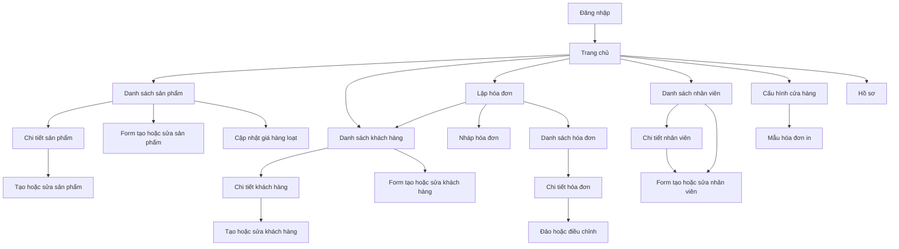

# MOBILE SCREEN FLOW VÀ API MAPPING

**Phạm vi:** Flutter app cho `TenantAdmin` và `Staff`; API v1; offline-first.
**Nguồn contract:** [API Contract](../api/api_contract.md), [OpenAPI](../api/openapi.yaml), [Business Rules](../business_rule.md), [Sync Flow](../sync/data_sync_flow_rabbitmq.md).

Tài liệu này chỉ gọi endpoint/schema đã có trong contract. Các mục ghi **GAP** là điểm chưa có contract đủ để triển khai; không tự suy diễn endpoint hoặc payload.

## 1. Phạm vi và quy tắc nền

- Hóa đơn chỉ ghi nhận giao dịch bán hàng. App không thu tiền, không ghi nhận phương thức thanh toán, và không hiển thị trạng thái đã/chưa thanh toán. Phần tiền được quản lý thủ công ngoài app.
- Không sửa/xóa hóa đơn đã đồng bộ. TenantAdmin dùng luồng đảo hóa đơn hoặc lập hóa đơn điều chỉnh; Staff chỉ tạo và xem hóa đơn trong phạm vi được phép.
- SQLite/SQLCipher là nguồn dữ liệu UI trên thiết bị. Ghi local trước; đồng bộ nền bằng outbox và giữ thay đổi khi offline.
- Mọi API thành công dùng envelope `{ data, meta }`; lỗi dùng `{ data: null, error: { code, args, fieldErrors, retryable }, meta }`. UI dịch `error.code`, không render thông điệp kỹ thuật từ server.
- Authenticated request gửi `Authorization: Bearer`, `X-Device-Id` khi contract yêu cầu, `X-Correlation-Id` nếu có, và `Accept-Language`. Tenant lấy từ JWT; không gửi/không tin `tenantId` trong payload.
- Command tạo hoặc sync có `Idempotency-Key` UUID ổn định qua retry. Với invoice, header phải bằng `clientOperationId`; retry không được tạo ID/key mới hoặc đổi payload.
- Cursor-based list dùng `cursor=` cho trang đầu, sau đó truyền `nextCursor` nguyên trạng. Không gửi `page` cùng `cursor`; khi đổi search/filter/sort phải bỏ cursor cũ.
- Decimal gửi dưới dạng JSON number, không gửi chuỗi tiền đã format theo locale. Timestamp gửi ISO 8601 UTC (`Z`). Request chỉ gửi field được schema cho phép (`additionalProperties: false` ở các schema tương ứng).
- UI mobile dùng chữ rõ, vùng chạm tối thiểu 44x44, semantic label/icon và semantic color token. Trạng thái quan trọng không được biểu đạt chỉ bằng màu.

## 2. Screen flow

`SyncStatus` là UI dùng chung trong app shell, luôn hiển thị trên mọi màn hình sau đăng nhập; đây là trạng thái/chức năng toàn cục, không phải một destination trong navigation. Chuyển sang login khi logout, token/session bị thu hồi hoặc device bị revoke.

## 3. Quy định UI đồng bộ toàn cục

Hiển thị đồng thời trạng thái mạng và trạng thái dữ liệu; online không đồng nghĩa dữ liệu đã đồng bộ.

| State local | Nhãn UI bắt buộc | Nguồn/chuyển trạng thái |
|---|---|---|
| `Draft` | Hóa đơn nháp trên thiết bị | Local only; chưa chốt để sync |
| `Pending` | Đã lưu trên thiết bị, chờ đồng bộ | Local outbox sau transaction local |
| `Sending` | Đang gửi dữ liệu | Outbox worker đang gửi request |
| `Queued` | Máy chủ đã nhận, đang xử lý | API trả `202`; chưa được báo là đồng bộ xong |
| `Synced` | Đã đồng bộ | Nhận `DataCreated` khớp `operationId` hoặc pull thấy change đã commit |
| `Failed` | Chưa đồng bộ được, cần xử lý | `CommandRejected`/lỗi nghiệp vụ; giữ dữ liệu và `LastErrorCode` |
| `Offline` | Mất kết nối; dữ liệu mới lưu trên thiết bị | Connectivity + trạng thái outbox; không được xóa pending |
| `Downloading` | Đang cập nhật dữ liệu | Đang pull/upsert changes |

Banner/status component phải giữ vị trí và kích thước ổn định giữa các state, có nhãn dễ hiểu, biểu tượng và màu tương phản. `Queued` khác `Synced`. Tap có thể mở thông tin lỗi/hoạt động gần nhất dạng dialog/bottom sheet; không yêu cầu màn hình đồng bộ riêng. Realtime dùng `DataCreated`/`CommandRejected`; SignalR chỉ báo hiệu, dữ liệu server được xác nhận qua event snapshot hoặc `GET /sync/pull?afterSequence=&limit=`. Upsert local trước khi cập nhật sequence.

`Invoice.status` trong API là `InvoiceStatus` (`Active`, `Reversed`) và mô tả trạng thái nghiệp vụ server. Trường local `syncStatus` dùng enum `Draft`, `Pending`, `Sending`, `Queued`, `Synced`, `Failed`. API không trả `syncStatus`; trạng thái online/offline và downloading là trạng thái app-wide riêng.

## 4. Mapping theo màn hình

### 4.1 Đăng nhập và phiên

**Mô tả:** Form username/password, lỗi đăng nhập dễ hiểu, trạng thái đang xác thực; sau thành công vào Home. Không lưu password; token lưu an toàn trên thiết bị.

| Hành động | API và dữ liệu |
|---|---|
| Đăng nhập | `POST /auth/login`; body `{ username, password }`; headers tùy chọn `X-Device-Id`, `X-Platform`, `X-App-Version`. |
| Nhận thành công | `data.accessToken`, `accessTokenExpiresAtUtc`, `refreshToken`, `user { id, tenantId, role, displayName }`, `device { id, isRevoked }`. `tenantId` có thể null cho SuperAdmin. |
| Gia hạn phiên | `POST /auth/refresh`; body `{ refreshToken }`; nhận access/refresh token mới. Thay refresh token cũ bằng token đã rotate. |
| Đăng xuất | `POST /auth/logout`; nhận `data.revoked`; xóa session/token local và quay về Login. |

Lỗi chính: `ERR_INVALID_CREDENTIALS`, `ERR_TENANT_INACTIVE`, `ERR_DEVICE_REVOKED`, `ERR_FORCE_UPDATE_REQUIRED`, `ERR_RATE_LIMITED`. Không đưa SuperAdmin vào tenant flow nếu app hiện chỉ phục vụ cửa hàng.

### 4.2 Trang chủ

**Mô tả:** Điều hướng tới bán hàng, hóa đơn, sản phẩm, khách hàng, nhân viên và cài đặt theo role; hiển thị SyncStatus toàn cục. Có thể hiển thị hoạt động gần đây từ local cache.

**API:** Không cần số liệu dashboard hoặc endpoint tổng hợp trong phạm vi hiện tại. Trang chủ chỉ điều hướng theo role, hiển thị SyncStatus toàn cục và có thể đọc dữ liệu local gần đây. Cấu hình effective được lấy từ `GET /settings/effective` khi cần.

### 4.3 Sản phẩm và danh mục

**Mô tả:** List có tìm tên/SKU/barcode, trạng thái loading/empty/error, filter danh mục và inactive (TenantAdmin). Detail tải record theo ID. Form create/edit validate trước lưu. Bulk price cho chọn sản phẩm, thao tác tăng/giảm, chọn phần trăm/số tiền và xem trước giá mới.

| Hành động | API và dữ liệu gửi/nhận |
|---|---|
| List/search | `GET /products?search=&cursor=&pageSize=&updatedSince=&includeInactive=`. Nhận `id, sku, barcode, name, unit, basePrice, taxRate, isActive, version, updatedAtUtc`; response list có cursor metadata. Staff chỉ thấy active. |
| Đọc detail | `GET /products/{id}`; nhận cùng Product schema với list, gồm `isActive`; Staff chỉ đọc product active, TenantAdmin đọc active/inactive. Có thể render cache trước khi response về. |
| Tạo | `POST /products` + `Idempotency-Key`; gửi `sku, barcode?, name, unit, basePrice, taxRate, categoryId?`; nhận `202` với `operationId, status=Queued`, sau đó chờ event/pull. TenantAdmin only. |
| Sửa | `PATCH /products/{id}`; gửi field cần đổi trong `name, barcode, unit, basePrice, taxRate, categoryId` và `expectedVersion`; `barcode: null` để xóa mã; nhận Product mới gồm `isActive`. TenantAdmin only. |
| Ngừng bán | `POST /products/{id}/deactivate`; gửi `{ expectedVersion }`. Dùng thay cho xóa nếu có invoice/history. |
| Xóa | `DELETE /products/{id}?expectedVersion=`; chỉ hard-delete khi chưa được tham chiếu; nếu không thì báo lỗi và hướng dẫn ngừng bán. |
| Tăng/giảm giá hàng loạt | `POST /products/bulk-price`; gửi `{ productIds, operation, mode, value, expectedVersions }`; `value > 0`; nhận danh sách Product đã cập nhật. Chỉ gọi khi TenantAdmin. |
| Danh mục | `GET /categories?search=&cursor=&pageSize=&includeInactive=`, `POST /categories`, `PATCH /categories/{id}`. Contract chưa có delete/deactivate category. |

**Lưu ý triển khai:** Backend đã có `barcode` trong create DTO; cần thêm barcode vào update DTO, `isActive` vào Product response và GET detail theo API contract. Category chưa có API detail/delete/deactivate.

### 4.4 Khách hàng

**Mô tả:** List tìm theo tên/mã/số điện thoại; detail xem thông tin và có thể chọn khách cho hóa đơn. Tạo riêng vào danh bạ; không lưu dữ liệu nhập dở của khách vào hóa đơn. TenantAdmin sửa/ngừng hoạt động/xóa theo điều kiện; Staff chỉ xem/tìm và tạo.

| Hành động | API và dữ liệu gửi/nhận |
|---|---|
| List/search | `GET /customers?search=&cursor=&pageSize=&updatedSince=&includeInactive=`. Nhận `id, code, fullName, phone, email, address, isActive, version, updatedAtUtc`; Staff chỉ active. |
| Đọc detail | `GET /customers/{id}`; nhận `Customer` đầy đủ; Staff chỉ đọc customer active, TenantAdmin đọc active/inactive. Có thể render cache trước khi response về. |
| Tạo/lưu danh bạ | `POST /customers` + `Idempotency-Key`; gửi `{ code, fullName, phone?, email?, address? }`; nhận `202 Queued`, chờ event/pull rồi mới báo hoàn tất. Staff và TenantAdmin. |
| Sửa | `PATCH /customers/{id}`; gửi field được sửa trong `fullName, phone, email, address` cùng `expectedVersion`; TenantAdmin only. |
| Ngừng hoạt động | `POST /customers/{id}/deactivate`; gửi `{ expectedVersion }`; TenantAdmin only. |
| Xóa | `DELETE /customers/{id}?expectedVersion=`; chỉ hard-delete khi chưa có invoice/history; nếu đã tham chiếu thì dùng deactivate. |

`RequireCustomerPhone` (nếu bật) được server enforce khi invoice sync; client cũng nên validate sớm nhưng không thay kiểm tra server. Invoice khách vãng lai gửi `customerId: null`, không tạo customer ngầm.

### 4.5 Lập hóa đơn, danh sách và chi tiết

**Mô tả:** Lập invoice bằng tìm/chọn product, chỉnh quantity, xem subtotal/discount/tax/rounding/total; chọn khách lưu hoặc giữ khách vãng lai. Lưu nháp local tự động. Không có vùng nhập tiền khách đưa, phương thức thu, hoặc nhãn đã/chưa thanh toán.
**Status hiển thị:** API `status` được map thành `invoiceStatus` trong model mobile (`Active` hoặc `Reversed`); `syncStatus` là trạng thái outbox local. Không gộp hai trường thành một badge và không hiển thị `Paid/Unpaid`.

| Hành động | API và dữ liệu gửi/nhận |
|---|---|
| Lưu nháp | Chỉ SQLite local; không gọi API cho draft chưa chốt. Cho phép mở lại/chỉnh sửa local draft. |
| Chốt và đưa vào outbox | Lưu invoice + details + outbox trong một transaction local; gán UUID ổn định cho invoice và `clientOperationId`. Sau đó worker gọi sync. |
| Sync Sale | `POST /invoices/sync`; header `Idempotency-Key = clientOperationId`; body `{ clientOperationId, payloadVersion: 1, invoice }`. Invoice gửi `id, invoiceNumber?, invoiceType: Sale, customerId|null, clientCreatedAtUtc, currencyCode, subtotal, discountAmount, taxAmount: 0, roundingAmount, totalAmount, details[]`. Mỗi detail gửi `lineNumber, productId, skuSnapshot, productNameSnapshot, unitSnapshot, quantity>0, unitPrice>0, discountAmount, taxRate:0, taxAmount:0, lineTotal`. |
| Nhận sync | `202` chỉ xác nhận command được queue; nhận `operationId, status=Queued`. Không báo “đã đồng bộ” tới khi `DataCreated` khớp operation hoặc pull xác nhận committed change. |
| List | `GET /invoices?search=&from=&to=&invoiceType=&cursor=&pageSize=`. Nhận summary gồm `id, invoiceNumber, invoiceType, status: InvoiceStatus, customerId, createdByUserId, clientCreatedAtUtc, syncedAtUtc, totalAmount, currencyCode, originalInvoiceId`. Staff chỉ thấy invoice mình tạo; TenantAdmin thấy tenant. |
| Detail | `GET /invoices/{id}`; nhận invoice và detail snapshots gồm mặt hàng, quantity, giá, tổng và liên kết invoice gốc nếu là reverse/correction. Staff chỉ đọc invoice do mình tạo. |
| In | Dựng bản in trên thiết bị từ invoice snapshot + `ReceiptTemplate`; không có print API. Lỗi in không đổi invoice. Không in thông tin thanh toán. |
| Sửa/xóa | Không có API edit/delete invoice. Draft local được sửa/hủy local. Invoice đã sync là immutable. |
| Đảo | TenantAdmin gọi `POST /invoices/{id}/reverse`; gửi `{ reasonCode }`, `Idempotency-Key`, `X-Device-Id`; nhận `201` operation result. Chỉ reverse một lần. |
| Điều chỉnh | TenantAdmin gọi `POST /invoices/{id}/correction`; gửi `{ reasonCode, roundingAmount?, details[] }`, `Idempotency-Key`, `X-Device-Id`; rounding mặc định `0`, total = subtotal - discount + rounding; server reverse invoice cũ và tạo correction mới atomically. |

Không gửi `invoiceType: Reverse/Correction` qua `/invoices/sync`; client chỉ sync Sale. Không cập nhật invoice đã sync bằng PATCH/DELETE. Thông tin `Paid/Unpaid` không thuộc UI hoặc model màn hình của phạm vi này.

**Lưu ý triển khai:** Backend hiện trả `Invoice.Status` dạng string; cần triển khai enum `InvoiceStatus`, lưu `syncStatus` riêng ở client, và bổ sung `roundingAmount` vào correction request/validation. Server không trả payment state.

### 4.6 Nhân viên

**Mô tả:** TenantAdmin quản lý tài khoản Staff trong tenant. List tìm theo username/display name; detail hiển thị profile, status, version và thời gian cập nhật. Form tạo có username, mật khẩu khởi tạo, tên hiển thị, email/phone; form sửa không cho đổi role/tenant/credential. Xóa chỉ khi chưa có lịch sử; nếu có dùng deactivate.

| Hành động | API và dữ liệu gửi/nhận |
|---|---|
| List | `GET /tenant/staff?search=&cursor=&pageSize=`; nhận StaffAccount, không có credential. |
| Detail | `GET /tenant/staff/{userId}`; chỉ tài khoản Staff thuộc tenant hiện tại. |
| Tạo | `POST /tenant/staff`; gửi `{ username, initialPassword, displayName, email?, phone? }`; nhận `201 StaffAccount`. Không giữ/trả password. |
| Sửa | `PATCH /tenant/staff/{userId}`; gửi `{ username, displayName, email?, phone?, expectedVersion }`; nhận StaffAccount mới. |
| Ngừng hoạt động | `POST /tenant/staff/{userId}/deactivate`; revoke session/device và nhận status `Inactive`. |
| Xóa | `DELETE /tenant/staff/{userId}`; hard-delete chỉ khi không có lịch sử/dependency; nếu không phải deactivate. |

`StaffAccount` nhận: `id, tenantId, username, displayName, email, phone, status, version, createdAtUtc, updatedAtUtc`. Không có API cho TenantAdmin thay đổi role hoặc mật khẩu Staff sau tạo trong contract hiện tại.

### 4.7 Cấu hình cửa hàng và mẫu in

**Mô tả:** TenantAdmin xem thông tin cửa hàng, cấu hình nội dung mẫu hóa đơn và xem preview render local. Máy in/Bluetooth được cấu hình và gọi tại thiết bị; không có server print API. Nhân viên có thể in theo quyền nhưng không sửa cấu hình.

| Hành động | API và dữ liệu gửi/nhận |
|---|---|
| Nạp cấu hình | `GET /settings/effective`; nhận `storeProfile`, `receiptTemplate`, `productDisplay`, feature flags và `settingsVersion`. |
| Sửa thông tin cửa hàng | `PUT /settings/StoreProfile`; body `{ value: { storeName, address?, phone?, taxCode? }, expectedVersion }`. |
| Sửa mẫu in | `PUT /settings/ReceiptTemplate`; body `{ value: { templateId, showStoreAddress, showTaxBreakdown, footerText? }, expectedVersion }`; `templateId` phải là template app hỗ trợ. |
| Lưu tùy chọn hiển thị sản phẩm | `PUT /settings/ProductDisplay`; body `{ value: { layout, sortBy, showSku, showBarcode, showCategory }, expectedVersion }`. |

Sau PUT dùng response để cập nhật cache hoặc đọc lại `/settings/effective`. `RequireCustomerPhone`, Bluetooth và rounding flags chỉ được bật/hiển thị theo giá trị effective; client UI không thay thế enforcement server. Preview/in là local rendering.

### 4.8 Hồ sơ cá nhân

**Mô tả:** Hiển thị username, tên, email, điện thoại và role/status hiện tại. TenantAdmin/Staff chỉ sửa hồ sơ của chính mình; không sửa role, tenant, status hoặc credential.

| Hành động | API và dữ liệu gửi/nhận |
|---|---|
| Xem | `GET /me`; nhận `id, tenantId, username, displayName, email, phone, role, status, version, createdAtUtc, updatedAtUtc`. |
| Cập nhật | `PATCH /me`; gửi `{ username, displayName, email, phone, expectedVersion }`; email/phone nullable để xóa giá trị. Nhận UserProfile mới. Username trùng trả `ERR_DUPLICATE_USERNAME`; version cũ trả `ERR_VERSION_CONFLICT`. |

Password change không thuộc hồ sơ trong contract hiện tại; cần API riêng nếu bổ sung chức năng đổi mật khẩu.

## 5. Hợp đồng dữ liệu và xử lý lỗi dùng chung

- Collection/query response: render `data`; cursor lấy từ `meta.paging.nextCursor`, `hasMore`, `pageSize`. Không tải toàn bộ danh sách; giữ nguyên scroll và deduplicate theo ID.
- Mutation đồng bộ ngay: chỉ báo thành công theo response `200/201`. Mutation trả `202` hiển thị “đang xử lý”, giữ operation ID và đợi event/pull.
- Offline mutation: ghi entity + outbox atomically trước; retry transient bằng cùng operation ID/key/payload. Lỗi nghiệp vụ không retry vô hạn; giữ form/dữ liệu và hiển thị lỗi đã localization.
- `409 ERR_VERSION_CONFLICT`: giữ nội dung người dùng nhập; tải/nhận version mới và yêu cầu xử lý conflict, không tự ghi đè.
- `401 ERR_DEVICE_REVOKED` hoặc session revoked: dừng worker, xử lý local data theo security policy, xóa token và đưa về Login.
- `403 ERR_ACCESS_DENIED`: ẩn/disable action theo role để dễ dùng, nhưng luôn xử lý response server nếu quyền đã đổi.
- Unknown enum/status: map về trạng thái “Không xác định” an toàn; không crash, không suy ra đã đồng bộ/thanh toán.
- Server error UI dùng `error.code`, `args`, `fieldErrors`, `retryable`; map catalog sang `vi.json`/`en.json`. Không hiện stack trace hoặc `message` kỹ thuật.

## 6. API gaps cần đóng trước khi làm màn hình liên quan

| Gap | Màn hình bị ảnh hưởng | Điều cần quyết định |
|---|---|---|
| Category không có delete/deactivate | Danh mục | Không hiển thị thao tác xóa cho đến khi có contract và rule lịch sử. |
| SignalR hub URL/method handshake chưa khai báo trong OpenAPI | SyncStatus | Chốt hub URL, event payload/version/auth/reconnect; sync doc mới nêu event names. |
| Backend chưa triển khai GET detail, `/me`, barcode update, Product `isActive`, invoice status split và correction rounding theo contract | Sản phẩm/khách hàng/hóa đơn/hồ sơ | Cập nhật implementation, authorization, DTO/response, persistence nếu cần và integration tests trước khi bật UI. |

Trang chủ không cần dashboard summary trong phạm vi hiện tại. Các API mới được mô tả ở đây là contract đích; UI chỉ gọi sau khi backend triển khai và contract tests xác nhận.

## 7. Acceptance checklist khi triển khai

- [ ] Mỗi request/response khớp schema OpenAPI; không gửi field ngoài contract.
- [ ] Kiểm thử role `Staff`/`TenantAdmin`, tenant isolation và trạng thái inactive.
- [ ] Tạo/sync command có idempotency; retry không nhân đôi; `Queued` không hiện là hoàn tất.
- [ ] Invoice draft/sync/reject/reverse giữ đúng immutable rule; không có UI payment status.
- [ ] SyncStatus luôn thấy được ở mọi route authenticated, dễ đọc, không phụ thuộc riêng màu sắc.
- [ ] List dùng cursor; đổi filter/search reset cursor; local pending không bị server response ghi đè.
- [ ] Error code được localization trong tiếng Việt/Anh; test màn hình nhỏ, text lớn và trạng thái loading/empty/error.
- [ ] Contract gaps trong mục 6 được ghi nhận; không tự thêm API/payload tại frontend.