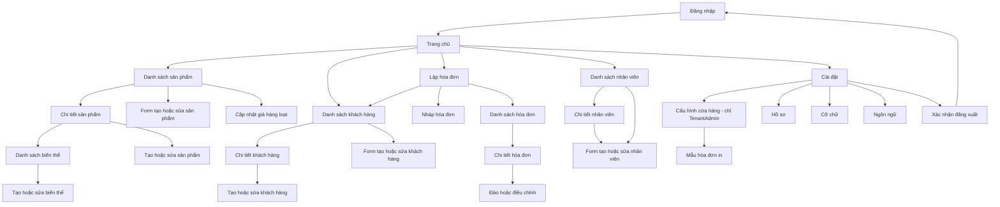

# MOBILE SCREEN FLOW VÀ API MAPPING

**Phạm vi:** Flutter app cho `TenantAdmin` và `Staff`; API v1; offline-first.
**Nguồn contract:** [API Contract](../api/api_contract.md), [OpenAPI](../api/openapi.yaml), [Business Rules](../business_rule.md), [Sync Flow](../sync/data_sync_flow_rabbitmq.md).

Tài liệu này chỉ gọi endpoint/schema đã có trong contract. Các mục ghi **GAP** là điểm chưa có contract đủ để triển khai; không tự suy diễn endpoint hoặc payload.

## 1. Phạm vi và quy tắc nền

- Hóa đơn chỉ ghi nhận giao dịch bán hàng. App không thu tiền, không ghi nhận phương thức thanh toán, và không hiển thị trạng thái đã/chưa thanh toán. Phần tiền được quản lý thủ công ngoài app.
- Không sửa/xóa hóa đơn đã đồng bộ. TenantAdmin dùng luồng đảo hóa đơn hoặc lập hóa đơn điều chỉnh; Staff chỉ tạo và xem hóa đơn trong phạm vi được phép.
- SQLite/SQLCipher là nguồn dữ liệu UI trên thiết bị. Ghi local trước; đồng bộ nền bằng outbox và giữ thay đổi khi offline.
- Mọi API thành công dùng envelope `{ data, meta }`; lỗi dùng `{ data: null, error: { code, args, fieldErrors, retryable }, meta }`. UI dịch `error.code`, không render thông điệp kỹ thuật từ server.
- Authenticated request gửi `Authorization: Bearer`, `X-Device-Id` khi contract yêu cầu, `X-Correlation-Id` nếu có, và `Accept-Language`. Tenant lấy từ JWT; không gửi/không tin `tenantId` trong payload.
- Command tạo hoặc sync có `Idempotency-Key` UUID ổn định qua retry. Với invoice, header phải bằng `clientOperationId`; retry không được tạo ID/key mới hoặc đổi payload.
- Cursor-based list dùng `cursor=` cho trang đầu, sau đó truyền `nextCursor` nguyên trạng. Không gửi `page` cùng `cursor`; khi đổi search/filter/sort phải bỏ cursor cũ.
- Decimal gửi dưới dạng JSON number, không gửi chuỗi tiền đã format theo locale. Timestamp gửi ISO 8601 UTC (`Z`). Request chỉ gửi field được schema cho phép (`additionalProperties: false` ở các schema tương ứng).
- UI mobile dùng chữ rõ, vùng chạm tối thiểu 44x44, semantic label/icon và semantic color token. Trạng thái quan trọng không được biểu đạt chỉ bằng màu.

## 2. Screen flow

`SyncStatus` là UI dùng chung trong app shell, luôn hiển thị trên mọi màn hình sau đăng nhập; đây là trạng thái/chức năng toàn cục, không phải một destination trong navigation. Chuyển sang login khi logout, token/session bị thu hồi hoặc device bị revoke.

Từ Home có lối vào **Cài đặt > Hiển thị và cỡ chữ** dành cho Staff/TenantAdmin; màn hình Login cũng có lối vào tùy chọn hiển thị. Cỡ chữ và ngôn ngữ là cài đặt local trên thiết bị, tách khỏi Cấu hình cửa hàng và không yêu cầu API.

## 3. Quy định UI đồng bộ toàn cục

Hiển thị đồng thời trạng thái mạng và trạng thái dữ liệu; online không đồng nghĩa dữ liệu đã đồng bộ.

| State local | Nhãn UI bắt buộc | Nguồn/chuyển trạng thái |
|---|---|---|
| `Draft` | Hóa đơn nháp trên thiết bị | Local only; chưa chốt để sync |
| `Pending` | Đã lưu trên thiết bị, chờ đồng bộ | Local outbox sau transaction local |
| `Sending` | Đang gửi dữ liệu | Outbox worker đang gửi request |
| `Queued` | Máy chủ đã nhận, đang xử lý | API trả `202`; chưa được báo là đồng bộ xong |
| `Synced` | Đã đồng bộ | Nhận `DataCreated` khớp `operationId` hoặc pull thấy change đã commit |
| `Failed` | Chưa đồng bộ được, cần xử lý | `CommandRejected`/lỗi nghiệp vụ; giữ dữ liệu và `LastErrorCode` |
| `Offline` | Mất kết nối; dữ liệu mới lưu trên thiết bị | Connectivity + trạng thái outbox; không được xóa pending |
| `Downloading` | Đang cập nhật dữ liệu | Đang pull/upsert changes |

Banner/status component phải giữ vị trí và kích thước ổn định giữa các state, có nhãn dễ hiểu, biểu tượng và màu tương phản. `Queued` khác `Synced`. Tap có thể mở thông tin lỗi/hoạt động gần nhất dạng dialog/bottom sheet; không yêu cầu màn hình đồng bộ riêng. Realtime dùng `DataCreated`/`CommandRejected`; SignalR chỉ báo hiệu, dữ liệu server được xác nhận qua event snapshot hoặc `GET /sync/pull?afterSequence=&limit=`. Upsert local trước khi cập nhật sequence.

**Giới hạn implementation hiện tại:** Home đổi nhãn kết nối theo trạng thái SignalR (`connected` hoặc mất kết nối/đang kết nối lại), chưa có bộ theo dõi Wi-Fi/mobile data riêng và chưa có banner kết nối toàn cục trên các route Settings. Refresh API lỗi giữ nội dung Home đã tải; lỗi lưu hồ sơ/cấu hình giữ form. Kiểm thử lỗi API giả lập không thay thế kiểm thử mất kết nối thật. Khi debug Android qua USB với `adb reverse tcp:5099 tcp:5099`, tắt Wi-Fi/mobile data vẫn có thể gọi backend qua USB; cần ngắt đường forwarding để kiểm thử backend không truy cập được, rồi khôi phục sau khi test.

`Invoice.status` trong API là `InvoiceStatus` (`Active`, `Reversed`) và mô tả trạng thái nghiệp vụ server. Trường local `syncStatus` dùng enum `Draft`, `Pending`, `Sending`, `Queued`, `Synced`, `Failed`. API không trả `syncStatus`; trạng thái online/offline và downloading là trạng thái app-wide riêng.

## 4. Mapping theo màn hình

### 4.1 Đăng nhập và phiên

**Mô tả:** Form username/password, lỗi đăng nhập dễ hiểu, trạng thái đang xác thực; sau thành công vào Home. Không lưu password; token lưu an toàn trên thiết bị.

| Hành động | API và dữ liệu |
|---|---|
| Đăng nhập | `POST /auth/login`; body `{ username, password }`; headers tùy chọn `X-Device-Id`, `X-Platform`, `X-App-Version`. |
| Nhận thành công | `data.accessToken`, `accessTokenExpiresAtUtc`, `refreshToken`, `user { id, tenantId, role, displayName }`, `device { id, isRevoked }`. `tenantId` có thể null cho SuperAdmin. |
| Gia hạn phiên | `POST /auth/refresh`; body `{ refreshToken }`; nhận access/refresh token mới. Thay refresh token cũ bằng token đã rotate. |
| Đăng xuất | `POST /auth/logout`; nhận `data.revoked`; xóa session/token local và quay về Login. |

Lỗi chính: `ERR_INVALID_CREDENTIALS`, `ERR_TENANT_INACTIVE`, `ERR_DEVICE_REVOKED`, `ERR_FORCE_UPDATE_REQUIRED`, `ERR_RATE_LIMITED`. Không đưa SuperAdmin vào tenant flow nếu app hiện chỉ phục vụ cửa hàng.

**Đã triển khai UI:** Login dùng Cubit cho submitting/success/failure; validate username/password bắt buộc, username tối đa 120 ký tự; trim username nhưng không trim password. Có hiện/ẩn mật khẩu, autofill, đổi vi/en, chặn submit lặp và giữ dữ liệu khi đăng nhập lỗi. Lỗi field/credentials/network hiển thị tại form; tenant inactive/device revoked/force-update/access denied dùng thêm `AppDialog` qua `forui`, không tự đóng khi chạm ngoài. Chỉ vào Home sau repository hoàn tất, không tự retry đăng nhập.

Form neo phía trên thay vì căn giữa lại theo chiều cao nội dung. Khi gửi request, giữ nguyên field/controller/focus và bàn phím; không disable/re-enable field hoặc đổi kích thước nút. Nút submit khóa lặp, có vùng tiến trình giữ chỗ; lỗi chung nằm sau nút nên không đẩy các ô nhập/nút lên xuống. Lỗi field dài vẫn được phép làm vùng validation tăng chiều cao để đọc đủ nội dung. Rebuild widget theo state là bình thường, nhưng không được remount/reset form hoặc thay toàn màn hình bằng loading khi retry/thất bại. Thành công chỉ chuyển Login sang Home sau khi lưu token.

Kết nối backend local qua Android USB cần `adb reverse tcp:5099 tcp:5099` trước khi dùng `API_BASE_URL=http://127.0.0.1:5099/api/v1`. Cấu hình chạy từ workspace và smoke test backend thật được hướng dẫn trong [Mobile README](../../mobile/README.md#run-on-android-or-a-usb-connected-device).

Login có lối vào Hiển thị và cỡ chữ; Home có cùng lối vào trên app bar cho mọi role đang hỗ trợ. Shared preference lưu local các preset system/large/extra_large; root `TextScaler` áp dụng đúng một lần cho mọi route/overlay. Cấu hình màu dialog lấy từ theme app, chữ từ typography chung.

**Duy trì phiên:** Repository từ chối tài khoản ngoài Staff/TenantAdmin trước khi lưu; secure storage giữ access token, refresh token và thời điểm hết hạn trong một session record. Trước request API hoặc kết nối lại SignalR, tự refresh nếu access token sắp hết hạn trong 30 giây. Request nhận 401 được refresh và gửi lại tối đa một lần, giữ nguyên payload/idempotency key; các request đồng thời dùng chung một refresh để tránh rotate trùng. Lỗi mạng giữ phiên để thử lại. Refresh bị từ chối hoặc tenant/device bị khóa/thu hồi xóa token, dừng realtime và chuyển về Login kể cả khi đang mở editor. Logout xóa cả access/refresh token; không lưu mật khẩu. Session cũ chỉ có access token không thể tự khôi phục refresh token: khi token đó hết hạn phải đăng nhập lại một lần. `HOME_PREVIEW=true` vẫn bỏ qua Login theo cơ chế preview hiện có.

### 4.2 Trang chủ

**Mô tả:** Điều hướng tới bán hàng, hóa đơn, sản phẩm, khách hàng, nhân viên và cài đặt theo role; hiển thị SyncStatus toàn cục. Có thể hiển thị hoạt động gần đây từ local cache.

**Đã triển khai:** Home hiển thị `Xin chào {displayName}` lấy từ `GET /me` và thẻ tenant từ `GET /tenant/profile`: tên, mã, trạng thái, tiền tệ, múi giờ. Tenant của hồ sơ phải khớp metadata; không dùng dữ liệu của tenant khác. Đọc `GET /settings/effective` để hiển thị cấu hình effective. Không cần API tổng hợp/dashboard mới.

Ba response khởi động được lưu bền trong bảng SQLCipher `account_snapshots`, khóa `(tenant_id, user_id, resource)`, sau khi kiểm tra contract và identity. Khi lỗi kết nối/timeout hoặc HTTP 502/503/504, kể cả lỗi mạng lúc tự refresh token, app khởi động bằng snapshot đúng tài khoản và báo dữ liệu chưa cập nhật thay vì lỗi toàn màn hình. Decode JWT lưu trong secure storage chỉ chọn partition local, không cấp quyền. HTTP 401/403, session bị thu hồi, response sai contract hoặc sai identity không được fallback cache. Thiết bị/tài khoản chưa từng tải đủ ba response online vẫn cần kết nối lần đầu; không tạo hồ sơ hoặc cấu hình giả. PATCH hồ sơ thành công cập nhật snapshot để lần mở offline giữ đúng tên mới.

Refresh hoặc lưu hồ sơ/cấu hình thành công tải lại Home nhưng giữ nội dung đã có trong khi chờ; khi refresh lỗi, giữ dữ liệu cũ và báo chưa cập nhật được. Lần tải đầu lỗi có nút thử lại. Lối vào Cài đặt ở app bar và ô chức năng cùng mở một màn hình. Lưới chức năng chuyển sang danh sách khi chữ lớn hoặc màn hình hẹp.

### 4.3 Sản phẩm và danh mục

**Mô tả:** Product là nhóm hàng gốc; `ProductVariant` mới là mặt hàng được chọn để bán và mang SKU, barcode, đơn vị, giá, trạng thái active cùng thuộc tính riêng. Ví dụ product `Sắt hộp 30x60` có variant `Hòa Phát` và `Việt Nhật`, mỗi variant có SKU/giá riêng; độ dày/thương hiệu đặt trong `extraData.attributes` khi cần. Product list có trạng thái loading/empty/error, filter danh mục và inactive (TenantAdmin); detail tải product và danh sách variants. Staff chỉ chọn variant active; TenantAdmin quản lý vòng đời product/variant.

| Hành động | API và dữ liệu gửi/nhận |
|---|---|
| List/search nhóm hàng | `GET /products?search=&cursor=&pageSize=&updatedSince=&includeInactive=`. Nhận product gốc `id, sku, barcode, name, unit, basePrice, taxRate, isActive, version, updatedAtUtc`; response list có cursor metadata. Search API hiện dùng tên/SKU/barcode legacy của product, chưa tìm xuyên qua SKU/barcode variant. Không dùng trường legacy để quyết định giá khi variant đã tải. |
| Đọc product và variants | `GET /products/{productId}` rồi `GET /products/{productId}/variants?includeInactive=`. Variant có `id, productId, sku, barcode, name, unit, basePrice, taxRate, isActive, version, extraData, updatedAtUtc`. `includeInactive=true` chỉ cho TenantAdmin. Cache riêng product và variant theo ID; ghép danh sách variant vào product theo `productId`. |
| Chọn mặt hàng bán | Chỉ cho chọn variant active thuộc product active. Hiển thị tên product + nhãn variant (nếu có), SKU, đơn vị và giá của chính variant. `extraData` theo object `{ schemaVersion: 1, attributes: {...} }`; render thuộc tính đã biết, giữ nguyên key/type chưa biết thay vì parse thành các field cố định. |
| Tạo product gốc | `POST /products` + `Idempotency-Key`; gửi `sku, barcode?, name, unit, basePrice, taxRate, categoryId?`; nhận `202` với `operationId, status=Queued`. Backend đồng thời tạo default variant có `id = productId`. Sau `DataCreated`/pull, tải lại `GET /products/{id}/variants` để đồng bộ variant; không tự tạo variant thứ hai chỉ vì event product chưa chứa collection. TenantAdmin only. |
| Tạo variant | `POST /products/{productId}/variants`; gửi `{ sku, barcode?, name?, unit, basePrice, taxRate: 0, extraData? }`; giá > 0; `extraData` tối đa 16 KiB và có `schemaVersion: 1`, `attributes` object. Trả `201` với variant mới và Location. TenantAdmin only. |
| Sửa product gốc | `PATCH /products/{productId}`; gửi field cần đổi trong `name, barcode, unit, basePrice, taxRate, categoryId` và `expectedVersion`. Các trường legacy được giữ để tương thích; chỉnh `basePrice/unit/barcode` ở product sẽ đồng bộ lên default variant, không sửa các variant khác. |
| Sửa variant | `PATCH /products/{productId}/variants/{variantId}`; gửi `{ sku, barcode, name, unit, basePrice, taxRate, extraData, expectedVersion }`; `barcode: null` xóa barcode, `extraData: null` xóa thuộc tính. Xử lý `409 ERR_VERSION_CONFLICT` bằng tải lại bản mới và yêu cầu người dùng xử lý conflict; không tự retry ghi. TenantAdmin only. |
| Ngừng bán | `POST /products/{productId}/variants/{variantId}/deactivate` + `{ expectedVersion }`. Không cho tắt variant active cuối cùng khi product còn active. Product có thể ngừng bán qua `POST /products/{productId}/deactivate`; xóa cứng chỉ khi chưa có lịch sử hóa đơn. |
| Tăng/giảm giá hàng loạt | `POST /products/bulk-price`; chọn `productIds` để đổi giá gốc (đồng bộ default variant), `variantIds` để đổi giá của các variant đã chọn, hoặc gửi cả hai để đổi chung trong một transaction. Gửi `expectedVersions` và `variantExpectedVersions` tương ứng; `value > 0`. Nhận `products` và `variants` đã đổi. Nếu product và default variant được chọn đồng thời, server điều chỉnh giá dùng chung một lần; các variant còn lại được điều chỉnh riêng. |
| Danh mục | `GET /categories?search=&cursor=&pageSize=&includeInactive=`, `POST /categories`, `PATCH /categories/{id}`. Contract chưa có delete/deactivate category. |

**Offline/local database:** Bản local phải lưu product gốc và variants thành hai loại record riêng, có index theo tenant/product và giữ nguyên `ExtraData` JSON. Chọn hàng, giá, đơn vị và snapshot invoice lấy từ variant; không suy diễn variant từ tên/giá. Mọi catalog change từ pull phải upsert đúng loại entity và tenant trước khi cập nhật sequence.

Giá trị `extraData` backfill từ catalog cũ có thể chưa theo `schemaVersion: 1`. Khi đọc, giữ nguyên JSON chưa biết schema; không tự xóa hoặc ghi đè. Nếu giá trị cũ là object, chỉ wrap thành `{ schemaVersion: 1, attributes: <legacy object> }` khi người dùng chủ động sửa và lưu, để bảo toàn các key cũ. Nếu không phải object, yêu cầu luồng chuyển đổi rõ ràng thay vì tự bỏ dữ liệu.

**GAP frontend:** Backend API variant đã có, nhưng mobile chưa tích hợp list/detail/create/edit/deactivate variant, local schema/migration và catalog pull/upsert. Trước khi bật chọn variant offline, triển khai đầy đủ các phần này và bảo đảm client cũ vẫn đọc legacy product/default variant.

**GAP API tìm kiếm:** `GET /products?search=` chưa tìm SKU/barcode của các variant không phải default. Cho đến khi có endpoint/filter variant-aware, mobile không được tuyên bố tìm catalog server-side là đầy đủ theo SKU mọi variant; tìm local chỉ bảo đảm trên catalog đã cache và phải thể hiện trạng thái tải dữ liệu.

### 4.4 Khách hàng

**Mô tả:** List tìm theo tên/mã/số điện thoại; detail xem thông tin và có thể chọn khách cho hóa đơn. Tạo riêng vào danh bạ; không lưu dữ liệu nhập dở của khách vào hóa đơn. TenantAdmin sửa/ngừng hoạt động/xóa theo điều kiện; Staff chỉ xem/tìm và tạo.

| Hành động | API và dữ liệu gửi/nhận |
|---|---|
| List/search | `GET /customers?search=&cursor=&pageSize=&updatedSince=&includeInactive=`. Nhận `id, code, fullName, phone, email, address, isActive, version, updatedAtUtc`; Staff chỉ active. |
| Đọc detail | `GET /customers/{id}`; nhận `Customer` đầy đủ; Staff chỉ đọc customer active, TenantAdmin đọc active/inactive. Có thể render cache trước khi response về. |
| Tạo/lưu danh bạ | `POST /customers` + `Idempotency-Key`; gửi `{ code, fullName, phone?, email?, address? }`; nhận `202 Queued`, chờ event/pull rồi mới báo hoàn tất. Staff và TenantAdmin. |
| Sửa | `PATCH /customers/{id}`; gửi field được sửa trong `fullName, phone, email, address` cùng `expectedVersion`; TenantAdmin only. |
| Ngừng hoạt động | `POST /customers/{id}/deactivate`; gửi `{ expectedVersion }`; TenantAdmin only. |
| Xóa | `DELETE /customers/{id}?expectedVersion=`; chỉ hard-delete khi chưa có invoice/history; nếu đã tham chiếu thì dùng deactivate. |

`RequireCustomerPhone` (nếu bật) được server enforce khi invoice sync; client cũng nên validate sớm nhưng không thay kiểm tra server. Invoice khách vãng lai gửi `customerId: null`, không tạo customer ngầm.

### 4.5 Lập hóa đơn, danh sách và chi tiết

**Mô tả:** Lập invoice bằng tìm/chọn product, chỉnh quantity, xem subtotal/discount/tax/rounding/total; chọn khách lưu hoặc giữ khách vãng lai. Lưu nháp local tự động. Không có vùng nhập tiền khách đưa, phương thức thu, hoặc nhãn đã/chưa thanh toán.
**Status hiển thị:** API `status` được map thành `invoiceStatus` trong model mobile (`Active` hoặc `Reversed`); `syncStatus` là trạng thái outbox local. Không gộp hai trường thành một badge và không hiển thị `Paid/Unpaid`.

| Hành động | API và dữ liệu gửi/nhận |
|---|---|
| Lưu nháp | Chỉ SQLite local; không gọi API cho draft chưa chốt. Cho phép mở lại/chỉnh sửa local draft. |
| Chốt và đưa vào outbox | Lưu invoice + details + outbox trong một transaction local; gán UUID ổn định cho invoice và `clientOperationId`. Mỗi detail giữ `productId` (product gốc), `productVariantId` (variant bán được), SKU/tên/unit/giá cùng snapshot thuộc tính lúc chốt. Sau đó worker gọi sync. |
| Sync Sale | `POST /invoices/sync`; header `Idempotency-Key = clientOperationId`; body `{ clientOperationId, payloadVersion: 1, invoice }`. Invoice gửi `id, invoiceNumber?, invoiceType: Sale, customerId|null, clientCreatedAtUtc, currencyCode, subtotal, discountAmount, taxAmount: 0, roundingAmount, totalAmount, details[]`. Mỗi detail gửi `lineNumber, productId, productVariantId, skuSnapshot, productNameSnapshot` (tên product gốc), `variantNameSnapshot?`, `unitSnapshot`, `quantity>0, unitPrice>0, discountAmount, taxRate:0, taxAmount:0, lineTotal`. `variantExtraDataSnapshot` được server lấy từ catalog và lưu; không gửi `ExtraData` tùy ý trong line. |
| Giá/variant stale | Server đối chiếu variant ID thuộc product, active state, SKU/tên/unit/giá với catalog lúc sync. Nếu catalog đã đổi khiến line không hợp lệ, giữ invoice local ở trạng thái lỗi nghiệp vụ, hiển thị lỗi có thể xử lý và không xóa/ghi đè snapshot/draft; yêu cầu tải catalog mới và cho người dùng xác nhận chỉnh invoice rồi tạo operation mới theo quy tắc retry/idempotency. |
| Nhận sync | `202` chỉ xác nhận command được queue; nhận `operationId, status=Queued`. Không báo “đã đồng bộ” tới khi `DataCreated` khớp operation hoặc pull xác nhận committed change. |
| List | `GET /invoices?search=&from=&to=&invoiceType=&cursor=&pageSize=`. Nhận summary gồm `id, invoiceNumber, invoiceType, status: InvoiceStatus, customerId, createdByUserId, clientCreatedAtUtc, syncedAtUtc, totalAmount, currencyCode, originalInvoiceId`. Staff chỉ thấy invoice mình tạo; TenantAdmin thấy tenant. |
| Detail | `GET /invoices/{id}`; nhận invoice và detail snapshots gồm `productId, productVariantId, skuSnapshot, productNameSnapshot, variantNameSnapshot, variantExtraDataSnapshot, unitSnapshot`, quantity, giá, tổng và liên kết invoice gốc nếu là reverse/correction. Render invoice từ snapshot, không lookup giá/tên hiện tại để thay đổi lịch sử. Staff chỉ đọc invoice do mình tạo. |
| In | Dựng bản in trên thiết bị từ invoice snapshot + `ReceiptTemplate`; không có print API. Lỗi in không đổi invoice. Không in thông tin thanh toán. |
| Sửa/xóa | Không có API edit/delete invoice. Draft local được sửa/hủy local. Invoice đã sync là immutable. |
| Đảo | TenantAdmin gọi `POST /invoices/{id}/reverse`; gửi `{ reasonCode }`, `Idempotency-Key`, `X-Device-Id`; nhận `201` operation result. Chỉ reverse một lần. |
| Điều chỉnh | TenantAdmin gọi `POST /invoices/{id}/correction`; gửi `{ reasonCode, roundingAmount?, details[] }`, `Idempotency-Key`, `X-Device-Id`; rounding mặc định `0`, total = subtotal - discount + rounding; server reverse invoice cũ và tạo correction mới atomically. |

Không gửi `invoiceType: Reverse/Correction` qua `/invoices/sync`; client chỉ sync Sale. Không cập nhật invoice đã sync bằng PATCH/DELETE. Thông tin `Paid/Unpaid` không thuộc UI hoặc model màn hình của phạm vi này.

**Lưu ý triển khai:** Lưu `invoiceStatus` riêng với `syncStatus` local. Correction dùng cùng snapshot variant trong details; server reverse invoice gốc và tạo correction atomically. Server không trả payment state. Legacy client có thể bỏ `productVariantId`/`variantNameSnapshot`; backend ánh xạ sang default variant, nhưng client mới phải luôn gửi ID variant đã chọn.

### 4.6 Nhân viên

**Mô tả:** TenantAdmin quản lý tài khoản Staff trong tenant. List tìm theo username/display name; detail hiển thị profile, status, version và thời gian cập nhật. Form tạo có username, mật khẩu khởi tạo, tên hiển thị, email/phone; form sửa không cho đổi role/tenant/credential. Xóa chỉ khi chưa có lịch sử; nếu có dùng deactivate.

| Hành động | API và dữ liệu gửi/nhận |
|---|---|
| List | `GET /tenant/staff?search=&cursor=&pageSize=`; nhận StaffAccount, không có credential. |
| Detail | `GET /tenant/staff/{userId}`; chỉ tài khoản Staff thuộc tenant hiện tại. |
| Tạo | `POST /tenant/staff`; gửi `{ username, initialPassword, displayName, email?, phone? }`; nhận `201 StaffAccount`. Không giữ/trả password. |
| Sửa | `PATCH /tenant/staff/{userId}`; gửi `{ username, displayName, email?, phone?, expectedVersion }`; nhận StaffAccount mới. |
| Ngừng hoạt động | `POST /tenant/staff/{userId}/deactivate`; revoke session/device và nhận status `Inactive`. |
| Xóa | `DELETE /tenant/staff/{userId}`; hard-delete chỉ khi không có lịch sử/dependency; nếu không phải deactivate. |

`StaffAccount` nhận: `id, tenantId, username, displayName, email, phone, status, version, createdAtUtc, updatedAtUtc`. Không có API cho TenantAdmin thay đổi role hoặc mật khẩu Staff sau tạo trong contract hiện tại.

### 4.7 Cấu hình cửa hàng và mẫu in

**Mô tả:** TenantAdmin xem thông tin cửa hàng, cấu hình nội dung mẫu hóa đơn và xem preview render local. Máy in/Bluetooth được cấu hình và gọi tại thiết bị; không có server print API. Nhân viên có thể in theo quyền nhưng không sửa cấu hình.

| Hành động | API và dữ liệu gửi/nhận |
|---|---|
| Nạp metadata cửa hàng | `GET /tenant/profile`; TenantAdmin/Staff nhận `id, code, name, status, timeZone, currencyCode, version, createdAtUtc, updatedAtUtc` từ tenant trong JWT; không truyền tenant ID. |
| Nạp cấu hình | `GET /settings/effective`; nhận `storeProfile`, `receiptTemplate`, `productDisplay`, feature flags, `settingsVersion` và `settingVersions` cho từng key có thể sửa. |
| Sửa thông tin cửa hàng | `PUT /settings/StoreProfile`; body `{ value: { storeName, address?, phone?, taxCode? }, expectedVersion }`. |
| Sửa mẫu in | `PUT /settings/ReceiptTemplate`; body `{ value: { templateId, showStoreAddress, showTaxBreakdown, footerText?, layout? }, expectedVersion }`; `templateId` là `Standard`, layout version 1 được mô tả ở mục 4.7.1. |
| Lưu tùy chọn hiển thị sản phẩm | `PUT /settings/ProductDisplay`; body `{ value: { layout, sortBy, showSku, showBarcode, showCategory }, expectedVersion }`. |

**Đã triển khai:** Menu và editor chỉ hiện cho TenantAdmin; Cubit chặn thao tác ghi của Staff và backend vẫn enforce quyền. Có lưu riêng từng nhóm StoreProfile, ReceiptTemplate (chỉ Standard), ProductDisplay và hai switch `AutoRoundMoney`/`EnableBluetoothPrint`; cache và bản nháp được tenant-scope trong SQLite/SQLCipher, ProductDisplay và ReceiptTemplate dùng chung cơ chế local-first như các setting tenant khác. Không cho sửa `RequireCustomerPhone` hoặc global flags. Metadata tenant là chỉ đọc; StoreProfile chỉ đổi thông tin hiển thị/in, không đổi tên/mã tenant. Chưa có local business repository/CRUD cho product, invoice hoặc customer; đây chỉ là persistence cho tenant configuration hiện có.

Mỗi PUT gửi `expectedVersion = settingVersions[key]`, dùng `0` khi tenant chưa có override; **không dùng aggregate `settingsVersion`** hoặc version của global setting. Response cập nhật value/version của đúng key, giữ nội dung chưa lưu ở nhóm khác. Backend thiếu metadata thì editor báo lỗi rõ, không đoán version. Deploy backend bổ sung metadata trước khi bật mobile editor.

Tenant configuration được cache trong SQLite/SQLCipher ở bảng `tenant_settings_cache`, khóa theo `(TenantId, setting key)` và lưu riêng version, JSON value, trạng thái pending. Tải cấu hình luôn thử server trước; khi lỗi kết nối có cache thì dùng bản local và báo rõ dữ liệu có thể cũ. Mỗi lần lưu, app ghi bản nháp local trước rồi mới gọi `PUT`; nếu request thất bại, giữ nháp và cho người dùng thử lưu lại. Không có background outbox cho setting: server chỉ được báo đã lưu khi PUT thành công. Nếu server trả conflict, nháp local được giữ; thao tác tải bản mới nhất phải được xác nhận và chỉ xóa nháp sau khi tải server thành công. Cache có tenant isolation, không dùng để cấp quyền; backend vẫn enforce role/tenant/version. `RequireCustomerPhone` và global flags vẫn là cấu hình server chỉ đọc, không được biến thành tenant override.

Snapshot `settings/effective` tải từ Home dùng chung cho editor: nếu chưa từng mở editor online, vẫn có thể mở lần đầu offline từ snapshot này. Bản local của editor (gồm value/version đã xác nhận và pending draft) được ưu tiên hơn snapshot server cũ khi offline; snapshot cũ không xóa draft hoặc lùi version. PUT thành công cập nhật đúng key/value/version trong snapshot effective của tài khoản hiện tại. Tải bản mới nhất để bỏ draft luôn yêu cầu response server mới, không dùng snapshot cũ để giả thành reload thành công.

Rời form còn thay đổi chưa được ghi local vẫn cần xác nhận; bản nháp đã lưu local thì được giữ khi rời trang/đóng app. Kết quả/lỗi cấu hình được giữ hiển thị cạnh vùng thao tác, không bị mất ngoài màn hình cuộn. Kết nối máy in và xuất PDF chưa được triển khai.

#### 4.7.1 Thiết kế và xem trước hóa đơn

- TenantAdmin mở **Cấu hình cửa hàng > Thiết kế & xem trước hóa đơn**. Dùng chung SettingsCubit/repository và version của `ReceiptTemplate`; không thêm endpoint.
- Bật/tắt tên/địa chỉ/điện thoại cửa hàng, mã số thuế, mã hóa đơn, ngày giờ, nhân viên, khách hàng, chiết khấu, chi tiết thuế và lời nhắn cuối. SKU và đơn vị tính là tùy chọn trong danh sách sản phẩm. Danh sách sản phẩm và tổng tiền không được ẩn/xóa.
- Thêm/xóa khối chữ thuần (không HTML/script), căn trái/giữa/phải; thêm/xóa khối dịch vụ với tên và tùy chọn ẩn khi số tiền bằng 0 (mặc định bật). Kéo tay nắm hoặc dùng nút Lên/Xuống để đặt khối trước/sau khối khác. ID của khối không thay đổi khi sửa tên hoặc đổi vị trí. Tối đa 40 khối, gồm tối đa 10 dịch vụ; chữ tối đa 1000 ký tự, tên dịch vụ tối đa 120.
- Khổ cuộn 58/80 mm tự tăng chiều dài; giấy A0–A10 theo ISO 216 dạng đứng; Custom nhập rộng/cao mm. Rộng 25–1500 mm, cao 25–2000 mm, lề mỗi cạnh 0–10 mm, vùng in tối thiểu 10 mm mỗi chiều. Giấy có chiều cao cố định tự chia trang, kể cả khối chữ dài; giữ đúng tỷ lệ vật lý của giấy khi thu phóng.
- Preview cập nhật theo nội dung chưa lưu, dùng tên/thông tin cửa hàng đang chỉnh và hóa đơn mẫu (không lấy hóa đơn/PII thật). Nêu rõ đây là bản mẫu và tiền tệ của tenant; số tiền dịch vụ mẫu là 0. Không sinh invoice, không ghi phí hoặc giá trị preview vào database.
- Controls tôn trọng cỡ chữ hệ thống/app; nội dung giấy in dùng kích thước chữ vật lý riêng và thu phóng để không làm thay đổi bố cục in khi đổi accessibility scaling. Giấy trắng/chữ đen là mô phỏng bản in kể cả app dark mode. Có semantic nội dung và nút thay thế kéo thả.
- Căn trái/giữa/phải của khối chữ áp dụng trên toàn chiều rộng vùng in sau khi trừ lề, kể cả từng dòng xuống hàng; không căn theo độ rộng nội tại của chữ. Kiểm thử vị trí pixel của chữ khi render preview, không chỉ kiểm tra giá trị `align` được lưu.
- Lưu `ReceiptTemplate.layout` version 1 (paper, showSku/showUnit, ordered blocks). Template cũ không có layout vẫn nạp được; chuyển sang layout khi người dùng lưu thay đổi. Lưu lỗi giữ draft; reload/Back yêu cầu xác nhận bỏ thay đổi. Các thay đổi StoreProfile chưa lưu vẫn được giữ khi quay lại từ designer; preview có thể dùng chúng nhưng chỉ lưu ReceiptTemplate, không tự lưu StoreProfile.
- Preview là tham chiếu bố cục/phân trang, chưa đảm bảo font và vùng in giống mọi máy in. Chưa có Bluetooth/ESC-POS, in thử, xuất PDF hoặc editor đặt tọa độ tự do.
- Preview giữ cache một bố cục hiện tại theo nội dung đã dịch và kích thước giấy; đổi zoom hoặc rebuild với nội dung tương đương không đo chữ/chia trang lại. Đổi nội dung, ngôn ngữ hoặc giấy sẽ tính lại và giải phóng TextPainter cũ; không giữ lịch sử nhiều bản preview.
- Thiếu `layout` là template legacy hợp lệ, chỉ chuyển thành layout trong bộ nhớ theo flag boolean hợp lệ; không tự ghi migration. `layout: null`, version không hỗ trợ hoặc cấu trúc sai phải báo lỗi theo catalog và giữ cấu hình/draft trước đó, không fallback thành mẫu trắng có thể lưu đè. Repository kiểm tra trước khi vào editor; Cubit bắt lỗi, ghi event kèm error code (không log payload).
- Khi phát triển có thêm/sửa asset bản dịch, cần hot restart để EasyLocalization nạp lại; hot reload riêng UI có thể giữ map bản dịch cũ và hiện key. Không cần gỡ/cài lại app hoặc xóa dữ liệu.

**Phí dịch vụ — phạm vi đã chốt nhưng chưa triển khai giao dịch:** Đợt này chỉ lưu danh mục/nhãn dịch vụ trong mẫu. Màn tạo hóa đơn sau này nhập tiền cho từng dịch vụ trên từng invoice, mặc định 0, không âm, cộng vào tổng. Ẩn phần in hoặc xóa định nghĩa tương lai không được xóa phí khỏi lịch sử; phải snapshot ID/nhãn/số tiền vào invoice và reverse đúng dấu. Cần mở rộng schema/API payload version, tổng tiền, persistence, outbox, pull/realtime và reverse/correction trước khi bật nhập phí thật. Không gửi phí vào invoice v1 hoặc giả thành rounding/discount/sản phẩm để né contract. Chi tiết thuế vẫn bằng 0 theo nghiệp vụ v1.

### 4.8 Hồ sơ cá nhân

**Mô tả:** Hiển thị username, tên, email, điện thoại và role/status hiện tại. TenantAdmin/Staff chỉ sửa hồ sơ của chính mình; không sửa role, tenant, status hoặc credential.

| Hành động | API và dữ liệu gửi/nhận |
|---|---|
| Xem | `GET /me`; nhận `id, tenantId, username, displayName, email, phone, role, status, version, createdAtUtc, updatedAtUtc`. |
| Cập nhật | `PATCH /me`; gửi `{ username, displayName, email, phone, expectedVersion }`; email/phone nullable để xóa giá trị. Nhận UserProfile mới. Username trùng trả `ERR_DUPLICATE_USERNAME`; version cũ trả `ERR_VERSION_CONFLICT`. |

Password change không thuộc hồ sơ trong contract hiện tại; cần API riêng nếu bổ sung chức năng đổi mật khẩu.

**Đã triển khai:** Sửa/lưu username, tên hiển thị, email và điện thoại; role/status chỉ đọc. Validate bắt buộc/độ dài/email, giữ dữ liệu khi API lỗi và khi conflict; tải lại/rời form cần xác nhận bỏ thay đổi. Lưu thành công cập nhật tên trên Cài đặt và lời chào Home.

### 4.8.1 Cài đặt chung và đăng xuất

Staff/TenantAdmin đều có Hồ sơ, Hiển thị và cỡ chữ, Ngôn ngữ (vi/en), Đăng xuất; chỉ TenantAdmin thấy Cấu hình cửa hàng. Ngôn ngữ áp dụng ngay toàn app bằng `easy_localization`, lưu local.

Đăng xuất dùng `AppDialog.confirm`; Hủy/Back không gọi API. Sau xác nhận, gọi `POST /auth/logout`, kiểm tra `revoked: true`, xóa access/refresh token local, dừng realtime và đóng các route authenticated trước khi về Login. Session đã bị revoke/unauthenticated cũng được phép xóa token. Khi mạng/API lỗi, giữ phiên và báo lỗi để thử lại; **chưa hỗ trợ đăng xuất chỉ local khi offline**. Không xóa dữ liệu/nháp/outbox trong luồng logout thường. Silent refresh/access token expiry đã triển khai như mục 4.1; quy trình kill-switch xóa database/key local khi device revoke vẫn cần hoàn thiện riêng, không đồng nhất với logout thường.

### 4.9 Cài đặt hiển thị trên thiết bị

**Mô tả:** Chọn cỡ chữ cho toàn app, có preview và áp dụng ngay mà không mất form/nháp đang nhập. Ba lựa chọn: Theo hệ thống (mặc định), Lớn, Rất lớn; mọi lựa chọn đều tôn trọng cỡ chữ hệ điều hành.

**Dữ liệu/API:** Preference local dùng chung trên thiết bị, không chứa PII; đọc/ghi offline, giữ qua restart. Không gọi `/settings/effective`, không PUT cấu hình cửa hàng hoặc `/me`, không tạo outbox hay endpoint mới. Lỗi đọc/ghi phải được báo rõ, cho thử lại/đặt lại và không báo lưu thành công khi thất bại.

Typography, hệ số chữ, phạm vi áp dụng và accessibility theo [Design System, mục 5](design_system.md#5-accessibility). Flutter đã có màn hình này từ Login/Home, preview, áp dụng ngay, khôi phục theo hệ thống và xử lý lỗi đọc/ghi local. Root scaler bao phủ mọi route/overlay; toast wrapper vẫn là yêu cầu cho bước triển khai sau.

## 5. Hợp đồng dữ liệu và xử lý lỗi dùng chung

- Collection/query response: render `data`; cursor lấy từ `meta.paging.nextCursor`, `hasMore`, `pageSize`. Không tải toàn bộ danh sách; giữ nguyên scroll và deduplicate theo ID.
- Mutation đồng bộ ngay: chỉ báo thành công theo response `200/201`. Mutation trả `202` hiển thị “đang xử lý”, giữ operation ID và đợi event/pull.
- Offline mutation: ghi entity + outbox atomically trước; retry transient bằng cùng operation ID/key/payload. Lỗi nghiệp vụ không retry vô hạn; giữ form/dữ liệu và hiển thị lỗi đã localization.
- `409 ERR_VERSION_CONFLICT`: giữ nội dung người dùng nhập; tải/nhận version mới và yêu cầu xử lý conflict, không tự ghi đè.
- `401 ERR_DEVICE_REVOKED` hoặc session revoked: dừng worker, xử lý local data theo security policy, xóa token và đưa về Login.
- `403 ERR_ACCESS_DENIED`: ẩn/disable action theo role để dễ dùng, nhưng luôn xử lý response server nếu quyền đã đổi.
- Unknown enum/status: map về trạng thái “Không xác định” an toàn; không crash, không suy ra đã đồng bộ/thanh toán.
- Server error UI dùng `error.code`, `args`, `fieldErrors`, `retryable`; map catalog sang `vi.json`/`en.json`. Không hiện stack trace hoặc `message` kỹ thuật.

### 5.1. Thông báo và xác nhận dùng chung

- Mọi màn hình dùng wrapper/policy chung theo [Design System, mục 4](design_system.md#4-component-catalog); không tự cấu hình popup/dialog/toast riêng.
- Thông tin nhẹ/thành công dùng toast; lỗi nhập liệu hiển thị tại field/form; thông tin quan trọng cần xử lý dùng dialog. Mạng và sync nền ở banner/status, không mở popup liên tục.
- Lưu local chỉ thông báo đã lưu trên thiết bị; `202` chỉ thông báo đang xử lý. Chỉ báo hoàn tất sau response xác nhận hoặc event/pull phù hợp, không đánh đồng `Queued` với `Synced`.
- Đảo hóa đơn, xóa/vô hiệu hóa đối tượng và đăng xuất có xác nhận rõ đối tượng/hậu quả; Hủy/Back/chạm ngoài không thực hiện hành động. UI vẫn tuân theo quyền và contract hiện có.
- Conflict giữ nội dung nhập và mở hướng xử lý, không dùng toast tự mất làm cách duy nhất để báo lỗi. Auth/revoke/force-update đi theo flow toàn cục, không phụ thuộc việc đóng dialog.
- Toast/dialog hỗ trợ cỡ chữ toàn app, text scaling hệ điều hành, vi/en và screen reader; không cắt nội dung quan trọng hoặc làm khuất action.

## 6. API gaps cần đóng trước khi làm màn hình liên quan

| Gap | Màn hình bị ảnh hưởng | Điều cần quyết định |
|---|---|---|
| Category không có delete/deactivate | Danh mục | Không hiển thị thao tác xóa cho đến khi có contract và rule lịch sử. |
| SignalR hub URL/method handshake chưa khai báo trong OpenAPI | SyncStatus | Chốt hub URL, event payload/version/auth/reconnect; sync doc mới nêu event names. |
| Mobile chưa triển khai product variant, local schema/migration, variant catalog sync và invoice snapshot fields | Catalog, lập hóa đơn, hóa đơn offline | Bổ sung model product gốc/variant riêng, migration local an toàn, repository/BLoC và upsert sync. Chỉ bật chọn hàng khi catalog có variant; không dùng giá legacy thay cho variant. |
| Product search server chưa tìm SKU/barcode qua mọi variant | Danh sách/chọn hàng | Thêm query variant-aware hoặc endpoint tìm variant với cursor trước khi hứa kết quả server-side đầy đủ; local filtering chỉ tìm được trong catalog đã tải. |
| Category không có delete/deactivate | Danh mục | Không hiển thị thao tác xóa cho đến khi có contract và rule lịch sử. |
| SignalR hub URL/method handshake chưa khai báo trong OpenAPI | SyncStatus | Chốt hub URL, event payload/version/auth/reconnect; sync doc mới nêu event names. |

Trang chủ không cần dashboard summary trong phạm vi hiện tại. Các API mới được mô tả ở đây là contract đích; UI chỉ gọi sau khi backend triển khai và contract tests xác nhận.

## 7. Acceptance checklist khi triển khai

- [ ] Mỗi request/response khớp schema OpenAPI; không gửi field ngoài contract.
- [ ] Kiểm thử role `Staff`/`TenantAdmin`, tenant isolation và trạng thái inactive.
- [ ] Tạo/sync command có idempotency; retry không nhân đôi; `Queued` không hiện là hoàn tất.
- [ ] Invoice draft/sync/reject/reverse giữ đúng immutable rule; không có UI payment status.
- [ ] SyncStatus luôn thấy được ở mọi route authenticated, dễ đọc, không phụ thuộc riêng màu sắc.
- [ ] List dùng cursor; đổi filter/search reset cursor; local pending không bị server response ghi đè.
- [ ] Error code được localization trong tiếng Việt/Anh; test màn hình nhỏ, text lớn và trạng thái loading/empty/error.
- [ ] Feedback dùng cấu hình chung, đúng toast/dialog/banner; test chống lặp, Hủy/Back, submit lặp và dọn popup khi đổi route/phiên.
- [ ] Cài đặt cỡ chữ dùng được ở Login/Staff/TenantAdmin, áp dụng ngay cho toàn app/overlay, giữ qua offline restart và không gọi API cấu hình cửa hàng.
- [ ] Tenant configuration đọc được từ cache khi offline; mỗi PUT ghi draft local trước, giữ pending draft qua restart/lỗi mạng, chỉ xóa pending sau server confirmation hoặc user xác nhận tải bản mới nhất.
- [ ] Test các preset chữ cùng system scaling 100%/200%, vi/en, màn hình 320 logical pixels và screen reader theo Design System.
- [ ] Contract gaps trong mục 6 được ghi nhận; không tự thêm API/payload tại frontend.