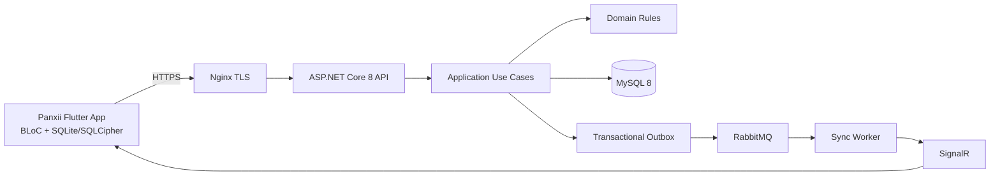

# PANXII

## 1. Giới thiệu dự án

**Panxii** là nền tảng POS SaaS dành cho cửa hàng bán lẻ, được thiết kế theo hướng **multi-tenant**, **offline-first** và **đa ngôn ngữ**.

Panxii giúp cửa hàng:

- Lập và quản lý hóa đơn nhanh ngay cả khi mất mạng.
- Đồng bộ dữ liệu an toàn giữa nhiều thiết bị trong cùng cửa hàng.
- Quản lý sản phẩm, danh mục và khách hàng.
- Kiểm soát quyền theo vai trò.
- Bảo toàn lịch sử giao dịch bằng bút toán đảo ngược thay vì sửa/xóa hóa đơn đã đồng bộ.
- Mở rộng dần sang kho, chấm công, thanh toán điện tử và các module SaaS khác.

## 2. Định vị sản phẩm

Panxii không chỉ là một màn hình bán hàng. Đây là một nền tảng vận hành cửa hàng, trong đó dữ liệu tại quầy phải luôn sẵn sàng, giao dịch phải truy vết được và dữ liệu giữa các tenant phải được cách ly nghiêm ngặt.

### Tuyên ngôn sản phẩm

> **Panxii giúp cửa hàng bán hàng liên tục, đồng bộ tin cậy và kiểm soát dữ liệu rõ ràng.**

## 3. Đối tượng sử dụng

| Người dùng | Nhu cầu chính |
|---|---|
| `SuperAdmin` | Quản lý nền tảng SaaS, tenant và global feature flags |
| `TenantAdmin` | Quản lý cửa hàng, sản phẩm, nhân viên, giá và hóa đơn |
| `Staff` | Tìm sản phẩm/khách hàng và lập hóa đơn tại quầy |
| Chủ cửa hàng | Theo dõi vận hành, giao dịch và cấu hình cửa hàng |

## 4. Giá trị cốt lõi

### Offline-first

Nhân viên vẫn có thể lập hóa đơn khi mạng không ổn định. SQLite được mã hóa bằng SQLCipher làm nguồn dữ liệu cho giao diện; outbox local sẽ gửi dữ liệu lên server khi có mạng.

### Multi-tenant SaaS

Mỗi cửa hàng được quản lý trong một tenant riêng. Dữ liệu được bảo vệ bằng tenant context, Global Query Filter, authorization và automated security tests.

### Giao dịch bất biến

Hóa đơn đã đồng bộ không được sửa hoặc xóa nội dung. Hủy hóa đơn tạo một hóa đơn đảo có giá trị âm; sửa hóa đơn tạo chuỗi reverse/correction mới.

### Đồng bộ nhiều thiết bị

Server lưu dữ liệu chuẩn trong MySQL. RabbitMQ xử lý event, SignalR thông báo thiết bị cùng tenant, còn client gọi pull API để lấy dữ liệu đầy đủ.

### Đa ngôn ngữ

Backend trả error code ổn định. Flutter dùng `easy_localization` để hiển thị tiếng Việt, tiếng Anh hoặc ngôn ngữ bổ sung sau này.

## 5. Các module cốt lõi

### Core POS

- Product và category management.
- Customer management.
- Invoice creation.
- Invoice sync.
- Invoice reverse/correction.
- Search nhanh tại quầy.

### Identity và access control

- JWT authentication.
- `SuperAdmin`, `TenantAdmin`, `Staff`.
- User device/session management.
- Remote kill-switch.

### Offline và synchronization

- SQLite/SQLCipher local database.
- Local outbox.
- Idempotent invoice sync.
- RabbitMQ transactional outbox.
- SignalR tenant group.
- Incremental pull bằng server sequence/cursor.

### Configuration

- Global feature flags.
- Tenant feature flags.
- Effective settings.
- Native force update.
- Shorebird OTA patch tương thích.

### Operations

- Docker deployment.
- Nginx TLS reverse proxy.
- MySQL backup/restore.
- RabbitMQ retry/DLQ.
- Health check, metrics và incident runbook.

## 6. Kiến trúc kỹ thuật

### Technology stack

| Thành phần | Công nghệ |
|---|---|
| Backend | ASP.NET Core 8 Web API |
| Architecture | Clean Architecture |
| Database server | MySQL 8.0 |
| ORM | Entity Framework Core 8 |
| Mobile | Flutter + BLoC |
| Local storage | SQLite + `sqflite_sqlcipher` |
| Messaging | RabbitMQ |
| Realtime | SignalR |
| Localization | `easy_localization` |
| Theme | `flex_color_scheme` |
| Icons | `hugeicons` |
| Complex UI | `forui` |
| Deployment | Docker + Nginx + VPS |

## 7. Nguyên tắc sản phẩm và kỹ thuật

1. Dữ liệu của tenant này không được xuất hiện ở tenant khác.
2. Server timestamp và server sequence là nguồn gốc cho thứ tự ghi sổ.
3. Retry phải idempotent; timeout không được tạo duplicate invoice.
4. Printer failure không rollback invoice hoặc payment.
5. API contract phải được mô tả bằng OpenAPI và kiểm tra backward compatibility.
6. Business rule nằm ở domain/application, không nằm rải trong UI/controller.
7. Error code là contract; không hardcode message nghiệp vụ trong backend.
8. Mọi thay đổi production phải có test, migration plan, observability và rollback plan.

## 8. Phạm vi hiện tại và mở rộng

### Phạm vi core

- SaaS tenant management.
- Authentication/RBAC.
- Product/category/customer.
- Offline invoice.
- Reverse/correction invoice.
- Sync và realtime notification.
- Feature flags.
- Production deployment và backup.

### Module mở rộng

Các module sau chỉ được bật khi có specification, API contract, database model và test riêng:

- Inventory.
- Attendance.
- Card/QR/e-wallet payment.
- Notification email/SMS.
- Advanced reporting.

## 9. Tài liệu liên quan

- [Tổng quan và quy trình đọc tài liệu](README.md)
- [Business Rules](business_rule.md)
- [System Architecture](architecture/system_architecture.md)
- [Domain & Use Cases](architecture/domain_use_cases.md)
- [Database Design](database/database_design.md)
- [API Contract](api/api_contract.md)
- [Security & RBAC](security/security_rbac_feature_flags.md)
- [Backend Coding Standard](backend/backend_coding_standard.md)
- [Frontend Coding Standard](frontend/frontend_coding_standard.md)
- [Testing Strategy](testing/testing_strategy.md)
- [Infrastructure Setup](infrastructure/infrastructure_setup.md)
- [Release Management](release/release_management.md)

## 10. Trạng thái tài liệu

- **Product name:** Panxii
- **Document status:** Architecture and implementation baseline
- **API version:** v1
- **Primary currency:** VND, có thể mở rộng theo tenant
- **Primary locale:** Vietnamese, hỗ trợ English
- **Target deployment:** Docker trên VPS qua Nginx TLS
