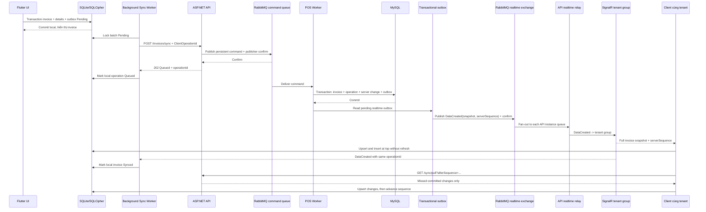

# DATA SYNC FLOW: OFFLINE -> ONLINE QUA RABBITMQ

## 1. Mục tiêu

Thiết kế này giữ SQLite/SQLCipher làm source of truth cho UI offline, dùng API để xác thực và xác nhận command vào RabbitMQ, Worker để ghi MySQL, và SignalR để phát snapshot tới các client cùng tenant.

API chỉ trả `202 Queued` sau publisher confirm. Worker commit entity, `sync_operations`, `server_changes` và `outbox_events` trong cùng transaction; outbox chỉ được publish sau commit.

## 2. Thành phần

| Thành phần | Trách nhiệm |
|---|---|
| Flutter App | Ghi invoice local, tạo outbox, retry |
| SQLite/SQLCipher | Dữ liệu UI local và local outbox |
| ASP.NET API | JWT, tenant, validation, idempotency header, publish command, SignalR relay |
| MySQL | Source of truth server và transactional outbox |
| RabbitMQ | Durable command queue, retry/DLQ, realtime topic exchange |
| Sync Worker | Consume create commands, ghi entity/change/outbox, publish outbox |
| SignalR Hub | JWT-derived group `tenant:{TenantId}` trên từng API instance |
| Other Devices | Nhận snapshot và chèn lên đầu; pull theo sequence sau reconnect |

## 3. Trạng thái local

`Pending -> Sending -> Queued -> Synced` hoặc `Pending -> Sending -> Queued -> Failed`.

- `Pending`: chưa gửi hoặc retry được.
- `Sending`: có lease timeout; worker chết thì được lấy lại.
- `Queued`: API trả `202` sau RabbitMQ publisher confirm; command chưa chắc đã commit DB.
- `Synced`: nhận `DataCreated` có cùng `operationId`, hoặc pull thấy change tương ứng.
- `Failed`: nhận `CommandRejected`; giữ `LastErrorCode` và không retry lỗi nghiệp vụ vô hạn.

Mỗi outbox có `ClientOperationId` UUID, `EntityId`, `PayloadJson`, `PayloadHash`, `AttemptCount`, `NextAttemptAt`.

Invoice mobile sinh operation đúng lúc chuyển Draft sang Pending; cập nhật invoice và insert outbox trong cùng SQLite transaction với điều kiện trạng thái vẫn Draft. Gọi submit lại không được thay operation đã commit. Mọi retry mạng/timeout/khởi động lại đọc UUID và payload đã lưu; chỉ thao tác gửi lại Failed có xác nhận mới tạo operation khác sau khi kiểm tra invoice chưa có trên server.

Hash receipt `SyncInvoice` payload v1/v2 giữ JSON PascalCase với `JsonSerializerDefaults.General` tường minh, khác Web/camelCase dùng cho response và reverse/correction. Không đổi format của hash đã lưu chỉ vì chuẩn hóa options: sẽ gây `ERR_SYNC_PAYLOAD_MISMATCH` khi replay. Tests khóa projection cũ v1 và v2 có phí; thay đổi contract/order/ignore/default phải giữ tương thích hash hoặc có kế hoạch version/migration riêng.

### 3.1. Catalog pause/resume

Mobile ghi `activate`/`deactivate` cho gốc hoặc `activateVariant`/`deactivateVariant` cho một biến thể cùng local mutation trong một transaction tenant/user-scoped. Đổi gốc cascade mọi biến thể đang có trong cache; đổi riêng một biến thể không đổi gốc hoặc sibling, kể cả default variant. Chỉ entity thực sự đổi cờ active tăng version.

Catalog command được gửi qua `POST /products/commands`; payload và operation UUID được đóng băng trước lần gửi đầu. Retry/replay không sửa payload hoặc `Idempotency-Key`. Worker kiểm tra quyền/version, áp dụng cascade lên mọi biến thể server (kể cả chưa cache local), lưu đầy đủ snapshot gốc/biến thể trong receipt `CatalogBatch` cùng operation/change/outbox. `202 Queued` chưa phải synced; client chỉ xác nhận sau receipt/pull, giữ các mutation local mới hơn đang pending khi áp dụng snapshot. Bán lại gốc bật cả biến thể đã ngừng riêng trước đó, không khôi phục lịch sử cờ cũ.

## 4. Luồng tạo invoice offline và realtime create



## 5. Contract message RabbitMQ

API publishes commands to durable queue `panxii.commands.create`. The worker
uses the `commandType` to dispatch `SyncInvoice`, `CreateProduct`, or
`CreateCustomer`.

After commit, outbox events are published to durable topic exchange
`panxii.realtime` with routing key `tenant.{tenantId}.changed`.

```json
{
  "messageId": "uuid",
  "eventName": "DataCreated",
  "tenantId": "uuid",
  "serverSequence": 123,
  "changeType": "Created",
  "entityType": "Invoice",
  "entityId": "invoice-uuid",
  "entityVersion": 1,
  "occurredAtUtc": "2026-10-08T09:01:00Z",
  "operationId": "uuid",
  "entity": { "invoiceNumber": "INV-...", "details": [] }
}
```

Each API instance creates an exclusive, auto-delete queue bound to
`tenant.*.changed`, then relays messages to its local SignalR connections. Event
`DataCreated` contains the committed entity snapshot, so connected clients can
insert it without a follow-up request. Clients deduplicate by `messageId` and
`serverSequence`; `/sync/pull` repairs missed events after reconnect.

`CommandRejected` events target only the initiating user and contain the
operation ID and stable error code, not the rejected payload.

## 6. Topology RabbitMQ

| Thành phần | Đề nghị |
|---|---|
| Command queue | `panxii.commands.create`, durable quorum |
| Retry queue | `panxii.commands.retry`, durable, TTL 5 seconds to command queue |
| Dead-letter queue | `panxii.commands.dlq`, durable |
| Realtime exchange | `panxii.realtime`, durable topic |
| API relay queue | Per-instance, exclusive/auto-delete, bound to `tenant.*.changed` |
| Publisher confirms | Required for API commands and outbox events |
| Manual acknowledgement | Worker ack after DB commit; API relay ack after hub send |
| Prefetch | 1 per consumer channel |

API does not wait for command processing. It returns `202` only after RabbitMQ
confirms the persistent command. If RabbitMQ is unavailable before confirmation,
the API returns `503 ERR_SERVICE_UNAVAILABLE` and does not claim acceptance.

Command/outbox publisher giới hạn connection attempt 2 giây và protocol
operation/publisher confirm 5 giây. Publisher tự tạo lại connection/channel sau
lỗi, không dùng automatic recovery để tránh race với disposal của cùng owner;
consumer/SignalR relay vẫn dùng recovery của kết nối consume. Request đã bị hủy
không được bắt đầu publish sau khi chờ lock. Gate resilience kiểm tra broker
down/restart và retry cùng operation với HTTP timeout 15 giây.

## 7. Transactional outbox publisher

1. Worker commits entity, `sync_operations`, `server_changes`, and
  `outbox_events` in one MySQL transaction.
2. The outbox publisher reads `Pending` records in batches.
3. It publishes each snapshot with a stable message ID and publisher confirm.
4. Confirmed events are marked `Published`; broker failures remain `Pending`.
5. Malformed events are marked `Failed` after 10 attempts for operator review.
6. Outbox history is retained for audit and replay.

Nếu publish thành công nhưng process chết trước khi mark `Published`, message có thể trùng. Consumer bắt buộc idempotent.

## 8. Retry và dead-letter

- Command consumer retries transient failures through the 5-second retry queue,
  up to 5 deliveries; the next failure is routed to `panxii.commands.dlq`.
- Không retry lỗi schema, tenant inactive, payload hash mismatch hoặc authorization.
- Outbox publish failures remain pending and are retried; malformed outbox
  payloads are marked Failed after 10 attempts.
- DLQ phải có dashboard, alert và quy trình replay có phê duyệt.
- Không retry mù invoice reverse vì có thể gây thao tác nghiệp vụ lặp; dùng idempotency trước mọi command.

## 9. Pull incremental

Server duy trì cursor bằng `ServerSequence BIGINT` tăng đơn điệu theo tenant trong cùng transaction ghi change. Không dùng clock của client hoặc `CreatedAt + UUID` để quyết định thứ tự. Client lưu `LastServerSequence` theo tenant.

Mỗi change trả `serverSequence`, `entityVersion` và `occurredAtUtc` từ server. Nếu hai event có timestamp giống nhau, `serverSequence` vẫn quyết định thứ tự.

1. Nhận SignalR event.
2. Gọi `/sync/pull?afterSequence={LastServerSequence}` với cursor cũ.
3. Upsert products/categories/customers/invoices vào SQLite.
4. Commit local.
5. Lưu `LastServerSequence` mới sau khi upsert thành công.

`server_changes` is currently retained without cursor expiry or cleanup. A
retention policy and full-resync endpoint must be defined before pruning rows.

### Ordering và late event

- Event đến trễ không được làm giảm `entityVersion` hoặc `LastServerSequence`.
- Upsert local chỉ nhận bản ghi có version mới hơn hoặc bằng version hiện tại theo policy.
- Event trùng `messageId` phải deduplicate.
- Sau khi xử lý hết batch, local replica phải converge về server snapshot.

## 10. Xử lý lỗi và conflict

| Tình huống | Xử lý |
|---|---|
| Mất mạng trước API | Giữ Pending |
| API timeout sau server commit | Retry cùng operation id |
| Cùng operation id, payload khác | `ERR_SYNC_PAYLOAD_MISMATCH`, không retry tự động |
| Product đã inactive | Failed + `ERR_PRODUCT_INACTIVE` |
| Device revoked | 401, xóa local DB và force logout |
| RabbitMQ unavailable before publisher confirm | API returns 503; client retries the same operation ID |
| RabbitMQ unavailable after DB commit | Entity remains committed; outbox stays pending and connected clients catch up via pull |
| Consumer crash | RabbitMQ redeliver; deduplicate message |
| Client reconnects after realtime event loss | Pull from the last committed `serverSequence` |
| Client clock sai | Bỏ qua để ghi sổ; dùng server timestamp/sequence |
| Event đến sai thứ tự | Giữ event, pull lại theo `ServerSequence`, không ghi đè version mới |

## 11. Bảo mật RabbitMQ

- RabbitMQ chỉ ở private Docker network/VPS, không public port.
- Dùng TLS nếu broker qua host/network khác.
- Tài khoản publisher/consumer riêng, permission theo vhost.
- Không đưa password, JWT, PIN hoặc dữ liệu khách hàng không cần thiết vào message.
- Secrets lấy từ Docker secrets/VPS secret store, không commit `.env` production.

## 12. Monitoring và load test

Theo dõi: queue depth, publish confirm latency, consumer lag, retry count, DLQ count, outbox pending age, sync API p95/p99 và duplicate rate.

k6 cần mô phỏng nhiều thiết bị gửi batch invoice, timeout/retry và reconnect. Mục tiêu p95/p99 phải được chốt theo VPS thực tế trước production.
