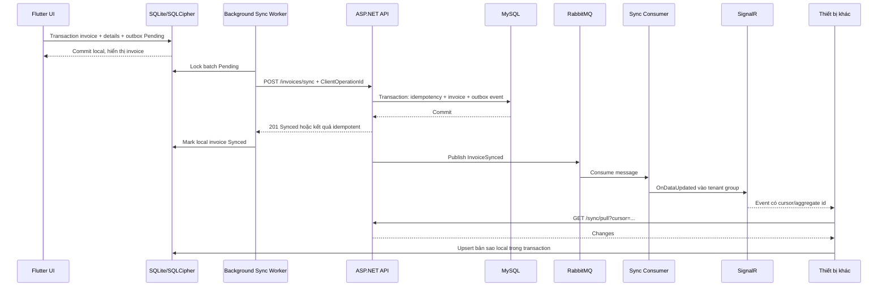

# DATA SYNC FLOW: OFFLINE -> ONLINE QUA RABBITMQ

## 1. Mục tiêu

Thiết kế này giữ SQLite/SQLCipher làm source of truth cho UI offline, dùng API để xác thực command, RabbitMQ để xử lý asynchronous work và SignalR để thông báo các thiết bị cùng tenant.

RabbitMQ không thay thế database transaction. Invoice và `sync_operations` phải commit thành công trước khi publish message.

## 2. Thành phần

| Thành phần | Trách nhiệm |
|---|---|
| Flutter App | Ghi invoice local, tạo outbox, retry |
| SQLite/SQLCipher | Dữ liệu UI local và local outbox |
| ASP.NET API | JWT, tenant, validation, idempotency, transaction MySQL |
| MySQL | Source of truth server và transactional outbox |
| RabbitMQ | Message broker, retry, dead-letter |
| Sync Worker | Consume message, publish realtime/pull triggers |
| SignalR Hub | Broadcast tới group `tenant:{TenantId}` |
| Other Devices | Nhận event và gọi pull API |

## 3. Trạng thái local

`Pending -> Sending -> Synced` hoặc `Pending -> Sending -> Failed`.

- `Pending`: chưa gửi hoặc retry được.
- `Sending`: có lease timeout; worker chết thì được lấy lại.
- `Synced`: server xác nhận thành công.
- `Failed`: lỗi nghiệp vụ không retry vô hạn; giữ `LastErrorCode`.

Mỗi outbox có `ClientOperationId` UUID, `EntityId`, `PayloadJson`, `PayloadHash`, `AttemptCount`, `NextAttemptAt`.

## 4. Luồng tạo invoice offline



## 5. Contract message RabbitMQ

Exchange đề nghị: `pos.events` loại topic. Routing key: `tenant.{tenantId}.invoice.synced`.

```json
{
  "messageId": "uuid",
  "eventType": "InvoiceSynced",
  "schemaVersion": 1,
  "tenantId": "uuid",
  "aggregateId": "invoice-uuid",
  "aggregateType": "Invoice",
  "clientOperationId": "uuid",
  "occurredAtUtc": "2026-10-08T09:01:00Z",
  "correlationId": "uuid",
  "payload": { "cursor": "opaque-cursor" }
}
```

Consumer phải xử lý idempotent theo `messageId`. Payload event chỉ là tín hiệu; thiết bị luôn pull API để lấy dữ liệu chuẩn.

## 6. Topology RabbitMQ

| Thành phần | Đề nghị |
|---|---|
| Exchange | `pos.events`, durable topic |
| Main queue | `pos.sync-events`, durable quorum |
| Retry queue | `pos.sync-events.retry`, TTL theo backoff |
| Dead-letter queue | `pos.sync-events.dlq` |
| Publisher confirms | Bật |
| Manual acknowledgement | Bật |
| Prefetch | Giới hạn theo CPU/DB |
| Message TTL | Theo chính sách, không xóa event chưa xử lý tùy tiện |

Không để API chờ consumer xử lý để trả response. API chỉ cần ghi transactional outbox; publisher worker đọc outbox và publish có confirm.

## 7. Transactional outbox publisher

1. API commit invoice, `sync_operations`, `outbox_events` trong một transaction MySQL.
2. Publisher lấy record `Pending` theo batch, lock lease ngắn.
3. Publish RabbitMQ với `messageId` và publisher confirm.
4. Confirm thành công thì mark `Published`.
5. Timeout/negative confirm thì trả về `Pending` với `AvailableAt` tăng theo exponential backoff.
6. Không xóa record ngay; lưu đủ thời gian để audit và replay.

Nếu publish thành công nhưng process chết trước khi mark `Published`, message có thể trùng. Consumer bắt buộc idempotent.

## 8. Retry và dead-letter

- Retry lỗi network, RabbitMQ unavailable, transient MySQL: 1m, 5m, 15m, 1h.
- Không retry lỗi schema, tenant inactive, payload hash mismatch hoặc authorization.
- Message vượt `MaxAttempts` vào DLQ.
- DLQ phải có dashboard, alert và quy trình replay có phê duyệt.
- Không retry mù invoice reverse vì có thể gây thao tác nghiệp vụ lặp; dùng idempotency trước mọi command.

## 9. Pull incremental

Server duy trì cursor bằng `ServerSequence BIGINT` tăng đơn điệu theo tenant trong cùng transaction ghi change. Không dùng clock của client hoặc `CreatedAt + UUID` để quyết định thứ tự. Client lưu `LastServerSequence` theo tenant.

Mỗi change trả `serverSequence`, `entityVersion` và `occurredAtUtc` từ server. Nếu hai event có timestamp giống nhau, `serverSequence` vẫn quyết định thứ tự.

1. Nhận SignalR event.
2. Gọi `/sync/pull?afterSequence={LastServerSequence}` với cursor cũ.
3. Upsert products/categories/customers/invoices vào SQLite.
4. Commit local.
5. Lưu `LastServerSequence` mới sau khi upsert thành công.

Nếu cursor hết hạn, API trả `ERR_SYNC_CURSOR_EXPIRED`; client thực hiện full resync theo transaction/batch.

### Ordering và late event

- Event đến trễ không được làm giảm `entityVersion` hoặc `LastServerSequence`.
- Upsert local chỉ nhận bản ghi có version mới hơn hoặc bằng version hiện tại theo policy.
- Event trùng `messageId` phải deduplicate.
- Sau khi xử lý hết batch, local replica phải converge về server snapshot.

## 10. Xử lý lỗi và conflict

| Tình huống | Xử lý |
|---|---|
| Mất mạng trước API | Giữ Pending |
| API timeout sau server commit | Retry cùng operation id |
| Cùng operation id, payload khác | `ERR_SYNC_PAYLOAD_MISMATCH`, không retry tự động |
| Product đã inactive | Failed + `ERR_PRODUCT_INACTIVE` |
| Device revoked | 401, xóa local DB và force logout |
| RabbitMQ down | Invoice vẫn sync được nếu DB commit; outbox chờ publish |
| Consumer crash | RabbitMQ redeliver; deduplicate message |
| Pull cursor hết hạn | Full resync |
| Client clock sai | Bỏ qua để ghi sổ; dùng server timestamp/sequence |
| Event đến sai thứ tự | Giữ event, pull lại theo `ServerSequence`, không ghi đè version mới |

## 11. Bảo mật RabbitMQ

- RabbitMQ chỉ ở private Docker network/VPS, không public port.
- Dùng TLS nếu broker qua host/network khác.
- Tài khoản publisher/consumer riêng, permission theo vhost.
- Không đưa password, JWT, PIN hoặc dữ liệu khách hàng không cần thiết vào message.
- Secrets lấy từ Docker secrets/VPS secret store, không commit `.env` production.

## 12. Monitoring và load test

Theo dõi: queue depth, publish confirm latency, consumer lag, retry count, DLQ count, outbox pending age, sync API p95/p99 và duplicate rate.

k6 cần mô phỏng nhiều thiết bị gửi batch invoice, timeout/retry và reconnect. Mục tiêu p95/p99 phải được chốt theo VPS thực tế trước production.
